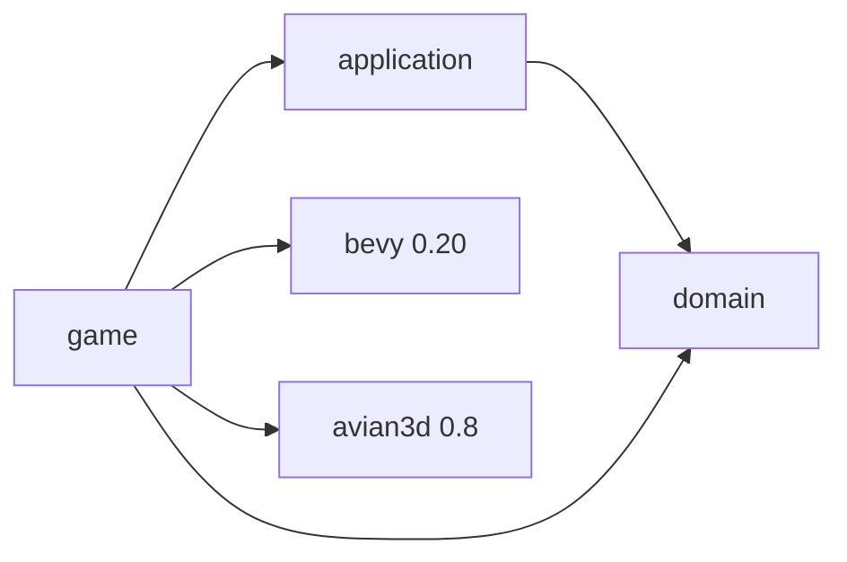
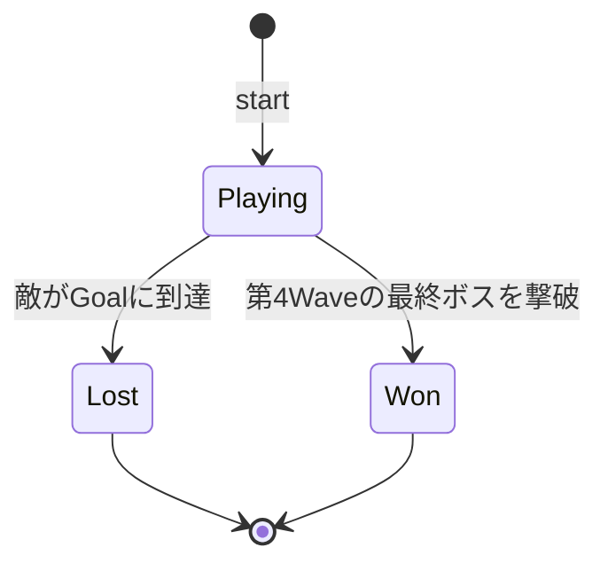
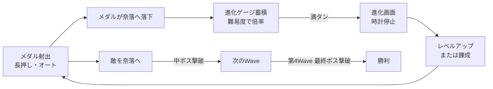
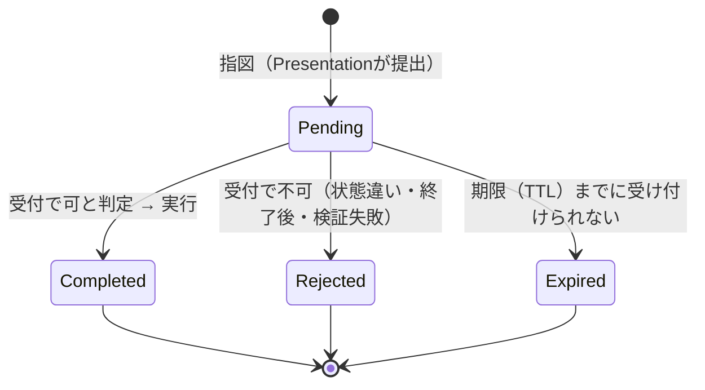
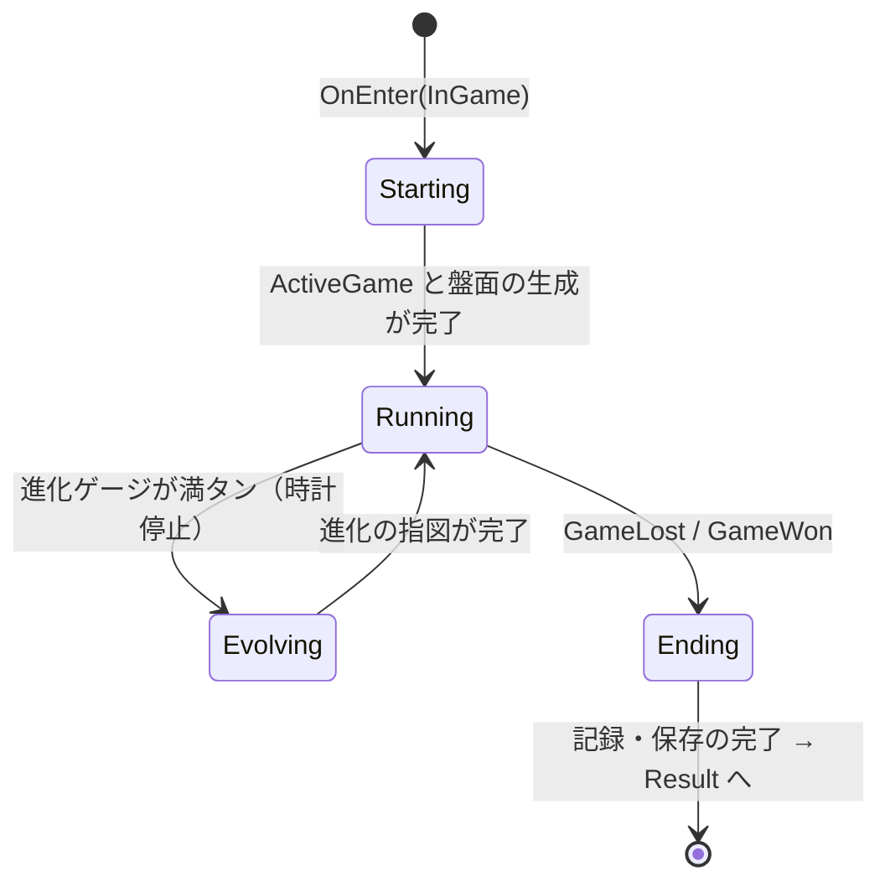
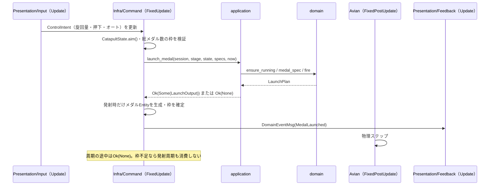
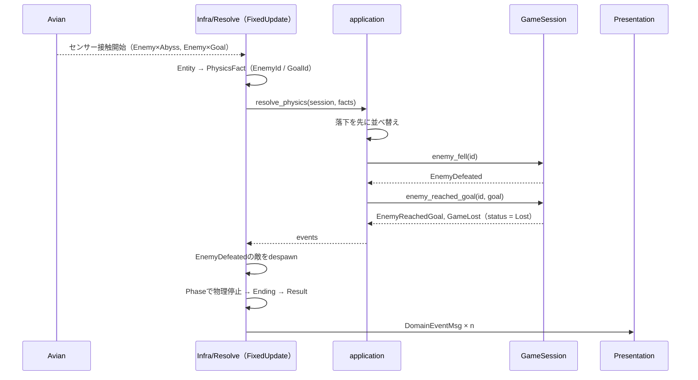

# 基本設計書

- 文書バージョン：0.2
- 作成日：2026-11-19
- 改訂日：2026-11-20
- プロジェクト名：NUDRA
- 入力文書：
  - 要件定義書 v0.1（[requirements.md](requirements.md)）… 以下「要件」
  - アーキテクチャ設計方針 v0.1 … 以下「方針」
- 技術基盤：Rust（edition 2024）/ Bevy 0.20.x / Avian 0.8.x（avian3d）/ thiserror 2.x / anyhow 1.x / tracing 0.1.x

### 記号

- 【仮決定】要件が未確定のため、本書で置いた暫定の決定。要件確定・検証結果に応じて見直す。
- 【要検証】プロトタイプで成立性やAPI仕様を確認してから確定する事項。
- コード片は設計意図を示す擬似コードである。正確なシグネチャは実装時に確定する。
- 【実装差分】本書の目標仕様に対して、現行コードに変更が必要な事項。実装済みを意味しない。

### v0.2の改訂範囲

基盤設計は維持し、能力と物理の接続・退場と報酬・実行順序・安全予算を改訂した。
`MedalCode` によるデータ識別、Bevyに依存しないDomain、ECSに置く個体状態、
`AbilityBook` の事前計算、印による相互作用は維持する。
全89種の識別・錬成データは存在するが、能力89種の成立性は未検証。
水・雷・爆弾・水分身・ゾンビ・デジャヴの同時動作を検証してから、残り83種の能力定義へ進む（10章）。
現行コードとの照合結果・優先順位・完了条件は [能力システム実装課題](ability-implementation-plan.md) に置く。
追加レビューでは、1能力の確定を排他的Systemで行う方式、`OtherFell` の候補列挙の上限、
支持接触による着地判定、進化時の既存個体の更新規則を具体化した。いずれも以下の目標仕様であり、実装は未変更。

---

# 1. 本書の位置づけ

## 1.1 目的

要件と方針を、実装できる構造（crate・モジュール・型・スケジュール・エラー処理）へ落とし込む。

## 1.2 範囲

含むもの:

- crate構成と依存関係
- ドメインモデルの型・不変条件・操作
- ユースケースの入出力
- ECS構成（Entity / Component / Resource / Plugin / State）
- スケジュールと処理順序
- 物理設計（剛体種別・衝突レイヤー・センサー）
- エラー管理とログ
- 性能・テスト方針

含まないもの:

- 数値パラメータ（質量・速度など）。定義データで調整する
- 未確定のゲームルールの詳細（勝利条件、経験値、特殊メダル効果、中ボス能力）
- アート・UIデザイン

## 1.3 全体を貫く設計判断

1. **ゲームの意味はDomain、物理状態の正本はECS（Avian）**
   位置・速度・接触状態を持つのはAvianのComponentだけとする。
   Domainは座標を入力として受け取ることはあるが、保持はしない。

2. **外側への指示は戻り値で返す**
   ユースケースは「射出計画」「出現指示」「ドメインイベント」を値として返し、
   game crateのSystemがそれをECSへ適用する。
   物理演算や生成のための出力ポートtraitは作らない
   （要件15.3の「必要に応じて」に対し、必要が生じていないため。方針17）。

3. **集約の操作は全か無か**
   集約のメソッドは検証を先に済ませ、Errを返す場合は状態を一切変更しない。
   この保証はECSへの適用には及ばない。能力は適用前に対象・定義・安全予算を検証し、
   Domainの確定とECSへの適用を同じ処理境界で完了させる（3.16、8.5）。

---

# 2. システム構成

## 2.1 Workspace構成

```
nudra/
├── Cargo.toml              # 仮想マニフェスト（workspace）
├── crates/
│   ├── domain/             # 純粋なRust。ゲームの意味とルール
│   └── application/        # ユースケース
├── game/                   # Bevy + Avian。Infrastructure + Presentation。実行バイナリ
├── assets/
│   ├── data/               # 定義データ（RON）: stage / character / specs
│   └── ...                 # モデル・テクスチャ・音
└── docs/
```

現在のルート単一パッケージ（`src/main.rs`）は `game/` へ移す。

```toml
# Cargo.toml（workspace）
[workspace]
resolver = "3"
members = ["crates/domain", "crates/application", "game"]

[workspace.dependencies]
domain      = { path = "crates/domain" }
application = { path = "crates/application" }
bevy        = "0.20"
avian3d     = "0.8"
glam        = "…"   # bevy_mathが使うバージョンと同一にする（2.4）
thiserror   = "2"
anyhow      = "1"
tracing     = "0.1"
serde       = { version = "1", features = ["derive"] }
ron         = "0.12"

[profile.dev.package."*"]
opt-level = 3       # Bevy・Avianは開発ビルドでも最適化する（物理を実時間で確認するため）
```

## 2.2 crate依存関係



| 外部crate | domain | application | game | 用途 |
|---|:-:|:-:|:-:|---|
| glam | ✓ | （domain経由） | （bevy経由） | ベクトル・クォータニオン |
| thiserror 2 | ✓ | ✓ | ✓ | 型付きError |
| anyhow 1 | – | –※ | ✓ | 技術エラーの集約・文脈付与 |
| tracing 0.1 | – | ✓ | ✓（`bevy::log`） | 構造化ログ |
| bevy 0.20 | – | – | ✓ | エンジン |
| avian3d 0.8 | – | – | ✓ | 3D物理 |
| serde / ron | – | – | ✓ | 定義データ読込 |

※ applicationは、失敗し得る外部依存（保存など）を持った時点でanyhowを追加する（8.3）。

## 2.3 レイヤーとコードの対応

| レイヤー | 置き場所 | 主な内容 |
|---|---|---|
| Domain | `crates/domain` | 集約・VO・ドメインサービス・ドメインイベント・Repository trait |
| Application | `crates/application` | ユースケース関数、PhysicsFact、ユースケースのError |
| Infrastructure | `game/src/infrastructure` | 定義データ読込、Repository実装、ユースケースを呼ぶSystem（ECSアダプタ）、Avian設定、Entity生成 |
| Presentation | `game/src/presentation` | 入力・カメラ・UI・音・演出・キャラクター選択画面 |

依存ルールの担保:

- Domain / Application の独立性は **crate境界で強制** する（domainの`Cargo.toml`にbevy・avianが無い限り、参照できない）。
- InfrastructureとPresentationは同一crateのため規約で守る。
  Presentationはdomain・applicationの型を**読み取りのみ**で使い、
  離散要求は `SubmitRequest`、旋回・発射は `ControlIntent` で依頼する。
  操作状態の `CatapultState` もInfrastructureが更新し、物理と能力の変更を明示的な順序（6章）に集める。

## 2.4 glamの扱い【設計判断】

Domainはベクトル演算（Rail上の位置、射出速度、進行方向）を必要とする。

- glamはBevy固有の型ではなく汎用の数学crateであり、Bevyの`Vec3`・`Quat`はglamの再公開である。
- よってDomainはglamに直接依存し、境界での変換をなくす。
- domainのglamはbevy_mathと一致させる（現在0.33系）。`cargo tree -i glam@0.33.12`で両者が同じ型を共有することを確認する。
  Avian内部のobvhsは別途glam 0.34系を使うが、その型をDomainとの境界には渡さない。
- domainは`domain::math`としてglamを再公開し、applicationはそれを使う。
- 座標系はBevyに合わせ、右手系・Y軸上向き・単位はメートルとする。

---

# 3. ドメイン層設計（crates/domain）

## 3.1 モジュール構成

```
domain/src/
├── lib.rs
├── math.rs          # glamの再公開
├── id.rs            # 各種ID
├── stage/           # Stage集約（geometry, catapult, bridge, abyss, rail, goal, placement, wave, error）
├── session/         # GameSession集約（status, wave_progress, level, error）
├── pusher/          # PusherCharacter集約、MovementState
├── spec.rs          # MedalType / MedalSpec / EnemyTypeId / EnemySpec / SpecCatalog
├── launch.rs        # CatapultState・射出計画（MedalLaunchService相当）
├── navigation.rs    # 敵の経路と進行方向（EnemyNavigationService相当）
├── event.rs         # DomainEvent
└── repository.rs    # StageRepository / PusherCharacterRepository
```

要件21章の総覧は概念の整理であり、そのままフォルダ構成にはしない（要件21の注記）。

## 3.2 IDと共通の値

| 型 | 表現 | 発行元 | 備考 |
|---|---|---|---|
| StageId | 文字列newtype | 定義データ | 例 `"stage_01"` |
| PusherCharacterId | 文字列newtype | 定義データ | 例 `"mop_rabbit"` |
| EnemyTypeId | 文字列newtype | 定義データ | 敵の種類をデータで追加できるようにする |
| GoalId / BridgeId / RailId | `u16` newtype | 定義データ | Stage内でのみ一意 |
| GameSessionId | `u64` newtype | 呼び出し側 | ログの相関用 |
| EnemyId | `u64` newtype | GameSession | 出現時に連番で発行。Bevy Entityとは別物 |

メダルの個体IDは設けない。`MedalCode` はメダル種の文字列IDであり、個体の識別にはBevy Entityを使う（3.7、3.13）。

## 3.3 Stage集約

### 構成

```
Stage [Aggregate Root]
├── id: StageId
├── geometry: Geometry                          [VO]
├── catapult: Catapult                          [Entity]
├── bridges: Vec<Bridge>                        [Entity]
├── abysses: Vec<Abyss>                         [VO]
├── rails: Vec<Rail>                            [Entity]
├── goals: Vec<Goal>                            [Entity]
├── initial_medals: Vec<InitialMedalPlacement>  [VO]
└── wave_plan: WavePlan                         [VO] 【仮決定】追加
```

### 構成要素

| 要素 | 保持する内容 | 主な振る舞い |
|---|---|---|
| Geometry | 形状種別（Rectangle / Circle / Polygon …）、外形寸法、床面の高さ。【仮決定】衝突形状そのものはアセット側が持ち、Domainはルールに必要な寸法だけを持つ | 包含判定（初期配置の検証用） |
| Catapult | 発射位置、基準方向、旋回角の範囲（min / max）、仰角、射出速度、クールダウン | 射出計画の計算（3.8） |
| Bridge | id、外部側の端点（敵の出現点）、ステージ側の端点、幅 | 敵の経路の起点 |
| Abyss | 領域。【仮決定】AABBの集合 | なし（侵入判定はAvianのセンサーが行う） |
| Rail | id、経路。【仮決定】折れ線（曲線・円弧は点列で近似） | `length()`、`point_at(s)`（弧長→位置） |
| Goal | id、位置、到達判定の半径 | なし |
| InitialMedalPlacement | メダル種別（Normal固定）、配置。【仮決定】格子（原点・列数・行数・段数・間隔） | `positions()`（配置座標の列挙） |
| WavePlan | Waveの列。各Waveは出現エントリ（時刻・EnemyTypeId・BridgeId・GoalId）の列 | 時刻範囲内の出現エントリ取得 |

WavePlanをStageに含める理由:
BridgeId・GoalIdの参照整合性をStageの不変条件として一度で保証でき、
GameSessionがStageの構造を複製せずに済むため（要件11.2）。

### 不変条件（`Stage::new`で検証）

| # | 条件 | 違反時のError | 出典 |
|---|---|---|---|
| S1 | Goalが1つ以上 | `StageError::NoGoal` | 要件11.1 |
| S2 | Bridgeが1つ以上 | `NoBridge` | 要件11.1 |
| S3 | Railが1つ以上 | `NoRail` | 要件11.1 |
| S4 | 初期メダル配置があり、総枚数が1以上 | `NoInitialMedals` | 要件11.1 |
| S5 | Goal・Bridge・RailのIDがStage内で一意 | `DuplicateId` | 本書 |
| S6 | Railは2点以上かつ長さが正 | `InvalidRail(RailId)` | 本書 |
| S7 | WavePlanが参照するBridge・GoalがStage内に存在 | `UnknownReference` | 本書 |
| S8 | Catapultの旋回角が min ≤ max | `InvalidCatapult` | 本書 |

```rust
pub struct Stage { /* フィールドは非公開 */ }

impl Stage {
    /// 唯一の生成経路。不変条件を満たすStageしか存在できない
    pub fn new(parts: StageParts) -> Result<Self, StageError>;
    pub fn id(&self) -> &StageId;
    pub fn catapult(&self) -> &Catapult;
    pub fn rail(&self, id: RailId) -> Option<&Rail>;
    pub fn goal(&self, id: GoalId) -> Option<&Goal>;
    pub fn bridge(&self, id: BridgeId) -> Option<&Bridge>;
    pub fn wave_plan(&self) -> &WavePlan;
}
```

`StageParts`は全フィールドを公開した組み立て用の構造体（引数の多い関数を避けるため）。

Stageは生成後は不変であり、インゲーム中の敵やメダルの状態を持たない。

## 3.4 GameSession集約

### 構成

```
GameSession [Aggregate Root]
├── id: GameSessionId
├── stage_id: StageId
├── character_id: PusherCharacterId
├── status: GameStatus
├── waves: WaveProgress               現在のWave、Wave内の経過時間、次の出現エントリ位置
├── difficulty: Difficulty            1〜4
├── medals: MedalCollection           所持メダル種とLv.1〜4
├── gauge: EvolutionGauge             進化ゲージ
├── rng / offer                      シード付き乱数と固定したNew!の候補
├── alive_enemies: HashSet<EnemyId>   【追加】
└── next_enemy_id: u64                【追加】
```

`alive_enemies`を持つ理由:
同じ敵の二重撃破や、撃破後のGoal到達を集約の中で排除するため。
保持するのはIDだけで、位置などの物理状態は持たない（方針5）。

### GameStatus



`Lost { enemy: EnemyId, goal: GoalId }` として敗北の原因を保持する（リザルト表示用）。

### 主要操作

| 操作 | 戻り値 | Playing以外のとき |
|---|---|---|
| `start(id, &Stage, &PusherCharacter, difficulty, &EvolutionRules, seed)` | `(GameSession, DomainEvent)`（GameStarted） | — |
| `advance(&Stage, now: Tick)` | `Vec<SpawnOrder>`（EnemyId発行済み） | 空を返す（進化の選択待ちの間も） |
| `ensure_playing()` | `Result<(), GameSessionError>` | `Err(NotPlaying)` |
| `ensure_running()` | `Result<(), GameSessionError>`（Playing かつ進化の選択待ちでない。射出・メダル選択・出現の前提） | `Err(NotPlaying)`。選択待ちは `Err(EvolutionPending)` |
| `enemy_fell(EnemyId)` | `Vec<DomainEvent>`（EnemyDefeated、WaveCleared / GameWon） | 空を返す |
| `enemy_reached_goal(EnemyId, GoalId)` | `Vec<DomainEvent>`（EnemyReachedGoal, GameLost） | 空を返す |
| `medal_spec(&MedalCode, &SpecCatalog)` | `Option<MedalSpec>`（現在レベルの定義） | 同左 |
| `medals_fell(value: f32, &SpecCatalog)` | `Vec<DomainEvent>`（EvolutionReady）。報酬対象の落下価値の合計だけを受け取る（3.18） | 空を返す |
| `evolve(Evolution, &SpecCatalog)` | `Result<DomainEvent, GameSessionError>`（Evolved） | `Err(NotPlaying)` |
| `evolution_choices(&SpecCatalog)` | 進化画面の選択肢 `EvolutionChoice { evolution, result, available }` の列。可否は `evolve` と同じ検証（`MedalCollection::check`）で決める | 同左 |

区別の原則:

- **物理から来た結果**（落下・到達）はエラーにしない。
  終了後に届いた結果や、既に退場した敵の結果は、正常に起こり得る遅れとして無視する（方針12）。
- **プレイヤー操作から来た要求**（射出・レベルアップ選択）は、
  終了後であれば`NotPlaying`を返し、呼び出し側が分岐する。

### 不変条件

| # | 条件 | 担保方法 |
|---|---|---|
| G1 | 開始時の成長状態は初期状態 | `start`は`MedalCollection::default()`（ノーマルLv.1）と空のゲージだけで生成する |
| G2 | Goal到達が成立したらLost | `enemy_reached_goal`が同じ呼び出しの中で遷移させる |
| G3 | 終了後は進行しない | 全操作の先頭でstatusを判定する |
| G4 | 敵は1回だけ退場する | `alive_enemies`から除去できた場合にだけイベントを出す |

### 同一tick内の判定順序【仮決定】

同じ物理ステップで「奈落への落下」と「Goal到達」が両方起きた場合は、落下（撃破）を先に処理する。
落下で退場した敵のGoal到達はG4により無視されるため、判定はプレイヤーに有利な側に倒れる。
並べ替えはapplicationが行う（4.3）。

## 3.5 PusherCharacter集約

```
PusherCharacter [Aggregate Root]
├── id: PusherCharacterId
├── name: String
├── base_stats: BaseStats        [VO] 移動速度・質量・押し出し力（最大推力）・押し出し幅
├── movement: MovementPattern    [VO]
└── abilities: Vec<Ability>      [VO]【未確定】初期は空
```

MovementPattern【仮決定】: `PingPong { pause_at_ends }`（端で停止して折り返す往復）のみ。
新しいパターンはenumのバリアント追加で増やす。

### MovementState（インゲームのPusherの移動状態）

要件12.3のMovementStateをVOとして定義し、ECSのComponentの中身として保持する。
Domain側に別のコピーは持たない。

```rust
pub struct MovementState { s: f32 /* Rail上の弧長位置 */, forward: bool, pause_left: f32 }

impl MovementState {
    pub fn start(rail: &Rail) -> Self;
    /// 純関数。dtだけ進めた状態を返す（端で停止・反転）
    pub fn advance(self, rail: &Rail, pattern: &MovementPattern, speed: f32, dt: f32) -> Self;
    /// 現在の目標位置
    pub fn target(&self, rail: &Rail) -> Vec3;
}
```

要件13.4のPusherMovementServiceは、この振る舞いで完結するため設けない。

## 3.6 定義データ（Spec）

「物理特性のゲーム上の定義」（方針5）を表す読み取り専用のVO。集約ではない。

| 型 | 内容 |
|---|---|
| MedalCode / MedalTier | メダル種の文字列IDと階層（Normal / Element / Fusion）。個体のIDではない |
| MedalSpec | 質量、半径、厚み、摩擦、反発係数 |
| EnemySpec | 質量、サイズ、最大歩行速度、歩行力、摩擦、`ability: Option<EnemyAbility>`（未確定） |
| SpecCatalog | `MedalCode → MedalDef { tier, levels: [MedalSpec; 4] }`、敵定義、錬成レシピ、進化ゲージのルール。ノーマル定義・素材と結果の階層・参照・レシピと結果の重複を検証する |
| Positive | 正の有限値（`is_finite() && > 0.0`）だけを生成できるnewtype。積は`checked_mul`で検証する |

- 敵もメダルも種類は文字列IDとし、定義データで追加する。効果の部品だけをコードで実装する（3.13）。
- 物理パラメータは調整の頻度が高いため、コード中の定数にせず定義データ（RON）に置く（5.5）。
- **不正な物理パラメータはDomainで生成できないようにする。** Avianへ渡す直前の検証には頼らない。
  - `Positive`: メダル・敵の質量／半径／厚み／高さ、Pusherの全能力値（要件6.2より速度0は不正）、強化倍率
  - `f32`のまま: 摩擦・反発係数、敵の最大速度・歩行力、端での停止時間（0が有効値のため）

## 3.7 動的Entity（Medal / Enemy / Pusher）の扱い【設計判断】

要件12章の動的Entityは、概念としてはDomainに存在するが、実行時の状態はECSを正本とする（方針5）。
Domainに「全メダルのコレクション」は作らない。

| 要件上の構成 | 実装上の置き場所 |
|---|---|
| Medal の個体ID | **設けない**。個体はBevy Entityで識別し、個体の状態は値 `MedalUnit`（3.16）としてECSが持つ。種類は `MedalCode` |
| Medal.MedalType / Ability | Component `Medal(MedalUnit)`（種類・レベル・印・使用回数。3.16） |
| Medal.PhysicalProperties | 生成時に`MedalSpec`からAvianの質量・摩擦・反発Componentへ設定 |
| Medal.Transform | Avianの位置・回転Component |
| Enemy.EnemyId | Component `Enemy { id }`（Domain IDとBevy Entityの関連付けはここだけ） |
| Enemy.EnemyType / Ability | 出現指示の種類からSpecを解決し、物理・`Appearance`・`Walker`・`EnemyMarks` に設定する |
| Enemy.GoalId | Component `Navigation { route, progress }`（Goalまでの経路） |
| Enemy.PhysicalProperties / MovementSpeed | 生成時に`EnemySpec`からAvianへ設定。歩行力はComponent `Walker` |
| Enemy.Transform | Avianの位置・回転Component |
| Pusher.CurrentStats | Component `Pusher { stats: PusherStats }` |
| Pusher.RailId / MovementState | Component `PusherMotion { rail: RailId, state: MovementState }` |
| Pusher.Transform | Avianの位置・回転Component |
| CatapultState | Resource `ActiveGame` の `catapult`（6.4） |

- Componentはdomainの値を包むnewtypeにする。DomainにBevyのderiveを持ち込まないため、またorphan ruleのため。
- Systemは包んだdomainの値のメソッドを呼ぶだけにし、ルールをSystemに書かない。

要件12.5（動的Entityの集約境界）と要件15.4（WorldState）への回答:
**WorldStateという集約は作らない。**
ECSのWorldがその役割を担い、DomainはGameSessionの`alive_enemies`など、ゲーム上の意味に必要な最小限だけを持つ。

## 3.8 ドメインサービスの実装方針

| 要件の候補 | 初期実装 | 理由 |
|---|---|---|
| MedalLaunchService | `CatapultState::fire`（launch.rs） | 射出の判断はカタパルトの操作状態に自然に属する |
| EnemyNavigationService | `navigation::route(&Stage, BridgeId, GoalId) -> Route` と `Route::steer(&mut progress, pos) -> Vec3` | 経路は出現時にStageから一度だけ導出する。【仮決定】経路探索は持たず、Bridge外端→Bridge内端→Goalの経由点を順に目指す |
| PusherMovementService | `MovementState::advance`（3.5） | Entityの振る舞いで完結する |
| LevelUpService | `GameSession::evolve` と `MedalCollection::evolve` | 進化ルールと全か無かの検証をDomainで完結させる |
| BattleResolutionService | `GameSession::enemy_fell` / `enemy_reached_goal` | 判定がGameSessionの状態遷移で完結する |

いずれもBevyの型・Query・Commandsを受け取らない。座標は`Vec3`（glam）で受け取る。

### CatapultState

```rust
pub struct CatapultState { yaw: f32, selected: MedalCode, next_fire: Tick }

impl CatapultState {
    /// 範囲外は丸める（エラーにしない）
    pub fn aim(&mut self, delta: f32, catapult: &Catapult);
    pub fn select(&mut self, medal: MedalCode);
    /// 発射できたときだけnext_fireを更新する。周期内ならNone
    pub fn fire(&mut self, catapult: &Catapult, spec: &MedalSpec, now: Tick)
        -> Option<LaunchPlan>;
}

pub struct LaunchPlan { pub medal: MedalCode, pub spec: MedalSpec, pub origin: Vec3, pub velocity: Vec3 }
```

- 【仮決定】プレイヤーが操作する射出角度は水平の旋回角（yaw）のみとし、仰角はCatapultの定義値で固定する。
- 【仮決定】クールダウンは要件12.4への追加。連射によるメダル数の急増を防ぐ、性能上の安全弁である（9章）。

## 3.9 ドメインイベント

純粋なRustの値（`enum DomainEvent`）とする。
集約やドメイン関数の**戻り値**として返し、Domainの中にイベントバスは持たない。

| イベント | ペイロード | 初期実装 |
|---|---|---|
| GameStarted | session, stage, character | ✓ |
| MedalLaunched | medal | ✓ |
| EnemySpawned | enemy, kind, goal | ✓ |
| EnemyDefeated | enemy | ✓（要件のEnemyFellIntoAbyssを統合。撃破の原因が奈落落下だけのため） |
| EnemyReachedGoal | enemy, goal | ✓ |
| GameLost | enemy, goal | ✓ |
| GameWon | — | 最終ボス撃破 |
| WaveCleared | wave | 中ボス撃破 |
| EvolutionReady | — | 進化ゲージ満タン |
| Evolved | medal, level | レベルアップ・錬成・New!成功 |

- 物理衝突（メダル同士、メダルと敵）はドメインイベントにしない。
- メダルの落下は、tick単位の集計値としてDomainへ渡し、進化ゲージへ加算する（4.3）。

## 3.10 成長（LevelProgress）

> 成長の仕様は 3.12「メダル進化」で確定した。この節の `LevelProgress` / `Upgrade` は、
> 3.12 の `MedalCollection` / `Evolution` に置き換え済み。

- 強化の適用単位は**種別単位**（確定）。個体単位にすると、メダル個体のIDと状態をDomainが持つ必要が生じ、方針5・15に反するため。
- 強化後の値は強化した時点でchecked演算で確定し、正の有限値にならない強化は状態を変えずに拒否する（全か無か）。
  この原則は 3.12 のレベルアップ・錬成でも維持する。
- 強化結果のECSへの反映は強化時の1回だけ行う。毎フレームの同期はしない（4.4）。

## 3.11 Repository

```rust
pub trait StageRepository {
    fn find(&self, id: &StageId) -> Option<Stage>;
}

pub trait PusherCharacterRepository {
    fn find(&self, id: &PusherCharacterId) -> Option<PusherCharacter>;
}
```

- 定義データは起動時（Loading状態）に全件を読み込み・検証してメモリに置く。
  そのため`find`は技術的に失敗しない。戻り値に`Result`を持たせない。
  読込の失敗はLoading時点の技術エラーとして扱う（8章）。
- 「見つからない」はユースケース側で型付きError（`StageNotFound`）に変換する。
- `save`（要件14.2）は作らない。ステージの編集機能が無いため。
- **GameSessionRepositoryは作らない。** インゲームの途中保存・再開の要件が無いため（要件14.4、方針13）。
- 実装はgame crateの`StageCatalog` / `CharacterCatalog`（HashMapを持つResource）。
  applicationのテストでは、テスト内の簡易実装を使う。
- キャラクター選択画面の一覧表示は、Infrastructureが読み取りモデル`CharacterRoster`として公開する（5.6）。

### ProgressRepository（セーブデータ）

```rust
pub trait ProgressRepository {
    type Error: std::error::Error + Send + Sync + 'static;
    fn load(&self) -> Result<Option<PlayerProgress>, Self::Error>;
    fn save(&mut self, progress: &PlayerProgress) -> Result<(), Self::Error>;
}
```

- 定義データと違い、ローカル保存は失敗し得るため`Result`を返す。エラー型は実装が関連型で決める。
- 対象の集約`PlayerProgress`【仮決定】: 最後に選んだキャラクター、総プレイ回数、ステージごとの記録（回数・最多撃破数）。
  インゲームの成長は持ち越さないため保存しない（要件9.1）。
- `PlayerProgress::restore`が読込時の値を検証する（記録の回数が0、同じステージの重複、
  ステージ回数の合計 > 総プレイ回数 を拒否）。
- 実装と保存形式は5.7。

## 3.12 中核のゲームサイクル（確定仕様）



### メダル射出（連射・オート）

- 射出は**継続的な操作意図**（6.4）。`firing = fire_button_held || auto_fire` で決まる。
  - 手動: 押している間、連続で射出する（ダダダダ）
  - オートON: 押していなくても連続で射出し続ける（メダルが流れ続ける）
- 射出の間隔は、待ち時間を意識させるクールダウンではなく、**連射速度を決める発射周期**（`fire_interval: Ticks`）。
  例: 60Hzで6Tickごとなら秒間10枚。値は調整ノブ。
- **射出の制約はStage、現在の状態はゲーム中の状態**に分ける（静的な定義と動的な状態を混ぜない）。

  | 置き場所 | 持つもの |
  |---|---|
  | Stage（定義） | カタパルトの位置、初期の旋回角、旋回できる範囲、仰角、射出速度、発射周期 |
  | `CatapultState`（ゲーム中） | 現在の旋回角、選択中のメダル、次に発射できるTick（`next_fire`） |

  発射周期はステージごとに定義し、将来は進化で変えられるようにする（そのときも期限Tickの比較だけで済む）。

### Wave（全4Wave、確定）

| Wave | 出現内容 | 次へ進む条件 |
|---|---|---|
| 1〜3 | 通常敵 + 終盤に中ボス1体 | その中ボスを撃破 |
| 4 | 最終ボスのみ | 最終ボス撃破で**勝利**（`GameStatus::Won`） |

- ボスは **Waveの構造で指定する**（各Waveは「通常の出現の列」と「ボスの出現1件」を持つ）。どの敵種をボスにするかは定義データ次第。
  これによりStage単体で構成を検証でき、セッションは定義データを見ずに「この敵がWaveのボスか」を判断できる。
- Stage の不変条件に追加: Waveはちょうど4つ。第4Waveは通常の出現を持たない（最終ボスのみ）。
- 中ボス撃破で `WaveCleared`、次に進めたTickから次のWaveが始まる。最終ボス撃破で `GameWon`。
- 【未決】中ボス撃破の時点で残っている通常敵の扱い（そのまま残す／一掃する）。当面は「そのまま残す」で実装する。
- 【未決】「終盤」の定義（Wave内の出現時刻の最後とするか、条件で出すか）。当面は WavePlan の出現時刻で表す。

### メダル進化（レベルアップ・錬成）

- メダルを奈落へ落とすと**進化ゲージ**が溜まる。溜まりやすさは難易度に依存する。
  - 落下の検知は物理（Infrastructure）が行い、個体別の出来事を保持して復活・退場を確定する。
    **報酬対象として確定した落下価値の合計**だけをDomainへ渡す（4.3）。
    ゲージの増加量（価値 × 難易度のポイント、四捨五入）はDomainが決める。消滅・復活・生成の境界は3.18。
- ゲージが満タンになると、インゲーム中に**進化画面**を出す。進化画面の間は**ゲーム世界の時計を止める**
  （`GamePhase::Evolving`。`GameClock` は進まず、敵も物理も止まる）【仮決定】。選択を確定すると `Running` に戻る。
- 進化の選択肢はレベルアップ・錬成・New!。選択は**指図**（`Request::Evolve`）として台帳を通し、必ず完了／却下で終わる。

  | 選択 | 条件 | 結果 |
  |---|---|---|
  | レベルアップ | 対象のメダル種がLv.4未満 | そのメダル種が Lv+1（最大Lv.4） |
  | 錬成 | メダルA・Bがどちらも**Lv.4**で、A+Bの錬成レシピが存在する | 別のメダルCを**Lv.1**で得る |

- 錬成の項目は、条件を満たすときだけグレーアウトを解除する。UIの表示とは別に、**Domainでも条件を検証する**。
- メダル種ごとのレベル（1〜4）は、セッション中の `MedalCollection`（所持メダル種とレベル）で持つ。
  開始時は Normal Lv.1。レベルごとの物理特性（質量など）は定義データに持たせ、checked演算の原則（3.10）を守る。
- 錬成レシピは定義データ（`(A, B) → C`）で持つ。順序は問わない（A+B と B+A は同じ）。
- 錬成では素材A・Bを**消費する**（確定）。A・Bは所持から外れ、Cが Lv.1 で加わる。
- 【要検証】素材2種のLv.4覚醒を失ってもCのLv.1で戦い方が変わり、錬成を選ぶ価値があるかを比較プレイする。
  炎Lv.4＋水Lv.4とサウナLv.1を同条件で比較し、選択率・クリア率・操作感を記録する。
  消費ルールを自動的に変更せず、問題があれば錬成結果の初期性能・能力構成を調整して再評価する。
- 【仮決定】錬成の結果Cをすでに所持している場合は錬成できない（`ResultAlreadyOwned`）。
- Normal 以外のメダルは、進化画面の **New!**（未所持の素材をランダムに1つ、Lv.1）で手に入る（確定、3.13）。
- Pusherは成長しない（確定）。進化の対象はメダルだけ。
- インゲームの成長は持ち越さない（要件9.1）。

### 難易度（全4段階）

| 影響するもの | 難易度による違い |
|---|---|
| 進化ゲージ | 溜まりやすさ（倍率） |
| Goalの数 | Easy は1つ。難しくなるほど増える |
| Wave構成 | 4Wave は共通 |
| 進化のルール | Lv.4上限・錬成条件は共通 |

- `Difficulty` を値オブジェクトとし、難易度ごとの設定値（ゲージ倍率など）は定義データに持つ。
- Goal は Stage の定義で「どの難易度から有効か」を持ち、選んだ難易度で有効なGoalだけを使う。
  敵が目指すのも有効なGoalだけ。
- 難易度はアウトゲームで選び、開始の指図（`Request::Start`）に含める。
- 【未決】Easy 以外の3段階の名称と、各段階の具体的な数値。

### Abyss（奈落）

- Abyss は**橋より下にある奈落**。落下した敵は撃破。メダルは復活を判定してから退場を確定し、報酬条件を満たすものだけゲージに数える（3.18）。
- 【未決】判定の形（落下判定面か領域か）。単純なY座標だけの判定は、橋の下に足場があると誤判定するため、
  ステージのアセットが決まった時点で決める。当面の実装はAABBの集合のまま。

## 3.13 メダル図鑑と効果

### 全89種（確定）

| 階層 | 種類 | 数 | 入手 |
|---|---|---|---|
| ノーマル | ノーマルメダル | 1 | 開始時に所持（Lv.1） |
| 素材 | 炎・砂・水・光・浄化・血・毒・雷・風・幻・死・星・時・刃・太陽・山 | 16 | 進化画面の **New!**（未所持の素材から1つランダム、Lv.1） |
| 錬成 | 焼きいも・サウナ・花火 … 72種（下の錬成表） | 72 | 素材2種（どちらもLv.4、消費）の錬成で Lv.1 |

- 錬成表は素材16種どうしの対称表（A+B と B+A は同じ）。72通りのレシピがあり、結果はすべて別のメダル。
  同じ素材どうし（×）とレシピの無い組み合わせ（—）は錬成できない。ノーマル・錬成メダルは素材にならない。
- メダルは**定義データで識別する**（`MedalCode`、例 `"fire"` `"roasted_sweet_potato"`）。89種をコードの列挙で持たない。
  名前・階層・レベルごとの物理特性・効果は定義データに書き、表示名はロケールのカタログ（`ui.json` とは別の `medals.json`）に置く。
- 錬成表そのものも定義データ（`fusions`）。読込時に、対称性・自己錬成なし・結果の重複なし・参照するメダルの存在を検証する。

### 進化画面の選択肢

| 選択肢 | 出る条件 |
|---|---|
| レベルアップ（所持メダルごと） | そのメダルが Lv.4 未満 |
| 錬成（組み合わせごと） | 素材2種がどちらも Lv.4 で、レシピがある（それ以外はグレーアウト） |
| **New!** 未所持メダル Lv.1 | 未所持の素材が残っている。候補は1つ【仮決定】 |

- New! の候補は、ゲージが満タンになった時点で決めて進化の提示（`EvolutionOffer`）として固定する。画面を開き直しても変わらない。
- 乱数はセッション開始時のシードから生成する決定的な乱数（Domain内の小さなPRNG）。同じシードなら同じ候補になり、テストで再現できる。
- New! の選択も指図（`Request::Evolve(Evolution::Acquire(id))`）。提示された候補以外は却下する。

### 効果の設計方針

#### メダル名の雰囲気（確定）

ダークファンタジー調に寄せず、少し気の抜けた、コミカルでカジュアルな名前にする。
素材の組み合わせを厳密な物質変化として解釈する必要はない。今回確定した名前は次の通り。

| 素材A | 素材B | 錬成メダル | ID |
|---|---|---|---|
| 炎 | 水 | サウナ | `sauna` |
| 炎 | 毒 | 激辛 | `spicy_food` |
| 星 | 浄化 | 願い | `wish` |
| 刃 | 雷 | チェーンソー | `chainsaw` |

錬成表の正本は [medal-fusions.csv](medal-fusions.csv)。ユーザーから提示された16×16の対称表をそのまま収録する。
現在の同梱データはノーマル1種・素材16種・錬成72種（全89種）。全256組について、錬成可否・結果・対称性を正本と照合する。
能力の共通処理と一部のサンプル効果は実装済みだが、説明文どおりの89種の能力は未実装。
レベル別の物理特性・進化ゲージの数値は検証用の仮値。

## 3.14 メダルの能力（共通処理と固有処理の境界）

説明文の正本は [medal-abilities.csv](medal-abilities.csv)（メダル名・能力の説明文）。
共通語彙で自然に表せる能力は**定義データの組み合わせ**で記述する。
独自の履歴・接触継続・複数対象間の操作が必要な能力には、小さな固有処理を許可する。
固有処理は定義データの処理キーで選び、Domain / applicationで判定・計画を返す。
89種のRust enumや、物理System内のメダルIDごとの分岐は作らない。

- 固有処理も共通の効果適用・退場・報酬・安全予算を通す。直接 `Commands`・Avian・ゲージ・敵の生存集合を書き換えない。
- 吸血鬼の価値移転は減算と加算を一体で検証し、砂時計の速度反転は現在速度を反転する計画にする。
  これらを既存の `Mark` や `Push` の組み合わせで近似したことにはしない。
- チェーンソーの継続接触、デジャヴの履歴解決など、固有の判定だけを分離する。
  複数能力で同じ意味が必要になったときに共通語彙への昇格を検討する。
- 【実装差分】固有処理の登録・読込検証は未実装。まず6種に必要な範囲を実証し、汎用フレームワークは追加しない。

### 能力 = いつ × 誰に × どこに × 何を（`domain::ability`）

| 語彙 | 値 |
|---|---|
| `Trigger`（いつ） | `Always` 常時 / `Launch` 射出 / `Land` 着地 / `Rest` 静止した / `Wake` 押されて動き出した / `Collide(Medals\|Enemies\|Any)` 接触開始ごとに1回 / `Fuse(Ticks)` 時限 / `Periodic(Ticks)` 一定間隔 / `SelfFell` 自分が落ちた / `OtherFell` 他が落下で退場した |
| `Target`（誰に） | `Itself` / `Medals` / `Enemies` / `Both` |
| `Area`（どこに） | `Touched` ぶつかった相手 / `Radius(r)` / `Front { length, width }` 射出方向の帯 / `Board` 盤面全体 |
| `Effect`（何を） | `Push { dir, strength }`（外へ・内へ・前・後・上・渦・奈落へ） / `Mark` 印を付ける / `Cleanse` 浄化 / `Zone` 場（一定時間残る範囲） / `Spawn` 生成 / `Transform` 変化 / `Remove` 消去 / `Split` 分割 / `Gauge` ゲージ加算 / `Revive` 落ちた自分が戻る / `Replay` 直前の能力を再生 |
| `uses` | 1個体あたりの発動回数の上限 |

- 座標を使う判定（範囲内の対象・向き）はECSが行い、domainは意味だけを決める。
- **場（`Zone`）**: 発動した位置に `duration` の間残り、中にいる対象（能力の `Target`）へ余韻 `linger` の長さの印を付け続ける
  （`Effect::zone_mark`）。場を出ても余韻の間は印が残る。例: 炎は敵に「アチチ」の場を残し、敵がスムーズに進めなくなる。
- **再生（`Replay`）**: 直前に**適用を確定した**非再生能力の定義参照（種類・レベル・能力番号）を使う。
  発生元・位置・向き・`Touched` の相手は再生側の今回の文脈に置き換え、過去のEntityは保持しない。
  接触相手を必須とする効果で今回の相手がいなければ、再生全体を不成立とする（最近傍への代替はしない）。
  履歴がない場合も不成立。再生を含む能力・再生された能力は履歴を更新せず、再生深度は1まで。
  元の個体の使用回数は減らさず、再生側の回数と共通予算を使う。再生分も含め一括検証する（3.16）。
  再生先の効果の前提も検証し、例えば `SelfFell` 以外での `Revive` や生成世代の超過を再生で迂回しない。
- **レベル**: `AbilityParts.scale`（Lv.1〜4の倍率）を強さ・範囲・印と場の時間・ポイントに掛ける（時間とポイントは四捨五入）。
  発動の時間・回数・個数には掛けない。**Lv.4で覚醒**（`awaken` の能力が加わる。覚醒にも倍率を掛ける）。
- 倍率と覚醒は**読込時に Lv.1〜4 の能力として計算済み**にし（`AbilityBook`）、実行中に失敗しない。

### 印と状態（`domain::mark`）

- 印（濡れ・砂・毒…）の種類と効き目は定義データ（`MarkDef`）。効き目の語彙 `Modifiers` だけがコード:
  摩擦の上書き・質量・大きさ・敵の速さ（0で足止め）・進路のずれ・価値（落下時のゲージの倍率。0で偽物）・封印・すり抜け。
  `harmful`（浄化で消える）、`vanish`（期限切れで `DestroyedByAbility` として消える。通常の落下報酬なし）、`max_stacks`。
- 生成時に値域を検証する（摩擦 0〜2、倍率は質量・大きさ 1/16〜16、速さ・価値 0〜16、進路 ±π）。
- 個体の状態 `Conditions` は**値としてECSのComponentが持つ**（個体はECSが正本。`MovementState` と同じ扱い）。
  変化のルールはdomainに閉じる:
  - 重ね掛けは上限まで、期限は遅い方（永続が最強）
  - `until <= now` で外れる
  - 浄化は悪い印だけ／すべて
  - 合成は倍率の `stacks` 乗の積、摩擦は後に付いた印が勝つ。合成結果は値域に収める

### 反応（`domain::reaction`）

- 「対象にある印 `on` に、印 `by` が付いたら効果を足す（`consume` なら `on` を外す）」を定義データに書く。
- 反応するのは**当たる前から対象にあった印だけ**。同じ当たりで付く印どうしは反応しない。
- **同じ効果適用内の反応は1段まで**。反応で付いた印から、さらに反応は起こさない。
  後の物理ステップの衝突・落下による連鎖は許可し、生成を含む暴走は実行時予算と系譜で止める（3.18）。
- `hit()` は状態の効果（印・浄化）を適用し、反応で増えた状態以外の効果（押す・消す…）を返す。後者はECSが対象の位置で実行する。

### 読込時の検証（`AbilityBookError`、`SpecError::Ability` で包む）

| 検証 | Error |
|---|---|
| 印の重複・未定義の印の参照（能力・場・生成・反応） | `DuplicateMark` / `UnknownMark` |
| 反応の組の重複 | `DuplicateReaction` |
| 未定義のメダルの能力 | `UnknownMedal` |
| 長さ0の時限・間隔・印・場・余韻（倍率適用後に検査） | `ZeroDuration` / `ReactionZeroDuration` |
| 反応の効果に再生は書けない | `ReplayInReaction` |
| `Revive` は `SelfFell` で、回数制限つき | `InvalidRevive` |
| ノーマル以外の生成は、回数制限か封印の印が必要（個体単位の防御。子孫の増殖は防げない） | `UnboundedSpawn` |
| 倍率を掛けた値が値域を外れる | `Scale` |
| 敵に当たり得る能力・反応の `Remove`・`Transform`・`Split`・期限で消える印（敵の退場は落下だけ、3.18） | `EnemyExit` / `ReactionEnemyExit` |

- 【実装差分】生成の報酬指定（`Spawn.rewarded`、既定なし）と敵への禁止効果は実装済み（P0-1）。
  世代制限（P0-3）、固有処理キーと必要な文脈（P1-1）の読込時検証は未実装。
- 【未決】説明文から具体的な発動条件・対象・数値への割り当て。6種の試作を優先し、残り83種は10章の合格後に着手する。

---

## 3.15 メダルの挙動ステータス（`domain::motion`）

移動に応じた能力の発動と見た目（アニメ・アセットの切り替え）は、**同じ挙動ステータス**から決める。
放電・爆発など移動を伴わない演出は、適用確定後の一過性通知 `AbilityCue` で別に伝える（5.6）。
ステータスは描画ではなく**物理（固定ステップ）から決める**（フレームレートで結果が変わらず、テストできる）。

```text
射出 ──► 飛行中 ──着地──► 転がり中 ⇄ 静止
           ▲                 │
           └──── 浮かされた ──┘（上へ押されると飛行中に戻り、着地でまた発動する）
```

| 層 | 役割 |
|---|---|
| domain | 状態遷移のルール `MedalMotion::observe(sample, now, rules) -> Option<MotionEvent>`、浮かせる `lift()` |
| Infrastructure | 毎tick、速度と支持接触からの接地（5.4、`MotionSample`）を測って渡し、`MedalMotion` を Component として持つ。出来事を `Happening` にして発動する能力を `AbilityBook::triggered` で引く |
| Presentation | portの `MedalMotionState` を読んで移動アニメを切り替え、`AbilityCue` を読んで放電・爆発などを再生する |

- 出来事 `MotionEvent`: `Landed`（飛行中 → 盤面）、`Rested`（転がり中 → 静止）、`Woke`（静止 → 転がり中）。1回の観測で高々1つ。
- **静止は「`rest_speed` 未満が `rest_delay` 続いた」、再始動は「`wake_speed` を超えた」**。`rest_speed < wake_speed` のヒステリシスで、
  止まりかけのメダルが静止と転がりを行き来して毎tick発動することを防ぐ（`MotionRules::new` が検証）。
  既定は秒速5cm未満が0.2秒で静止、秒速15cm超で再始動（調整ノブ）。
- 跳ねて浮いても飛行中には戻さない。**飛行中に戻すのは `lift()`（上へ押す効果）だけ**。浮かせて着地させる連鎖（星で浮かせる → 着地で爆発）はルールとして起こせるが、跳ね返りで勝手に連発しない。
- 初期配置のメダルは静止（`MedalMotion::placed()`）から始める。
- 発動の判定 `Trigger::fires_on(Happening)`: 射出・着地・静止・再始動・衝突（相手の種類で絞れる）・落下。時限・間隔・常時はECSがスケジュールする。
- 【未決】`MotionRules` を定義データ（`SpecParts`）に載せるか。当面は `MotionRules::default()`。


## 3.16 メダル個体と能力の発動（`domain::unit`、`domain::firing`）

| 知識・操作 | 置き場所 | 理由 |
|---|---|---|
| メダル個体の状態（種類 `MedalCode`・レベル・印・能力の使用回数） | 値オブジェクト `MedalUnit`（ECSのComponentが持つ。個体IDは持たない） | 封印・回数・変化は個体のルール。復活では初期化しない |
| 能力の発動 | Domainの判定・計画と、applicationの検証・確定 | セッション・定義・個体にまたがる。現行の `firing::fire` は判定時に変更するため改修対象 |
| 生成・変化するメダルの決定 | 同上 | 同じ種は同じレベル、ノーマル・素材は所持レベル（未所持はLv.1）、ランダムな素材はセッションのシード付き乱数 |
| ゲージ | `GameSession::medals_fell(value)` / `add_gauge(points)` | 落下は**価値の合計**（ノーマル1.0、偽物0、輝き2倍）× 難易度のポイントを四捨五入。物理由来の非有限・負は0。能力の加算も同じ満タン処理（New! の決定）を通る |

- 封印された個体・使い切った能力・進行できない間は発動しない。
  使用回数・乱数・履歴・ゲージは**計画を作った時点では変更せず、適用が確定した能力だけ**更新する。
- 指示 `AbilityOrder` は、対象ごとに当てる**状態の効果**（`states`: 印・浄化）と**それ以外の動作**（`actions`: 押す・場・生成・変化・消去・分割・復活）に分けて返す（対象ごとに選り分けて確保しないため）。

### 現行ユースケースと改修境界（application `abilities`）

次表は現行API。v0.2では `fire_abilities` を計画と確定に分ける必要があり、このままで適用前検証が成立するわけではない。

| ユースケース | 入力 | 出力 |
|---|---|---|
| `fire_abilities` | `&mut GameSession`, `&SpecCatalog`, `&mut MedalUnit`, `Happening` | `Firing { orders, events }` |
| `hit_target` | `&SpecCatalog`, 対象の `&mut Conditions`, `states`, now | `MarkOutput { modifiers: 変わったときだけ, reactions }` |
| `stand_in_zone` | 同上（場の効果） | 同上（場の余韻の長さの印） |
| `expire_marks` | `&SpecCatalog`, `&mut Conditions`, now | `ExpireOutput { modifiers, vanish }` |

- 印の効き目は変わったときだけ返し、ECSは物理へ1回だけ反映する（毎フレームの同期はしない）。
- `PhysicsFact::MedalsFell(f32)` は**報酬対象として確定した落下価値の合計**だけを渡す（4.3）。

### 能力1回の適用境界【実装差分】

1. **収集**: 衝突・挙動・落下・期限の出来事を、Tick・発生元・相手・位置・向きの文脈つきで保持する。
   並列の収集順には依存せず、6.2の順に並べる。
2. **計画**: Domainが封印・回数・条件を判定し、効果と予定する状態変更を返す。
   乱数も候補状態で計算し、棄却した計画でセッションの乱数を進めない。
3. **適用前検証**: Infrastructureが対象を検索し、Domainのルールと照合して、必要なComponent・定義・生成位置・
   有限の物理値・退場可否・反応の追加効果・必要予算をすべて検証する。対象を確定した計画は並列に適用しない。
4. **確定と適用**: 1能力の複数対象・生成・消去・ゲージ・再生分までを1単位として、全体を受理するか全体を棄却する。
   受理後は排他的SystemからWorldを直接更新し、Domainの予定変更とECSの変更を完了してから次の能力へ進む。
   受理前の対象不在・予算不足なら、使用回数・乱数・履歴・ゲージ・演出を変更しない。
5. **通知**: 完了した効果だけを `DomainEventMsg` / `AbilityCue` にする。実行待ちの指示から成功通知を出さない。

- 原子性の範囲は1能力であり、tick全体のロールバックは行わない。
  状態効果と動作効果を別々に確定してはいけない。例えば「濡らす＋生成」で生成予算が足りなければ両方を棄却する。
- 範囲に対象がいない場合、場・生成・自分へのゲージ加算など単独で成立する効果があれば実行する。
  対象必須の効果しかなければ不成立。範囲の対象一覧は各能力の直前に取り直し、先行能力の結果を反映する。
- `Gauge` で満タンになっても、**受理した1能力の残りは完了する**。その境界で後続の未受理能力を止める。
  同じ `fire_abilities` 呼び出しの別能力・別Entity・発行済みだが未適用の指示も対象。持ち越さず破棄する。
  `NextState` の反映を待たず、Domainの進行可否を各能力の境界で判定する。
- 適用後に物理で起きる接触・落下は次の物理ステップの出来事であり、計画時点で撃破を先取りしない。
- 実装は小さな計画値と直列の確定処理で始める。任意のECS操作を巻き戻す汎用トランザクション機構は作らない。
  受理後の予期しない失敗は継続せず、安全にセッションを中断する（8.5）。

### 1能力ずつ確定する実装方式【仮決定・実装差分】

- 確定処理は `fn resolve_abilities(world: &mut World)` のような**排他的System**に集める。
  Resolve内の `SelfFell` / `OtherFell` とAbilities内の通常発動は、同じ内部関数 `try_commit_one` を使う。
  物理観測の収集・支持判定は通常のSystemや並列Queryで行い、Worldを独占する範囲は計画・確定のループに限定する。
- 直前の収集Systemに遅延変更があれば、排他的Systemへ入る**手前のスケジュール境界**で反映する。
  ループ内では `Commands`、CommandQueue、別Systemの実行、`World::flush()` による一括反映を使わない。
  System間の `apply_deferred` を、ループ内の1能力ごとの反映として扱わない。
- 1回のループでWorldから必要な値を読み、Query / Resourceの借用を解放してから、検証済みの計画を直接適用する。
  `ActiveGame` とWorldの可変アクセスには、例えば `World::resource_scope` を使う。
  Domain / applicationはWorldを受け取らず、能力の可否と予定する変更を値で返す。
- 検証済み計画は、対象Entityと必要Component、変更後の個体状態・物理値、生成用bundle、退場理由、
  予約枠、セッションへの変更、通知を持つ。`world.spawn`・Component更新・despawnを同期的に適用する。
  次の能力は新しいWorldを検索するため、直前に消した対象は見つからず、生成した個体は存在する。
- 生成・復活ではAvianの `Position` / `Rotation`・速度と描画用Transformを明示的に設定し、
  後続の対象探索が次のAvian初期化を待たず正しい位置を読めるようにする。
  接触グラフや広域衝突判定の更新は次の物理ステップで行い、新規Entityに同tickの接触を捏造しない。
- ゲーム状態を変更するObserver・Component hookからの再入は許可しない。
  アセット読込・定義解決・失敗し得る外部処理を適用中に行わず、通知は全変更の完了後に発行する。
  排他実行は他Systemとの競合を防ぐがロールバック機能ではない。想定外の失敗は8.5の中断経路にする。
- まずこの方式で正しさと排他区間の時間を計測する。並列化やCommand方式へ戻す判断は、
  「先行能力の生成・退場が次の能力に見える」境界を維持できることをテストしてから行う。

### 進化時の既存個体の能力更新【仮決定・実装差分】

進化は物理と論理Tickが停止している間に、対象個体・変更後のSpec・購読・追加能力を事前検証する。
所持状態だけ先に変更せず、4.4の更新を排他的処理で完了してからRunningへ戻す。

| 項目 | 既存個体への更新 |
|---|---|
| `MedalUnit.level` | レベルアップした種の現存個体を `max(個体の現在Lv, 所持種の新Lv)` にする。変化・生成した同種も含め、既に高いLvの個体を下げない |
| 既存能力の使用回数 | そのまま保持。baseの能力番号は全Lvで同じとし、倍率変更で回数を初期化しない |
| 既存の `Fuse` | 絶対期限と処理済み状態を保持。一度評価した時限は、予算棄却されたものも再登録しない |
| 既存の `Periodic` | 次の絶対期限を保持。既存語彙では発動間隔はLv倍率の対象外。進化を起点に待ち直さない |
| 新しく有効になるLv.4覚醒 | base末尾の安定した能力番号で追加し、新規能力だけ使用回数0で初期化。同じLvの再反映で追加し直さない |
| 新規覚醒の時限・周期 | 進化が確定した停止中のTickを起点に `now + fuse` / `now + period` で初回期限を作る |
| 新規覚醒の `Always` | 次のRunning tickで、新規能力番号だけを初回評価する。既存の `Always`・`Entered`・`Launch`・過去の着地や静止を再発行しない |
| 印・物理・来歴 | 印のstack・絶対期限、挙動、生成世代、報酬資格、通算復活回数を保持。新Lvの基礎物理値と現在の印を合成して1回更新し、衝突購読も見直す |

- 次回の時限・接触等は新Lvの定義で評価する。既に存在する印・場の効果と期限、記録済みの再生履歴のLvは遡って変更しない。
- 新規 `Always` の初回評価は、対象個体のリスト（最大3,000件）と追加能力の範囲を持つ1件の有界なバッチとして保持する。
  同時に保持する覚醒バッチは1件まで。全個体×全能力をMessageへ展開せず、次のRunning tickに個体キー・能力番号順で遅延列挙する。
  発動・対象効果予算を使い、枠不足分はそのtickで棄却してバッチを終了する。再開や再反映で再試行しない。
- 錬成は所持種の操作であり、盤面に残った素材個体のLv・能力・タイマーは変更しない。
  結果種やNew!の取得も、同種の既存個体の回数・期限を初期化しない。以後の射出は所持種のLvを使う。
- 【実装差分】現行の `set_level` は回数を保持するが、gameの進化処理は `AbilityTimers::new(now)` で全期限を作り直す。
  未処理／処理済みの時限状態と覚醒追加分の差分更新が必要。詳細の完了条件は10章。

## 3.17 能力のECS側（`game/src/infrastructure/abilities.rs`）

| Component / Resource | 中身 |
|---|---|
| `Medal(MedalUnit)` | メダル個体の状態（種類・レベル・印・使用回数）。種類だけの `MedalKind` は廃止 |
| `MedalMotionState(MedalMotion)`（port） | 挙動ステータス。Infrastructure が更新し、Presentation がアニメに読む |
| `AbilityTimers` | 時限・間隔の絶対期限と時限の処理済み状態。進化で既存分を保持し、新規覚醒分だけ追加する（3.16） |
| `EnemyMarks` | 敵の印と効き目（歩行の速さ・進路に反映） |
| `ZoneField` | 場。期限まで中の対象へ印を付ける。見た目は `Appearance("zone/{印}")` |
| `PendingOrders` | 発動した指示。検知と実行を分け、`execute_orders` がまとめて実行する |
| `FallenMedals` / `Touching` | 現行の落下Entity集合／接触Entity集合。目標は落下文脈／法線・位置・速度を検証した支持観測へ拡張（5.4） |
| `OtherFell` 購読索引（追加予定） | 有効な `OtherFell` 能力のEntity・能力番号を整列して保持する。全メダルへの総当たりを避ける（3.18） |

- 物理特性は `MedalBody::new(定義, 効き目)` で作り、印・レベル・変化が変わったときだけ `refresh` する
  （`CollisionLayers` は変更不可のComponentのため、すり抜けが変わったときだけ差し替える）。
- 衝突の出来事（`CollisionEventsEnabled`）は、飛行中のメダル（着地の検知）と衝突の能力を持つメダルだけが受け取る（数千枚の性能のため）。
- 挙動の観測は `par_iter_mut` で並列に行い、状態が変わったメダルだけを `Parallel` に積んで順に発動する。
- 【仮】押す向き `TowardAbyss` は奈落の形が未決のため、盤面の中心から外へ押す。分割は大きさを変えずに複製する。
- 【実装差分】`FallenMedals` のEntity集合は個体別の落下文脈へ拡張する。
  `PendingOrders` は未確定の計画として扱い、前節の確定処理を通す。並列収集後の並べ替え、
  報酬・系譜の個体状態、予算カウンタ、`AbilityCue` は未実装。

## 3.18 退場・生成・復活と実行時の安全予算

以下のルールはv0.2の目標仕様。ゲーム体験に関する選択は【仮決定】として12章でも管理する。

### メダルの退場原因と報酬【仮決定・実装差分】

```rust
enum MedalExitReason {
    FellIntoAbyss,
    DestroyedByAbility,
    Consumed,
    Transformed,
}
```

| 原因・結果 | 通常の進化報酬 | 出来事と状態 |
|---|---|---|
| `FellIntoAbyss`（復活しなかった） | 報酬資格ありの個体だけ、落下時の価値を加算 | `SelfFell` 判定後に退場。`OtherFell` を他の生存個体へ通知 |
| `DestroyedByAbility`（`Remove`・`vanish`） | なし | `SelfFell` / `OtherFell` は発生させない |
| `Consumed`（能力のコスト等） | なし | コストの確定と同じ適用単位で退場 |
| `Transformed`（別種への置換） | なし | 同じ個体の系譜・報酬資格を保持。落下扱いにしない |
| 落下後に `Revive` 成功 | なし | 退場を取り消す。`OtherFell` も発生させない |

- 報酬資格は個体の来歴として印の価値倍率とは別に持つ。価値を上げる印だけでは資格を取得できない。
  初期配置・プレイヤー射出は資格あり。能力生成・分割は**既定で資格なし**とし、生成定義で明示する。
  幻・水分身の子は資格なし。熱帯雨林などの有価生成は、資格を付ける場合に生成回数・報酬量を合わせてレビューする。
- 能力でゲージを増やす場合は `Gauge` を明示し、通常報酬と区別して記録する。
  退場に伴う暗黙の加算はしない。錬成での所持種の消費と盤面個体の退場も混同しない。
- センサー・安全高度・同tickの複数効果による同じ個体の退場は1回にまとめる。
  同tickに奈落へ入った個体は、後続の通常の対象探索から外す。
  同じ物理ステップの奈落侵入と能力消去が競合したら、先に収集した落下処理を優先する（6.2）。
- `Revive` は同じ個体を戻し、種類・レベル・印の期限・使用回数・報酬資格・生成の世代を保持する。
  消費した復活回数は戻さず、`Entered` / `Launch` は再発行しない。速度は0（カタパルトへ戻すときは転がし出す速度）、挙動は飛行中へ戻す。
  能力ごとの `uses` に加え、個体通算の復活上限を定義し、試作では1回とする。再生・変化でもこの上限を使う。
  時限・周期の期限も初期化しない。復活が尽きた最後の落下だけ通常報酬を得られる。
  `SelfFell` は落下地点を持ち、復活位置は明示した `Here` / `Catapult` / `Sky` から決める。
  `Here` は落下地点そのものではなく、その水平位置に対応する盤面上の安全な高さへ戻す。
  足場のない位置・範囲外ならカタパルトの口へ戻し、今の旋回角の射出速度で転がし出す（口は盤面の外にあり、止めて置くと奈落へ落ちるため）。
  能力の生成（`Spawn`）の戻り先も同じ。位置は受理前に検証する。
- 変化は印を保持し、種類ごとの使用回数を数え直す現行ルールを維持するが、生成世代・報酬資格・
  個体の復活消費数はリセットしない。変化を繰り返すことで復活や増殖の制限を回避させない。

- 【実装済み（P0-1）】退場原因 `MedalExitReason`、来歴 `Lineage { rewarded, generation, revives }`、
  `MAX_REVIVES = 1`、復活しなかった資格ある落下だけの報酬、`vanish` の報酬なし、生成・分割の来歴。
  `Consumed` を起こす効果（爆弾）はP1-1、世代上限はP0-3で追加する。

### 敵の退場

- 現段階では `Remove` / `Consumed` / `Transform` / `vanish` による敵の即時退場は許可しない。
  敵に適用され得る定義・反応は読込時に拒否する。封印や一時的な歩行阻害は可能。
- 敵の撃破は奈落への落下だけとし、必ず `GameSession::enemy_fell` を通す。
  ボスも同じ経路で生存集合・Wave・勝利を更新し、その結果でECSを除去する。
- 将来、敵への直接撃破能力を追加する場合は、ボス耐性と撃破原因をDomainで定めてから共通退場処理へ接続する。
  Entityだけを削除する実装は認めない。セッション終了時の盤面一括破棄は撃破・報酬を発生させない。

### 生成の系譜【仮決定・実装差分】

- 個体は生成世代を持つ。初期配置・射出を0、能力生成・分割を親の世代+1とする。
  6種の試作では最大世代を1とし、世代1の個体による生成・分割を拒否する。変化・復活・再生でも世代は戻らない。
- 水分身は親と同じ種類・レベル・能力定義を持つ新個体。子の使用回数は0、印は生成定義で明示したものだけ。
  能力を継承しても、生成権限と通常報酬は継承しない。
  分割は親の使用回数・印を引き継ぐが、同じ世代・報酬制限を通す。素の `medal_bundle` から生成して迂回しない。
- 子の `Entered` は次の論理tickで1回処理し、同じtick内で子から子へ発動を再帰させない。
  本体の物理特性・生成定義で指定した初期印は生成計画で検証してから設定する。
  `Always` の効果とは区別し、`Always` は `Entered` で1回だけ発動する。射出時だけの `Launch` は生成・分割には送らない。
- より深い増殖が必要な毒キノコ等は、系譜単位の残り生成枠を共有する方式を別途検証する。
  各個体の `uses = 1` だけで安全とは判定しない。試作合格までは世代制限を緩めない。

### 実行時予算【仮決定の初期値・実装差分】

| 予算 | 初期上限 | 数え方 |
|---|---|---|
| 能力発動 | 256 / tick | 再生先も1回。反応は発動回数に重ねず、対象効果数で数える |
| `OtherFell` 候補の検査 | 4,096 / tick | 落下1件×購読能力1件を検査前に1消費。不成立・封印・回数切れも含む |
| 能力によるメダル生成 | 64 / tick | 生成・分割を合算。射出は総数上限を使う |
| 生存メダル | 3,000 / セッション | 初期配置・射出・生成・分割と、予約済みの生成を含む。復活は増加0 |
| 同時に存在する場 | 128 / セッション | 場の生成も予約してから確定する |
| 対象への効果適用 | 8,192 / tick | 対象数×効果数。印・物理作用・反応・場の再適用も含む |
| 次tickの能力出来事の待ち行列 | 1,024 / セッション | 生成直後の `Entered` 等。生成計画と同時に枠を予約する。覚醒の有界バッチは1件として数え、同時に1バッチまで（3.16） |

- 上限値は性能保証ではない。PC・iOS実機の計測で調整するが、**上限到達時の意味は先に固定する**。
  必要な枠を1能力分まとめて予約できなければ、その能力全体を棄却する。生成の一部だけ実行しない。
  範囲検索も上限超過が判明した時点で打ち切り、残り対象を適用せず棄却する。
- 棄却した能力は次tickへ繰り越さず、使用回数・履歴・乱数・成功演出を変更しない。
  接触・単発時限の出来事を再試行しない。周期発動は次の本来の期限へ進め、遅延分をまとめて発火しない。
  場の再適用は各tickの場1つを適用単位とし、枠不足ならそのtickの適用全体を省略する。
- 盤面が満杯なら射出も生成前に拒否し、射出のクールダウン・成功通知を消費しない。
  初期配置だけで上限を超えるステージは開始前の検証で拒否する。
- メダルの退場確定・敵の落下とGoal判定・印と場の期限切れによる後片付けは予算で延期しない。
  `SelfFell` の能力が棄却された場合は復活せず通常の落下退場を確定する。
  後片付けで生じた `OtherFell` は通常の能力予算を使い、上限を超えた発動は棄却する。
- 世代1による生成などの禁止操作を含む能力は、その操作だけを無言で除かず能力全体を不成立にする。
  子にも必要な非生成効果は、生成とは別の能力定義に分ける。
- 予算・棄却理由・待ち行列の最大長を集計し、毎件の警告ログは出さない。
  セッション終了・進化開始時には未確定の計画と待ち行列を破棄する。
  生成時の必須初期化は既に完了しているため、`Entered` の破棄で不正な物理個体を残さない。

### `OtherFell` の候補生成を有界にする【仮決定・実装差分】

- 発動が受理される回数だけでなく、**受理前の候補検査にも上限**を設ける。
  500枚落下×3,000監視個体で150万組になっても、全組の生成・確保・走査・ソートを行わない。
- 個体の生成・退場・変化・進化時に、`OtherFell` 能力を持つEntity・能力番号だけの購読索引を更新する。
  通常メダルを落下ごとに検索し直さない。通知を始める時点で生存購読者の整列済みスナップショットを1回作る。
  各エントリには定義参照と個体の能力構成の版も持ち、評価直前に退場・変化による無効化を確認する。
  同tickの効果で新たに加わった購読者は次tickから参加し、変化前の能力番号を変化後の別能力として評価しない。
- 落下退場の文脈F件と購読能力W件をそれぞれ保持し、落下キー→購読Entityキー→能力番号の順で
  **イテレータから1候補ずつ**取り出す。候補のVecや個体ごとの `OtherFell` Messageを先に作らない。
  各候補は、条件判定の前に検査枠を1消費してから、共通の計画・検証・確定へ進む。
- 検査枠が4,096に達した場合、能力発動枠が尽きた場合、進化・終局が確定した場合は、残りを列挙せずに止める。
  棄却分を持ち越さず、次tickにも再生しない。落下退場・通常報酬・Goal判定は既に確定しており省略しない。
- 保持する文脈はO(F + W)、候補用の一時状態はO(1)。ソート後の候補検査は
  `min(F × W, 4,096)` 件以下になる。封印等で発動0でも、150万候補を検査することはない。
  対象探索と計画の内部コストは別途3.18の対象効果予算・9.4の計測で評価する。
- 診断は検査数・受理数・上限で打ち切った事実を集計する。未列挙の潜在候補数が必要ならFとWから飽和演算で求め、
  正確な不成立理由を集めるために残り全組を走査しない。購読索引とスナップショットはセッション境界で破棄する。

# 4. アプリケーション層設計（crates/application）

## 4.1 方針

- ユースケースは**関数**として実装する。状態を持つUseCase構造体やUseCase traitは作らない。
- 入力は「domainの値への参照」と「コマンド値」。
  出力は「domainへの変更」と「外側への指示（Plan / Order）」と「DomainEvent」。
- Bevy・Avianの型を扱わない。ECSへの適用はgame crateのSystemが行う。
- 手順の調整が無い単純な処理（Pusherの移動、敵の操舵）はユースケース関数で包まず、
  SystemからDomainの関数を直接呼ぶ（方針14の`game → domain`の依存）。

## 4.2 ユースケース一覧

| ユースケース | 入力 | 出力 | Error | 呼び出し元 |
|---|---|---|---|---|
| `check_start` | Repository、`&PlayerProgress`、ステージ・キャラクター・難易度 | `()` | `StartGameError` | Update / 開始の指図の受付 |
| `start_game` | Repository、SpecCatalog、`StartGameCommand { session_id, stage_id, character_id, difficulty, seed }` | `StartGameOutput { session, stage, character, pusher: PusherSetup, event }` | `StartGameError` | OnEnter(Starting) |
| `launch_medal` | `&GameSession`, `&Stage`, `&mut CatapultState`, `&SpecCatalog`, now | `LaunchOutput { plan, event }` | `LaunchMedalError` | FixedUpdate / Command |
| `advance_waves` | `&mut GameSession`, `&Stage`, dt | `Vec<SpawnOrder>`、EnemySpawnedイベント | なし | FixedUpdate / Intent |
| `resolve_physics` | `&mut GameSession`, `&mut Vec<PhysicsFact>`, `&SpecCatalog` | `Vec<DomainEvent>` | なし | FixedUpdate / Resolve |
| `evolve` | `&mut GameSession`, `&mut CatapultState`, `&SpecCatalog`, `Evolution` | `EvolveOutput`（イベント・変更後のSpec） | `GameSessionError` | Update / Evolving（時計停止中） |
| `select_medal` | `&GameSession`, `&mut CatapultState`, `MedalCode` | `()` | `SelectMedalError` | Update / Running（メダル選択の指図） |

## 4.3 PhysicsFact（物理の結果からゲーム上の意味への変換点）

```rust
pub enum PhysicsFact {
    EnemyEnteredAbyss(EnemyId),
    EnemyEnteredGoal(EnemyId, GoalId),
    // 報酬対象の落下価値の合計。枚数ではない。
    MedalsFell(f32),
}
```

- Infrastructureはまず**個体別の観測**を保持する。メダルの落下観測はEntity（世代込み）・Tick・
  位置・向き・種類・レベル・落下時の価値・報酬資格を含む。敵の観測はEnemyIdと落下位置を保持する。
  位置の保持はこの処理の文脈だけで、Domainに物理状態の正本を作らない。
- センサーと安全高度の重複を個体単位で除いた後、6.2の順で落下・復活・退場を確定する。
  `SelfFell` は落下した個体と位置、`OtherFell` は退場した相手の種類・位置・価値を参照できる文脈にする。
  集計値から個体の出来事を復元しない。敵の落下も、撃破確定後に `OtherFell` の対象に含める。
- **個体別の処理が終わってから**、報酬資格のある `FellIntoAbyss` だけの価値を合計し、
  `MedalsFell(value)` をtickごとに高々1件渡す。復活・能力消滅・資格なしの生成個体は含めない。
  非有限・負の価値はDomainで加算しない。個体の二重退場を集計前に防ぐ。
- `resolve_physics` は落下をGoal到達より先にGameSessionへ適用し、発生したDomainEventを返す（3.4）。
  進化の選択待ちになっても、収集済みの敵の落下・Goal到達を捨てない。終局後の重複事実は既存ルールどおり無視する。
- 【実装差分】現行APIの `Happening::OtherFell` には相手と位置がなく、`FallenMedals` はEntity集合だけ。
  文脈つきの入力と、敵の落下からの通知が必要。現行の `MedalsFell(f32)` は維持し、入力の意味を上記に限定する。
- ジャックポット（要件8章）専用のロジックは持たない。通常の物理から自然に発生させる（要件8.3）。
  検知や報酬が必要になった時点で、上記の集計値から判定する。

## 4.4 各ユースケースの手順

### start_game（要件16.1）

1. Stageを取得する。無ければ`StageNotFound`
2. PusherCharacterを取得する。無ければ`CharacterNotFound`
3. `GameSession::start`で生成する（成長状態は初期状態）
4. Pusherの初期配置（先頭Railの`MovementState::start`、補正済みステータス）を算出する
5. 出力を返す。地形と初期メダルは、game側がStageの値から生成する

### launch_medal（要件16.2）

1. `session.ensure_running()?`（終了後・進化の選択中は撃たない）
2. `let spec = session.medal_spec(state.selected(), specs).ok_or(NotOwned)?;`
3. `state.fire(stage.catapult(), &spec, now)` が `None`（発射周期の途中）なら `Ok(None)`。却下ではない
4. `LaunchOutput { plan, event: MedalLaunched }`を返す

### AdvanceGame（要件16.3）

1つの関数にはせず、物理ステップの前後に分割する（6章）。

- 物理の前: `advance_waves`（敵の出現）、敵の操舵、Pusherの移動
- 物理: Avian
- 物理の後: `resolve_physics`（撃破・敗北の判定）

### evolve（要件16.4、確定仕様3.12）

1. ゲージ・所持・レベル・錬成・New!の候補を検証し、所持状態・カタパルト・既存個体の更新計画を作る
2. game側で対象個体と新LvのSpec・能力・購読・覚醒追加分を検証し、途中で失敗する処理を残さない
3. 停止中の排他的処理でセッションと対象個体を確定する。`MedalUnit.level`・使用回数・`AbilityTimers`・覚醒は3.16の表に従い、物理特性・仮形状・購読を1回更新する
4. 錬成で選択中の素材が消費されたら、射出メダルをノーマルへ戻す。盤面上の素材個体のLv・能力・期限は維持する
5. 覚醒の新規 `Always` だけ有界バッチへ登録し、確定結果を通知してRunningへ戻す。却下時はECS・時計停止・New!の候補を保つ

【実装差分】現行 `evolve` はセッションを先に変更してSpecを返すAPIであり、game側は全タイマーを再作成する。
上記の適用前検証と差分更新へ改修する。停止中は論理Tickを進めず、期限到来済みの既存タイマーは
再開後の最初のRunning tickに1回評価する。進化確定時に時限能力を即発火させたり、周期の遅延分を連射させたりしない。

全メダルがLv.4で、未所持の素材も実行可能な錬成も無い場合、ゲージを蓄積しない。
選択肢の無い進化画面でゲームが止まることを防ぐ。

## 4.5 アプリケーションのError

規約は8.3で定める。

```rust
#[derive(Debug, thiserror::Error)]
pub enum StartGameError {
    #[error("stage not found: {0}")]
    StageNotFound(StageId),
    #[error("pusher character not found: {0}")]
    CharacterNotFound(PusherCharacterId),
    #[error(transparent)]
    Progress(#[from] ProgressError),     // LockedDifficulty（check_start）
}

#[derive(Debug, thiserror::Error)]
pub enum LaunchMedalError {
    #[error(transparent)]
    Session(#[from] GameSessionError),   // NotPlaying / EvolutionPending
    #[error("{0} medal is not owned")]
    NotOwned(MedalCode),
}

#[derive(Debug, thiserror::Error)]
pub enum SelectMedalError {
    #[error(transparent)]
    Session(#[from] GameSessionError),   // NotPlaying / EvolutionPending
    #[error("{0} medal is not owned")]
    NotOwned(MedalCode),
}
```

- 発射周期の途中で撃たないことは却下ではない（`Ok(None)`）。そのため `LaunchError` は持たない（6.4）。
- ゲームのルール（開始・メダル選択・進化の可否）は game 側に書かない。game 側はユースケースの `Result` を
  `RequestStatus` に写すだけにする（`Session(_)` は `WrongState`、それ以外は `Invalid`）。

---

# 5. game crate設計（Infrastructure / Presentation）

## 5.1 モジュールとPlugin

```
game/src/
├── main.rs                 App構築、Plugin登録、ログ・エラーハンドラ設定
├── state.rs                AppState
├── infrastructure.rs       Infrastructureの関数Pluginを束ねる
├── infrastructure/
│   ├── data.rs             RONのDTO、AssetLoader、DTO→Domain変換、Catalog
│   ├── session.rs          セッション系Resource、ゲーム進行のSystemと順序
│   ├── abilities.rs        能力の観測・対象検索・物理適用・場・期限
│   ├── world.rs            Entity生成（地形・メダル・敵・Pusher）
│   └── physics.rs          衝突レイヤー、物理結果の収集、敵とPusherの制御
├── port/                   入力・出力・見た目の境界
├── presentation.rs         Presentationの関数Pluginを束ねる
└── presentation/
    ├── select.rs           キャラクター選択画面
    ├── input.rs            入力 → ControlIntent / SubmitRequest
    ├── camera.rs
    ├── hud.rs              インゲームUI・リザルト
    └── feedback.rs         DomainEventMsg / AbilityCue → 演出・音
```

- Pluginを持つモジュールは `fn plugin(app: &mut App)` を公開し、`infrastructure.rs` / `presentation.rs` で束ねる。
  上図は関連部分の抜粋。サブモジュールは `foo.rs` + `foo/` とし、`mod.rs` は使わない。
- Pluginは機能単位で分ける。集約の単位に合わせない（方針6）。
- Avianへの依存はgameのInfrastructureに閉じ込める。能力の物理適用は `abilities.rs`、
  物理観測と制御は `physics.rs`、生成は `world.rs`、スケジュール接続は `session.rs` が担う。
  Domain / applicationへAvianの型を持ち込まず、抽象化traitは作らない。

## 5.2 アプリケーション状態（States）

```mermaid
stateDiagram-v2
    [*] --> Loading
    Loading --> Title : 定義データの読込・検証に成功
    Loading --> [*] : 致命的エラー（AppExit::error）
    Title --> CharacterSelect : 準備をする
    Title --> Options : オプション
    Title --> Credits : クレジット
    CharacterSelect --> Title : 戻る
    Options --> Title : 戻る
    Credits --> Title : 戻る
    CharacterSelect --> InGame : Pusher・ステージ・解禁済み難易度を選んで開始
    InGame --> Result : GameStatusがLost / Won
    Result --> CharacterSelect
```

- 起動後のアウトゲームはTitleから始める。タイトルの項目は準備をする・オプション・クレジットの3つ。
- `CharacterSelect`は準備画面の内部状態名。Pusher・ステージ・解禁済み難易度を選び、明示的な開始ボタンで始める。
  難易度は初期状態で1（Easy）のみ。各ステージの最高クリア難易度+1まで（上限4）を選択できる。
  開始要求でもStage・Pusherの存在と難易度の解禁を検証する。インゲームHUDに難易度は常設しない。
- オプションの項目は言語選択（日本語・英語）のみ。クレジットには主要ライブラリとフォントを表示し、ライセンス本文をアセットへ同梱する。
- InGame中のサブ状態は `GamePhase::{Starting, Running, Evolving, Ending}` とする（6.4）。
- InGameで生成するEntityには状態スコープ（`DespawnOnExit(AppState::InGame)`）を付け、個別の後始末を書かない。

| タイミング | 処理 |
|---|---|
| OnEnter(Loading) | 定義データのロード開始 |
| Loading中（Update） | ロード完了を待ち、DTO→Domain変換、Catalogを登録 |
| OnEnter(Starting) | `start_game`、地形・初期メダル・Pusherの生成、`ActiveGame`・補助Resourceの登録 |
| OnEnter(Ending) | 通常終了なら `GameResult` と進行記録を確定。技術的中断は勝敗・クリア報酬にしない |
| OnExit(InGame) | セッション系Resource・キューを除去（Entityは状態スコープで自動除去） |

### 要件3.2（インゲーム開始）との対応

| 要件3.2の手順 | 実行箇所 |
|---|---|
| 1. Stageを読み込む | Loading（全件読込）、`start_game`（取得） |
| 2. 地形・設備を配置する | OnEnter(Starting)、world.rs |
| 3. 初期メダルを配置する | OnEnter(Starting)、`InitialMedalPlacement::positions()`から一括生成 |
| 4. Pusherを配置する | OnEnter(Starting)、`PusherSetup`から生成 |
| 5. 敵の出現進行を初期化する | `GameSession::start`（WaveProgressの初期化） |
| 6. 成長状態を初期化する | `GameSession::start`（ノーマルLv.1・空の進化ゲージ） |
| 7. ゲームを開始する | 状態がInGameになり、FixedUpdateのGameplaySetが動き始める |

## 5.3 ECS構成

### Entityの種類とComponent

| Entity | 独自Component | Avian | 想定数 |
|---|---|---|---|
| 地形・Bridge・出現領域 | `StageGeometry` | Static + Collider | 少 |
| Abyss | `AbyssZone` | Static + Sensor | 少 |
| Goal | `GoalZone(GoalId)` | Static + Sensor | 少 |
| Catapult | `CatapultModel` | なし（表示のみ） | 1 |
| Medal | `Medal(MedalUnit)`、`MedalMotionState`、`AbilityTimers`、`Appearance`。報酬資格・生成世代を持つ個体状態を追加予定 | Dynamic + Collider（円柱） | 数百〜3,000（仮上限） |
| Enemy | `Enemy { id }`, `Navigation`, `Walker`, `EnemyMarks`, `Appearance` | Dynamic + Collider、回転ロック | 数十〜数百 |
| Pusher | `Pusher { stats }`, `PusherMotion` | Dynamic + Collider、回転ロック | 1（複数可否は未確定） |
| 能力の場 | `ZoneField`, `Appearance` | 剛体なし。範囲検索で対象を決める | 128以下（仮上限） |

`Conditions` は `MedalUnit` / `EnemyMarks` の内部に置く。Domainの値にBevyのderiveを付けない。
メダルは種類だけの `MedalKind` に戻さず、能力の個体状態を明示する。
頻繁なComponentの付け外しと、空の使用回数・印の確保を抑える方針でメモリ量を計測する。

### Resource

| Resource | 中身 | 寿命 |
|---|---|---|
| `StageCatalog` / `CharacterCatalog` / `Specs` | Domainの定義データ（Repository実装） | 起動〜終了 |
| `ActiveGame` | `session: GameSession`, `stage: Stage`, `character: PusherCharacter`, `catapult: CatapultState` | Startingで挿入、InGame終了で一括除去 |
| `GameClock` | 論理Tickと周波数 | InGame |
| `PendingFacts` / `FallenMedals` / `Touching` | 物理観測・個体別の落下文脈・接地観測 | セッション境界で空にする |
| `PendingOrders` | 未確定の能力計画。次tickの出来事も明示的に管理する（改修予定） | セッション・フェーズ境界で空にする |
| `OtherFell` 購読索引・覚醒バッチ（追加予定） | 購読能力だけの索引と、新規覚醒の初回評価用の有界な対象リスト（3.16、3.18） | セッション境界で空にする。覚醒バッチは評価・フェーズ切替で破棄 |
| 能力予算カウンタ（追加予定） | tickごとの使用枠と、生存数・場・待ち行列の予約枠（3.18） | InGame。tick枠のみ毎tickリセット |
| `GameResult`（port） | 勝敗とその原因 | Result画面まで |

セッションの主要4状態を個別のResourceへ分けず、6.4と同じ `ActiveGame` を使う。
時計・一時キュー・予算は補助Resourceとして管理し、開始・終了で一括初期化・破棄する。
`GameSession`のフィールドは非公開のため、Resource経由でも公開メソッドでしか変更できない（方針6）。

## 5.4 物理設計

### 剛体の種別と制御【要検証】

| 対象 | 種別 | 制御方法 | 理由 |
|---|---|---|---|
| Medal | Dynamic | 射出時の初速に加え、確定した能力の力・印による特性変更・復活を共通処理で適用 | 通常の移動と能力の結果をAvianで解決する |
| Enemy | Dynamic | 進行方向へ上限付きの歩行力を加える | 速度を直接上書きすると、メダルに押し流される挙動（要件7.1）が消えるため |
| Pusher | Dynamic | Rail上の目標点へ、最大推力＝押し出し力の制御力で追従させる | Kinematicは推力が無限になり、「押し出し力」や「重いメダルは押しにくい」（要件5.4、6.4）を表現できないため |

Pusherの追従の安定性（目標点の先行量の上限、制御ゲイン）は、最優先の検証項目とする（9.4）。

### 衝突レイヤー

| | Stage | Medal | Enemy | Pusher | Abyss | Goal | SpawnFloor |
|---|:-:|:-:|:-:|:-:|:-:|:-:|:-:|
| **Medal** | ✓ | ✓ | ✓ | ✓ | ✓ | – | – |
| **Enemy** | ✓ | ✓ | ✓ | ✓ | ✓ | ✓ | ✓ |
| **Pusher** | – | ✓ | ✓ | – | – | – | – |

PusherはStageと衝突させず、並進Yを固定して床からわずかに浮かせる（床の摩擦で追従が乱れないようにするため）。

- Goalのセンサーは敵だけを検知する。数千枚のメダルとの組み合わせ判定を発生させない。
- 敵の出現領域の床（SpawnFloor）は敵とだけ衝突させる。
  「外部領域にはメダルの物理作用が及ばない」（要件4.4）をレイヤーで保証する。
- 敵同士の衝突は有効にする（押し合い）。負荷が問題になったら無効にする調整ノブとする。

### センサーと衝突イベント

- Abyss・Goalのセンサー、飛行中のメダル（着地検知）、衝突能力を持つメダルに `CollisionEventsEnabled` を付ける。
  着地後、衝突能力がなければメダル側の通知を外す。進化・変化で能力が変わった場合も購読を更新する。
- Avian 0.8.0の `CollisionStart` / `CollisionEnd` をMessageとして読む。
  Messageはペアの少なくとも片方に通知Componentがあれば生成されるため、
  受信後に**各側の能力と相手の種類を別々に検証**する。全メダルへの常時有効化はしない。
- Resolveはセンサーの接触を `Enemy` / `Medal` で振り分け、通常の接触開始は能力の出来事として保持する。

  | 組み合わせ | 処理 |
  |---|---|
  | Enemy × Abyss | `PhysicsFact::EnemyEnteredAbyss` |
  | Enemy × Goal | `PhysicsFact::EnemyEnteredGoal` |
  | Medal × Abyss | 個体別の落下観測を保存。`SelfFell`・復活・退場・報酬を確定してから除去（3.18、4.3） |
  | Medal × Medal / Enemy | ペアを正規化して重複除去し、各メダルの `Collide` を判定 |
  | 飛行中のMedal × 非センサー | 接触開始だけでは着地にしない。以下の支持判定を満たす接触だけ `grounded = true` とする |

- 安全高度もセンサーと同じ落下経路に合流させ、同tickの重複を除く。直接despawnしない。
- `Collide` は1回の接触開始につき1回。離れて再接触すれば再発動できる。個体の生涯で相手ごと1回ではない。
  接触継続中の効果は開始通知だけで代用せず、必要な能力だけ接触ペアを `CollisionEnd` まで追跡し、
  決まった論理Tickの間隔で処理する。相手の退場でもペアを破棄する（固有処理の追加課題）。
- Avianの物理スケジュールは`PhysicsPlugins::new(FixedPostUpdate)`のように明示して登録し、既定値に依存しない。
- 上記のMessage生成条件はローカルのAvian 0.8.0ソース `src/collision/collision_events.rs` で確認済み。
  【要検証】通知対象の割合別に、密集時のイベント数・読取時間・物理時間を計測する（9.4）。

### 着地の支持判定【仮決定・実装差分】

`CollisionStart` は接触能力の入力に使い、着地は**直前の完了した物理ステップの接触データ**から別に判定する。
開始通知が来た瞬間だけでなく、飛行中の個体に残っている支持接触を毎tick調べる。

1. `Collisions::collisions_with(entity)` 相当で、その個体のtouchingな接触ペアを取得する。
   スリープ中の相手も含め、センサー・退場確定済みの相手・接触点のないペアは除外する。
2. 各manifoldのワールド法線を、**相手からメダルへ向く支持法線n**へ揃える。
   Avian 0.8.0の `ContactManifold.normal` はcollider1→collider2なので、
   メダルがcollider1なら符号反転し、collider2ならそのまま使う。
3. 次の条件を満たす接触点が1つ以上ある場合に限り、支持ありとする（数値は試作の仮値）。
   - `dot(n, Vec3::Y) >= 0.5`。横壁や天井を除外し、上向きの支えだけを受け付ける。
   - 接触点がメダル中心より下側（中心から上方向への射影が2mm以下）にあり、`penetration >= -2mm`。
     AABBの重なりや、距離がある投機的接触だけでは支持にしない。
   - 接触点の相対速度 `dot(v_medal - v_support, n) <= 0.2m/s`。
     両物体の角速度による接触点速度も含め、面から離れて跳ね上がっている状態は除外する。
4. Infrastructureは結果だけを `MotionSample.grounded` に写し、Domainの `MedalMotion::observe` へ渡す。
   `Flying` から支持ありへ移ったときだけ `Landed` が1回出る。壁への `Collide` が発動しても、支持がなければ飛行中のまま。

- 初期配置は従来どおり `placed()`。復活・テレポート・`lift()`・コライダー再構築で位置や形が変わった場合は、
  その個体の古い支持観測を無効化し、変更後の物理ステップから判定し直す。
- 法線・接触点・相対速度はECS側の物理観測であり、Domainに接触グラフを保持しない。
  しきい値は定義・設定の検証を通す。傾斜や積層の成立性は実Avianで検証して調整する。
- 使用する接触データと法線の向きは、ローカルのAvian 0.8.0の `collision/contact_types` で確認済み。
  【実装差分】現行の `Touching` は非センサーとの接触開始を記録するだけであり、この支持判定への置換が必要。

## 5.5 定義データとアセット

| ファイル | DTO | 変換先（Domain） |
|---|---|---|
アセットのルートは`game/assets/`（`cargo run`時のBevyの既定位置）。

| ファイル | DTO | 変換先（Domain） |
|---|---|---|
| `data/stages/*.stage.ron` | `StageAsset` | `Stage`（`Stage::new`で検証） |
| `data/characters/*.character.ron` | `CharacterAsset` | `PusherCharacter` |
| `data/game.specs.ron` | `SpecsAsset` | `SpecCatalog` |
| `visuals.visuals.ron` | `VisualManifest`（Presentation） | —（見た目の割り当て、5.8） |

- DTOはserdeでデシリアライズする。Domainの型にはserdeを付けず、DTOの`to_domain()`で変換する（方針13）。
- RONの読込は汎用の`RonLoader<A>`で行う（拡張子ごとに登録）。Errorはthiserrorで定義する（8.3）。
- 【未実装】定義データのホットリロード（Catalogの再構築）。物理調整の反復が増えた時点で追加する。
- 地形の衝突形状は当面Geometryから単純形状で作る。glTFメッシュ由来にするかは【要検証】。

## 5.6 依存性逆転とMessage / Event / Observerの使い分け

Bevy ECSの流儀で依存性を逆転する。ポートのtraitにDTOを流す代わりに、
`game/src/port` に置いた **Message・読み取り専用Resource・Component** を境界にする。
入力（意図・指図）は `port/request.rs`、出力（指図の終端・ドメインイベント・`*Model`）は `port/response.rs`、
見た目の指定（`Appearance`）は `port/appearance.rs` に分ける。利用側は `crate::port::X` で参照し、下位の構成に依存しない。
InfrastructureとPresentationは`port`だけに依存し、互いを参照しない。

| 方向 | 種類 | 型 |
|---|---|---|
| Presentation → Infrastructure | 継続意図と指図（入力ポート） | `ControlIntent`（旋回・手動／オート発射）、`SubmitRequest`（Start / Evolve / SelectMedal / Menu） |
| Infrastructure → Presentation | Message（出力ポート） | `DomainEventMsg(DomainEvent)` |
| Infrastructure → Presentation | 一過性Message（追加予定） | `AbilityCue { tick, kind, position, source, intensity }`。適用済みの放電・爆発など |
| Infrastructure → Presentation | 読み取り専用Resource | `CharacterRoster` / `HudModel` / `AimModel` / `GameResult` |
| Infrastructure → Presentation | Component | `Appearance { key, silhouette }`（何に見えるべきか） |
| Avianの衝突 → Resolve | Avianの`CollisionStart`をMessageとして読む | — |
| UIウィジェット内の反応 | Observer（`On<PointerClick>`） | — |

- ユースケース（application）を呼ぶのはInfrastructureのSystemだけ。
- ゲーム進行（射出・撃破・敗北）をObserverで連鎖させない。処理順序を6章のSystemSetだけで決めるため（方針11）。
- `DomainEvent`自体はBevyに依存しない値である。game側で1種類のMessageに包んで配る。
- `AbilityCue` は成功した適用からのみ発行し、ゲームルールの入力には使わない。
  sourceが既に消えていても位置から演出できるようにする。演出を省略してもゲーム結果は変わらない。
  メダル89種ごとの専用演出を必須にせず、色・形・音など共通部品の組み合わせで表す。

## 5.7 セーブデータ（オフラインファースト）

Nudraのゲームプレイは、インターネット接続・ユーザー認証・外部サーバーの稼働状態に依存しない。
ローカルのセーブファイルが唯一の正本で、通信できない状況でもゲーム進行と記録を維持する。
オンライン機能は、将来このファイルを同期する**後付けのサービス**として追加する（今は抽象を作らない）。

実装: `game/src/infrastructure/save.rs` の `FileProgressRepository`（`ProgressRepository`の実装）。

| 要件 | 設計 |
|---|---|
| シリアライズ | serde。版ごとの保存形式（`SaveV1` …）はDomainと分離し、リリース後は変更しない |
| バイナリ保存 | postcard（ワイヤー形式が1.0で固定）。ファイル: `"NUDRASAV"(8) \| 版 u16 \| 長さ u32 \| CRC32 u32 \| 本体` |
| バージョン管理 | 版番号で分岐し、古い版は最新の形へ移行する。未来の版のファイルは**読み取り専用**とし上書きしない。版1の固定バイト列をテストで保持する |
| 保存失敗への備え | 一時ファイルへ書いて同期 → 現行を`.bak`へ退避 → 一時ファイルを現行へ改名。途中で落ちても現行か`.bak`が残る |
| 読込時の検証 | マジック → 版 → 長さ（上限1MiB）→ CRC32 → デコード → `PlayerProgress::restore`（Domainの検証） |

- 読めない現行ファイルは`.corrupt`へ隔離し、`.bak`から復旧する（警告ログ）。両方とも読めなければ空の記録で始め、隔離したファイルは残す。
- 保存先: 環境変数`NUDRA_SAVE_DIR` → OSのユーザーデータ領域`/nudra` → `./save`。
- 保存の失敗はゲームを止めない。記録はメモリに保持し、次の保存で再試行する（`warn`ログ）。
- 保存のタイミング: ゲーム開始受付時、ゲーム終了時、言語変更時。保存は既存の`SaveJob`へ依頼し、非同期に実行する。
- 現行形式は`SaveV2`。版1の記録に加え、言語とステージごとの最高クリア難易度を保存する。
  `SaveV1`はそのまま残し、読込時に移行する。旧版のプレイ回数をクリア実績とは推測せず、解禁はEasyからとする。
  復元時は難易度1〜4、クリア実績とプレイ記録の参照整合性、ステージの重複を検証する。
- ゲーム結果の記録は`PlayerProgress::record_session_result`だけから行う。
  未解禁難易度、または総プレイ回数が`u32::MAX`に達している場合はエラーとし、回数・自己ベスト・クリア実績を含む集約全体を変更しない。
  `u32::MAX - 1`からの最後の1回は全項目を一緒に記録し、その後は`PlayLimitReached`で拒否する。

## 5.8 2.5Dの外観とアセットの差し替え

モデルは Blender 5.3 で制作する（2026-11-20 に Houdini から変更）。座標・命名・モディファイア・書き出しは[Blender制作ワークフロー](blender-asset-pipeline.md)を参照する。
Houdini 用の[モデル制作依頼書](houdini-asset-brief.md)は、モデルの一覧・優先順位の参考として残す。
初回は3Dの静止モデルを`Model`で接続し、最初の3点で見た目とスケールを確認してから種類を増やす。

- 物理は3D（Avian）のまま、見た目を2.5Dにする。縦長の盤面を急角度（約60°）・狭い画角の固定カメラで見下ろす。
  画面下（+Z）にGoal、画面上（-Z）の橋から敵が下りてくる。左右の外周は奈落。カタパルトは盤面の右外・奥寄りに立つ（下記）。
- メダル・Pusher・敵など個別生成するものは、Infrastructureが見た目を`Appearance`（keyと仮の形状）で指定する。Presentationが
  `visuals.visuals.ron` でkeyごとの見た目を決める。アセットが揃ったら、この定義ファイルの行を書き換えるだけで差し替わる。

| 見た目 | 用途 |
|---|---|
| `Placeholder(color)` | 仮の図形（円柱・箱・カプセル）。同じ形のメッシュとマテリアルは共有する |
| `Billboard(image, height)` | 2.5D用。カメラを向く板ポリに画像を貼る（転がる物体でもカメラを向く） |
| `Model(scene)` | glTFシーン |

### カタパルトとPusherキャラ

- **カタパルトは敵を狙う砲台ではない。** 盤面の横（stage_01 は右外・奥寄り (4.4, 0.85, −4.5)）に固定され、
  狭い範囲（±35°）だけ旋回して、上から盤面へメダルを**横から転がし入れる**（基本の向きは −X、仰角 −6°、速さ 4.5）。
  旋回で、奥（橋の出口の手前）からPusherが押す領域の手前までへメダルを垂らし分ける。
  要件定義 2.1 の「勢いよく射出し、山へ衝突させる」は、この横からの転がし入れで山を崩す体験として解釈する（2026-11-20 の指示）。
- 射出したメダルは縁で立てて（円柱の軸を進行方向の横へ）、滑らずに転がる角速度を与えて生成する（`abilities::rolling`）。
- 見た目は2つのEntity: 固定の台座 `catapult/base` と、旋回するシュート `catapult/chute`。原点はどちらも旋回軸＝射出口。
  シュートは Infrastructure の `aim_chute` が旋回角の水平方向へ向ける（傾きはモデルが持つ）。物理の判定は持たない。
- Pusherキャラはウミウシをモチーフにする。最初の1体は `ao_umiushi`（アオウミウシ: 青い体・黄色い縞・橙の触角とえら、
  フリルの外套膜）。モデルの原点はコライダー（厚さ0.5 × 高さ0.8 × 押し幅）の中心で、頭は手前（+Z）を向いてレール上を横へ這う。

### ステージ全体のGLB制作・取り込み方針

Blender 5.3 をステージエディタとして使う。Empty `root_game` の子として、舞台・橋・出現足場・レール・奈落の見た目と、
カタパルト・ゴールのロケータ（Empty）を置き、`models/stages/stage_01.glb` へ形状と初期配置をまとめる（+Y Up、モディファイア適用）。
ゲームが読む値（設備ID・半径・射出口の高さ・旋回範囲など）はカスタムプロパティとして glTF の extras に入れる。
制作手順は[Blender制作ワークフロー](blender-asset-pipeline.md)を参照する（旧Houdini手順 [houdini-stage-markers.md](houdini-stage-markers.md) は置き換え）。

- ステージGLBは1回だけ展開し、名前付きノードとTransformを取得する。接続後は、同じ設備を
  個別の`Appearance`から重複生成しない。メダル・キャラクターの個別アセット方式は維持する。
- 初期配置はGLBを正本とする。判定寸法、設備IDとの対応、Wave・難易度・経路などのゲーム設定は別に管理する。
  描画メッシュをそのままColliderとして使う前提にはしない（5.4および未決事項15）。
- 表示と物理・ゲーム処理の接続は5.6の`port`境界を通す。Domain / ApplicationへBevyのEntityやHandleを渡さない。
  カタパルトのゲーム中の旋回、物体の位置・速度はゲーム側の状態として扱う。
- 現行のステージ生成からの移行は未実装。最初は床・カタパルト・ゴールの3部品で
  名前・配置・回転を往復確認し、橋・足場とゲーム処理の接続へ広げる。射出口`socket_muzzle`は追加検証後に扱う。

## 5.9 表示文の国際化（i18n）

- Presentation 層に文字列リテラルを書かない。表示文は bevy-intl のカタログ `game/locales/<言語>/ui.json` に置き、
  `I18nText` Component で表示する（言語を切り替えると自動で再描画される）。
- 翻訳キーは enum `Ui`、引数名は enum `Arg` で表し、`presentation/keys.rs` に集約する（Rust 側の打ち間違いをコンパイル時に防ぐ）。
- カタログとの整合は `game/tests/presentation_text.rs` で検査する: 全言語に `Ui::ALL` のキーが過不足なくある、
  `{{引数}}` がすべて `Arg::ALL` にある、言語間で `{{引数}}` が一致する、Presentation にリテラルが無い。
- カタログは `bundle-only` でビルド時にバイナリへ埋め込む（オフラインファーストと整合。場所は `.cargo/config.toml`）。
- bevy-intl は crates.io の最新版（0.3）が Bevy 0.18 向けのため、Bevy 0.20 対応の master を Git 依存で使う。
- 初回の言語は日本語。以後は保存された言語を適用する。`OptionsModel`からPresentationが`I18n::set_lang`へ反映する。
  日本語を表示できるNoto Sans JPとOFL本文を`game/assets/fonts/`へ同梱する。
  ステージ表示名は各言語の`stages.json`へ置く。

---

## 5.10 レンダリングと映像品質プリセット（Render Profile）【実装済み・実機計測は継続】

NUDRAの商業品質は、数千枚の金属メダルが**一枚ずつ美しく読み取れる**ことで決まる。iOSも対象のため、機能を全部ONにはしない。
LookDevの値はRustのソースに散らさず、**`RenderProfile`（Presentationの読み取り専用Resource）1つに集める**。
値は定義ファイル `assets/render.profiles.ron` に置き、アセットのホットリロードで調整する（5.8と同じく、コードを変えずに差し替える）。

### 調整の順序

Environment Map → Camera → Shadow → Tonemapping → Anti-aliasing → Bloom → Contact Shadows / SSAO。
同じ構図・同じメダル配置のスクリーンショットで比較する（10章の負荷シーンと同じ盤面を使う）。

### 機能ごとの方針（Bevy 0.20 のソースで確認済みの制約を含む）

| 機能 | 優先度 | 方針 |
|---|---|---|
| `EnvironmentMapLight` | 必須級 | 金属の反射のためだけに、スタジオ撮影用HDR（大きな白いソフトボックス＋暗部）を使う。背景には見せない。HDRIが届くまでは `EnvironmentMapLight::hemispherical_gradient` を仮に使う |
| `DirectionalLight` ＋影 | 必須 | 主光源1つ。カスケード・解像度・Biasはプリセットで変える |
| Tonemapping ＋ `ColorGrading` | 必須 | 初期候補 `AgX`（`tonemapping_luts` はデフォルトfeatureで有効）。`BlenderFilmic`・`KhronosPbrNeutral` と比較。金の白飛び・暗部の茶色潰れを確認。素材の色ばらつきをGradingで後から直さない |
| `ContactShadows` | 高・要計測 | メダル同士の接地感。深度プリパス必須（`DepthPrepass` を要求する）。上位プリセットのみ |
| `ScreenSpaceAmbientOcclusion` | 高・要計測 | 重なりの隙間。**`Msaa::Off` 必須**のため、使うプリセットではSMAA／TAAでアンチエイリアスする。控えめに |
| MSAA / SMAA / TAA | 高 | 細い円形の縁のギザギザ防止。基準はMSAA 4x |
| `Bloom` | 中 | 金属の輝きは反射で、魔法の発光はEmissive＋Bloomで作り、混ぜない。通常は `Bloom::NATURAL` を弱めに、注目させる場所だけ光らせる |
| Auto Exposure / DoF | 低 | 通常プレイではOFF（光るメダルの大量出現で画面の明るさが勝手に変わるのを防ぐ） |
| Solari | PC実験 | 共通の描画基盤にはしない。PCでの比較研究だけ |
| Reflection Probe / Volumetric Fog | 後回し | 固定の小さな盤面は単一の環境マップから始める。霧はボス戦などの特別な場面向き |

### 映像品質のプリセット（オプション画面で切り替え）

| プリセット | 想定 | 内容（初期値。実機計測で確定する） |
|---|---|---|
| `Mobile` | iOS標準 | 透視30°・環境マップ・主光源の影（低解像度）・AgX・MSAA 4x・Bloomなし |
| `Standard` | PC標準 | `Mobile` ＋影の高解像度・Bloom弱 |
| `High` | PC上位 | `Standard` ＋Contact Shadows・SSAO（`Msaa::Off`、SMAA） |
| `Experimental` | 開発のみ | Solariなどの比較用。配布ビルドのオプションには出さない |

- カメラの初期値（試行値、Bevyの推奨値ではない）: 狭角の透視 縦FOV 25〜35°・俯角55〜65°・遠めに置く・盤面中央のやや手前を注視・
  通常プレイでは回転しない。正投影は比較対象として残す（`Projection` はどちらも扱える）。
- プリセットの選択はオプション画面の指図（`Request::SetRenderQuality` を追加予定）で行い、セーブに保存する。
  保存形式の変更になるため、版3を追加して版2から移行する（5.7。版1・版2のゴールデンテストは消さない）。
- 表示名はi18nカタログに置く（5.9）。開発時だけ、少数の値（FOV・環境光の強さ・主光源の色・Bloom）をキー操作で変える
  デバッグ用の小さな操作を用意する。汎用のマテリアルエディタは作らない。
- 2026-11-20 実装: `presentation/render_profile.rs` の `RenderProfile`、`assets/render.profiles.ron`、オプションの品質選択、セーブ版3を接続。
  版1・2は既定の品質（PCはStandard、iOSはMobile）へ移行し、言語・クリア記録を保持する。版1のゴールデンファイルと版2の固定ペイロードを検証する。
- 環境マップは専用のスタジオ照明を自作し、`lighting/studio_{diffuse,specular}.ktx2`（linear RGBA16F）へ同梱。
  diffuseはcosine積分、specularはGGXの粗さ別7mip。背景には使わない。RONで両パスを `None` にすると半球グラデーションで比較できる。
- 初期構図は位置(10,31,17)、注視点(0,0,-2.3)、俯角約55°・縦FOV33°。主光源8,000lux、AgX、ColorGradingは露出-0.5・彩度1。
  カメラは固定で、黒背景を深い紺へ変更し、距離45〜80mの霧で盤面下の岩を沈める。
- Mobile: 影1024px/1カスケード、MSAA4x、Bloomなし。Standard: 影2048px/2カスケード、MSAA4x、弱いBloom。
  High: 影4096px/2カスケード、MSAAなし＋SMAA、Depth/Normal Prepass、接触影0.15m、SSAO半径0.24m。
  軽量プリセットへ戻す際はBloom・接触影・SSAO・AA・各Prepassも明示的に除去する。
  HUDは後処理を掛けない別の2Dカメラで最後に重ね、映像品質によらず文字とアイコンの色を保つ。
- 設定は開発時だけ0.5秒間隔でファイル更新時刻を監視し、`AssetServer::reload` で再読込する。構文が不正、非有限値、不正な影解像度、SSAOとMSAAの同時指定などは適用せず、最後の有効な設定を維持する。
  初回読込前も同梱の既定値で描画する。配布ビルドでは監視を停止する。標準 `file_watcher` はこの環境で依存する `notify-debouncer-full 0.7` を解決できないため使用しない。
- 開発ビルド専用: F6=FOV、F7=環境光、F8=主光源の暖色/寒色、F9=Bloom、F10=Experimental、F11=トーンマッピング比較、F12=比較値リセット。
  ExperimentalはTAA＋KhronosPbrNeutralの比較用。Solariは有効にせず、オプション・保存対象にも含めない。
- `cargo run -p game --example art_review -- mobile`（`standard` / `high` も可）で、別の保存先を使い同じTick付近の画像を `art/reviews/` へ出力する。
  iOS実機、数千枚の性能、SSAOのノイズと最終的な露出は継続検証。Auto Exposure・DoF・Reflection Probe・Volumetric Fogは通常プレイでは有効にしない。

# 6. スケジュール設計

## 6.1 1フレームの流れ

```
PreUpdate          Bevyの入力収集
StateTransition    OnEnter / OnExit
FixedMain × N      固定ステップ（60Hz。調整ノブ）
  FixedUpdate
    GameplaySet::Resolve    予算リセット → 前ステップの観測を収集・整列 → 敵の落下 → メダルの落下・復活・報酬 → Goal到達 → 印・場の期限 → OtherFell
    GameplaySet::Command    ControlIntent → 射出の事前検証・生成 → Entered / Launch の計画・確定
    GameplaySet::Abilities  次tick待ち出来事・覚醒初回・衝突・挙動・時限を整列 → 排他的Systemで各能力の計画・検証・確定・通知 → 場の適用
    GameplaySet::Intent     advance_waves → 敵の生成 / 敵の歩行力（印の速さ・進路）/ Pusherの制御力
    GameplaySet::Advance    GameClockを1Tick進める
    GameplaySet::Phase      終局を優先してEnding、満タンならEvolving。未確定計画を破棄し、次の物理ステップを止める
  FixedPostUpdate
    Avianの物理ステップ
Update
    PresentationSet::Input     入力 → ControlIntentの更新 / SubmitRequestの送信
    PresentationSet::Feedback  DomainEventMsg / AbilityCue → HUD・演出・音
    カメラ
PostUpdate以降     Transformの伝播・描画
```

上記はv0.2の目標順序。印・場の期限は、収集済みの落下・復活を処理した後、通常の接触・時限能力の前に処理する。
これにより同tickの落下と `vanish` では落下を優先する。進化・終局が決まったtickでも必要な後片付けを完了する。
`OtherFell` は収集した落下退場が確定してから通知する。
【実装差分】現行は検知時に発動済みとし、`execute_orders` で後から適用する順序（3.17）。
能力ごとの確定境界、期限処理の移動、敵の落下通知、予算の組込みが必要。

## 6.2 順序の決め方

- `GameplaySet`は`(Resolve, Command, Abilities, Intent, Advance, Phase).chain()`で**明示的に直列化**し、`Running`の間だけ動かす。
  終了またはゲージ満タンが確定したTickは、後続の未受理能力・Command・Intent・Advanceを止める。
  Set単位の `can_advance` だけに頼らず、能力1回ごとの確定境界でも `ensure_running` を確認する。
  受理済みの能力は最後まで完了する（3.16）。PhaseでBevyの状態と物理時計を切り替える。
- **必須の物理結果は途中で捨てない**。前ステップの敵の落下・メダルの落下・Goal到達を先に処理し、
  進化待ちになっても敵のGoal判定と退場の後片付けは完了する。終局後の報酬と任意の能力は発生させない。
  落下処理中に進化待ちとなり、まだ受理していない `SelfFell` が残れば、それらは発動させず退場を確定する。
  通常の落下報酬は対象価値を合計して1回加算する。ゲージ上限を超えた分は持ち越さない（仮決定）。
- **同種の出来事も順序を固定する**。敵の落下はEnemyId順、メダルの落下はEntityの世代込みのキー順、
  Goal到達はEnemyId・GoalId順にする。落下の優先により、落ちた敵の同tickのGoal到達は無視される。
  `OtherFell` は退場側のキー、発動側のキー、能力番号の順にする。
  Abilities内は、次tick待ちの `Entered`・新規覚醒の `Always` → 接触開始 → 挙動変化 → 時限・周期、
  それぞれ発生元キー・相手キー・能力番号で整列する。`OtherFell` は3.18の遅延列挙と検査上限を使い、
  整列のために落下×購読者の全候補を実体化しない。対象への適用も対象キー順にする。
  Entityキーはセッション内でのみ使い、Domainの個体IDや永続化項目にはしない。
- 並列Query・HashSet・Avian Messageの到着順で乱数や再生履歴を更新しない。
  同じ入力観測列で能力の結果を再現することを保証範囲とし、Avianの浮動小数点計算がOS間で一致する保証はしない。
- Resolveを先頭に置く理由:
  1. 敗北が確定したtickで、同じtickの射出や敵の出現を行わせないため
     （GameSessionの不変条件G3でも防いでおり、二重の安全策になる）
  2. Avian内部のSystemSet名に依存せず、自前のSetだけで順序が閉じるため

  物理結果の反映は最大1固定ステップ（約16ms）遅れるが、ゲーム上の影響はない。
- Commandで生成したメダルは、同じtickのFixedPostUpdateの物理ステップから参加する。
- 能力生成の子は同tickの物理へ参加するが、`Entered` の能力評価は次の論理tickだけ。
  進化待ち・終局になった場合、未確定の計画と次tick待ちの能力出来事を破棄し、再開後に再発行しない。
  衝突Messageの読取位置・一時キューも区切り、古いセッションや停止前の出来事を再生しない。
- Presentationは順序の要求が弱いため、Set間の依存を最小にして並列実行を妨げない。
  `chain_weak`などの採用は、計測で効果が確認できた箇所に限る（方針7）。

## 6.3 方針8（ゲームループの処理境界）との対応

| 方針8の手順 | 実行箇所 |
|---|---|
| 1. プレイヤー入力を取得 | Update / Input |
| 2. 射出の意図を更新 | Update / Input（ControlIntent） |
| 3. Domainルールを評価 | FixedUpdate / Command（launch_medal） |
| 4. ECSへメダル生成を要求 | FixedUpdate / Command |
| 5. Pusherと敵の行動目標を更新 | FixedUpdate / Intent |
| 6. 物理シミュレーションを実行 | FixedPostUpdate / Avian |
| 7. 物理結果を収集 | 次のtickのFixedUpdate / Resolve |
| 8. Domainルールで結果を評価 | 同上（resolve_physics） |
| 9. GameSessionを更新 | 同上 |
| 10. UI・演出へ反映 | Update / Feedback |

## 6.4 処理のライフサイクル（パイプライン管理）

ゲームであっても、処理を単発で投げっぱなしにしない。フレームや状態をまたぐ処理は、
業務システムの「指図 → 受付 → 実行 → 完了」と同じくライフサイクルを持たせ、
**すべての処理が必ず終端状態に到達し、その結果が観測できる**ことを基盤で保証する。
目的は、実行時エラー（パニック・エラーハンドラ行き・黙った取りこぼし）を構造的にゼロへ近づけること。

### 対象と典型的な事故

| 処理 | フレーム・状態をまたぐ理由 | 起き得る事故 |
|---|---|---|
| プレイヤーの離散要求（開始・強化・メニュー） | Update で発生し FixedUpdate / 次の状態で処理 | 取りこぼし、状態遷移中に届く、二重実行、却下の黙殺 |
| プレイヤーの連続入力（旋回・発射ボタン） | 毎フレーム発生 | 要求の洪水（押しっぱなしで毎フレーム射出要求） |
| セッションの開始・終了 | 状態遷移は次のフレームで適用される | Resource が一部だけ存在する時間帯に System が走る |
| 定義データの読込 | 非同期I/O | 失敗の見落とし、未完了のデータの参照 |
| 物理結果の判定 | 物理ステップの後 | 除去済み Entity への二重コマンド |
| セーブ | I/O | 失敗の黙殺、書き込み中の再要求 |

### 原則

1. **離散要求は台帳で管理する。** 要求は ID を振って台帳（`RequestLedger`）に記帳し、
   `受付待ち → 完了 / 却下 / 期限切れ` のいずれかの終端へ必ず移す。終端に移すときに結果（`RequestOutcome`）を通知する。
2. **連続入力は要求にしない。** 旋回量と発射ボタンの押下は「意図（`ControlIntent`）」という状態として扱い、
   毎tick最新の値を読む。射出の可否（クールダウン）は Domain が決める。要求の洪水と大量の却下ログを構造的に無くす。
3. **適用前に実行可否を決める。** 要求の受付で状態・セッション・Domainを検証する。
   能力は各適用の直前に対象・予算まで検証し、受理後に失敗し得る処理を残さない（3.16）。
4. **セッションの主要状態は1つの Resource にまとめる。** セッションに必要な値（セッション・ステージ・キャラクター・カタパルト）は
   `ActiveGame` 1つで挿入・除去し、「一部だけ存在する」時間帯を作らない。
   時計・キュー・予算は5.3の補助Resourceとし、同じセッション境界で初期化・破棄する。
5. **フェーズで実行範囲を区切る。** InGame をサブ状態 `GamePhase::{Starting, Running, Evolving, Ending}` に分け、
   ゲーム進行の System は `Running` の間だけ動かす。`Running` なら `ActiveGame` が必ず存在する。
6. **網羅性をテストで保証する。** 「全要求が終端に至る」「台帳が空に戻る」に加え、
   ランダムな入力列で長時間プレイさせるソークテストで、パニック0・エラーハンドラ到達0を確認する
   （テストでは `FallbackErrorHandler` を panic にして、実行時エラーを即座にテスト失敗にする）。

### 要求のライフサイクル



| 要求 | 受け付ける状態 | 主な却下理由 |
|---|---|---|
| `Navigate(screen)` | Title、準備、Options、Credits | 許可されていない画面遷移 |
| `SetLanguage(language)` | Options | 状態違い |
| `Start { character, stage, difficulty }` | CharacterSelect | 未知のキャラクター／ステージ、未解禁の難易度 |
| `Evolve(choice)`（レベルアップ・錬成） | InGame / Evolving | Lv.4のメダルのレベルアップ、錬成条件（両方Lv.4・レシピあり）を満たさない |
| `SelectMedal(id)` | InGame / Running | 未所持のメダル、終了・進化への遷移中 |
| `Menu` | Result | — |

- 期限（TTL）は調整ノブ（既定 1秒）。状態遷移の途中で届いた要求も、期限切れとして必ず終端に至る。
- 同じ種類の要求の重複（例: 開始ボタンの連打）は、最初の1件だけ実行し残りは `Rejected(Duplicate)` にする。

### セッションのライフサイクル



- `Starting`: `start_game` を実行し、`ActiveGame` と盤面を生成する。失敗したら CharacterSelect へ戻す（終端あり）。
- `Running`: ゲーム進行（Resolve → Command → Intent）が動く唯一のフェーズ。
- `Evolving`: Updateで進化の指図だけを処理する。Resolveでゲージ満タンを検出した時点から射出・歩行・出現・時計を止め、`Time<Physics>::pause()`で物理も止める。次の状態遷移を待たない。
- `Ending`: 結果の記録と保存を行ってから Result へ遷移する。進行の System は止まっている。

### 非同期ジョブと並列処理

自前の `std::thread` や `Mutex` は使わない。Bevy の TaskPool と並列 Query を用途別に使う。

| 用途 | 使うもの | Nudraでの例 |
|---|---|---|
| ファイル・ネットワークI/O | `IoTaskPool` | セーブの書き込み |
| 複数フレームにまたがる重い計算 | `AsyncComputeTaskPool` | （将来: ステージの事前計算など） |
| 現在のフレーム内で終える計算 | `ComputeTaskPool`、`Query::par_iter(_mut)` | 大量のメダルの落下判定、敵の歩行力 |

- **タスクは投げっぱなしにしない（`.detach()` しない）。** `Task` のハンドルを Resource に保持し、
  毎フレーム `bevy::tasks::futures::check_ready` で完了を確認して、終端（完了 / 失敗）を必ず受け取る。
- 定義データの読込: `読込中 → 完了 / 失敗` の終端を必ず判定する（失敗は起動中止、5.5）。
- セーブ（`SaveJob`）: `待機 → 書込中 → 完了 / 失敗` のジョブ。
  - 書込中に届いた保存依頼は、最新の内容1件に合流させ、書き終えたら続けて書く（同時に2つ書かない）。
  - 一時的な失敗（I/O）は間隔をあけて再試行する。恒久的な失敗（未来の版のファイルで読み取り専用）は再試行せず終端にする。
  - アプリの終了時は、書込中のタスクと未書き込みの依頼を書き切ってから終了する。
- 並列 Query の中で Entity を除去するときは `ParallelCommands` を使う。共有の可変状態は持たない。

## 6.5 ゲーム内の論理時刻（Tick）

ゲーム世界に時計は1つだけ置く。Entityごとに時計を持たない。

| 時計 | 役割 |
|---|---|
| Bevy `Time<Fixed>`（60Hz） | 固定ステップを駆動する（いつ1tick進めるか） |
| `GameClock`（`Tick`、u64） | ゲーム上の「いつ」を表す唯一の時刻。セッション開始が `Tick(0)` |

- `GameClock` は `GamePhase::Running` の固定ステップごとに1つ進む。一時停止中・`Starting` / `Ending` 中は進まない。
  端末の時計やフレームレートに依存しない。
- Entity・Domainの状態は「残り時間」を毎tick減算せず、**期限のTick**を持って現在のTickと比較する（u64の比較なので誤差が無い）。
  - カタパルト: `next_fire: Tick`。射出中（押下またはオート）で `now >= next_fire` なら発射し、`next_fire = now + fire_interval`（発射周期）。
  - Wave: 開始Tickを持ち、`開始Tick + 出現オフセット ≦ now` で出現させる。
- Domainの時間はすべて `Tick` / `Ticks`。定義データのミリ秒は読込時に `Ticks::from_millis_ceil(ms, 60)` で切り上げ変換する
  （クールダウンが短くならないように）。
- 連続的な運動（Pusherの移動など）は、1tickの長さ（秒）を掛けて進める。
- 射出は意図（`ControlIntent { fire, auto }`）。`fire || auto` の間は発射周期ごとに発射する。周期の途中で発射しないことは却下ではない。
  発射した事実だけを `MedalLaunched` で通知する。

---

# 7. 主要な処理の流れ


## 7.1 メダル射出



## 7.2 敵の撃破と敗北



---

# 8. エラー管理設計

## 8.1 基本方針

- 使用ライブラリ:
  - **thiserror 2.x**: 型付きError
  - **anyhow 1.x**: 技術エラーの集約と文脈の付与
  - **tracing**: 記録
- 内側（domain・application）は**型付きError**で返し、呼び出し側が`match`で分岐できるようにする。
- 外側（game）で技術エラーを**anyhowに集約**し、文脈を付けてBevyのエラー処理とtracingへ渡す。
- 1つのエラーは**処理した場所で1回だけ**記録する。伝播の途中の層ではログを出さない。

## 8.2 分類

| 分類 | 例 | 表現 | 記録 | 処理 |
|---|---|---|---|---|
| ゲーム上の出来事 | 敵が奈落へ落下、Goal到達、敗北 | `DomainEvent` | debug（勝敗はinfo） | 通常の処理 |
| 操作の拒否 | クールダウン中の射出、終了後の射出 | 型付きError（`LaunchError`など） | debug | 呼び出し側で`match`。状態は変わらない |
| 入力の範囲外 | 旋回角の範囲外 | エラーにしない | なし | Domainが丸める |
| 定義データの不整合 | Goalの無いStage | 型付きError（`StageError`） | error | Loadingで検出し、起動を中止 |
| 技術的な失敗 | ファイル読込の失敗、RONの構文エラー、適用途中の不整合 | Infraの型付きError → anyhow | error | 起動時は終了。実行中は変更前なら棄却、途中ならセッションを安全に中断（8.5） |
| バグ | Domainの事前条件違反、到達しないはずの分岐 | panic（`expect`に理由を書く） | panicメッセージ | 捕捉しない |

「操作の拒否」は型付きErrorだが、**ソフトウェアのエラーではない**。
`?`でBevyのエラーハンドラへ流さず、その場で`match`して処理する。

## 8.3 crateごとの役割と規約

### domain（thiserror）

- Errorは集約・操作ごとに分ける: `StageError`、`SpecError`、`GameSessionError`、`LaunchError` など。
- 全体を束ねる巨大な`DomainError`は作らない（方針12の`DomainError`はこれらの総称とする）。
  呼び出し側が、起こり得ないバリアントまで`match`しなくて済むようにするため。
- バリアントは判断に必要な値（ID・数値）を持つ。メッセージ文字列だけのバリアントは作らない。
- anyhow・tracingに依存しない。Domainはログを出さず、値を返すだけにする。
- `PartialEq`を付け、テストで`assert_eq!(result, Err(StageError::NoGoal))`と書けるようにする。

```rust
#[derive(Debug, PartialEq, thiserror::Error)]
pub enum StageError {
    #[error("stage has no goal")]
    NoGoal,
    #[error("rail {0} must have at least 2 points and a positive length")]
    InvalidRail(RailId),
    #[error("wave plan refers to unknown {kind} {id}")]
    UnknownReference { kind: &'static str, id: u16 },
    // ...
}

#[derive(Debug, PartialEq, thiserror::Error)]
pub enum LaunchError {
    #[error("catapult is cooling down ({remaining:?} left)")]
    CoolingDown { remaining: Duration },
}
```

### application（thiserror、必要になればanyhow）

- ユースケースごとに`XxxError`を定義する。
  domainのErrorは`#[error(transparent)]`と`#[from]`で包み、`?`だけで伝播できるようにする。
- 「見つからない」などユースケース固有の失敗はバリアントとして追加する（`StageNotFound`）。
- 将来、失敗し得る外部依存（例: GameSessionの保存）を持った場合に限り、
  次の透過バリアントでanyhowを受ける。分岐の必要がない技術エラーを型で細かく分けない。

  ```rust
  #[error(transparent)]
  Infrastructure(#[from] anyhow::Error),
  ```

### game（thiserror + anyhow）

- 外部の仕組みが特定のError型を要求する箇所（AssetLoaderなど）は、thiserrorで型を定義する。

  ```rust
  #[derive(Debug, thiserror::Error)]
  pub enum DataLoadError {
      #[error(transparent)]
      Io(#[from] std::io::Error),
      #[error(transparent)]
      Ron(#[from] ron::error::SpannedError),
      #[error(transparent)]
      InvalidStage(#[from] StageError),
  }
  ```

- それ以外のSystemやセットアップ処理では、`anyhow::Context`で文脈（どのStageか、どのファイルか）を付けて伝播する。
- Bevy 0.20 の prelude は `ContextExt`（BevyError向けの `.context()` / `.with_context()`）を含み、`anyhow::Context` と名前が衝突する。
  anyhow で文脈を付けるファイルでは `bevy::prelude::*` を glob で読み込まず、必要な型を個別に import する。

### 共通の規約

- 下位のエラーを`#[source]` / `#[from]` / `transparent`で保持する場合、上位のメッセージに下位のメッセージを埋め込まない（原因チェーンの表示で二重に出るため）。
- anyhowのErrorを記録するときは`{:?}`で出力し、原因チェーン全体を残す。
- `unwrap()`は使わない。`expect("理由")`は、不変条件上起こり得ない場合（バグ）に限る。

## 8.4 伝播の流れ

```
domain                application              game（Infrastructure / Presentation）
──────                ───────────              ─────────────────────────────────────
StageError ─────────────────────────────────► DataLoadError ─► anyhow + context ─► pipe → AppExit
GameSessionError ──┬─► LaunchMedalError ────► match（拒否 → debugログ、状態変更なし）
LaunchError ───────┘
                       StartGameError ──────► anyhow + context ─► pipe → CharacterSelectへ戻る
                                              その他の技術エラー ─► BevyError ─► FallbackErrorHandler
```

## 8.5 Bevyとの接続

### SystemのResult

失敗し得るSystemはBevyの`Result`（`Result<(), BevyError>`）を返す。
thiserrorで定義した型も`anyhow::Error`も、`?`で`BevyError`に変換される。

```rust
fn apply_validated_plan(/* ... */) -> Result {
    let plan = prepare_and_validate(/* 定義・対象・予算。まだ状態を変更しない */)?;
    commit_infallible(plan); // DomainとECSに確定。ここでは失敗を返さない
    Ok(())
}
```

集約の全か無かは、ECSの半数だけを生成したSystemまで巻き戻さない。
`Commands` の発行後に通常の検証エラーを返す構成にせず、検証と適用の間へ別の可変処理を挟まない。
予期しない適用失敗を捕捉して、そのまま次の能力を実行してはいけない。

### 回復動作が必要な失敗

エラーハンドラは、失敗前のDomain変更・Component変更・遅延Commandを巻き戻せない。
状態遷移などの回復動作が必要な失敗は、`pipe`で受けて処理する。

```rust
fn exit_on_error(In(result): In<anyhow::Result<()>>, mut exit: MessageWriter<AppExit>) {
    if let Err(e) = result {
        error!("{e:?}");
        exit.write(AppExit::error());
    }
}

// app.add_systems(Update, build_catalogs.pipe(exit_on_error).run_if(in_state(AppState::Loading)));
```

| 失敗する箇所 | 受け方 | 回復動作 |
|---|---|---|
| 定義データの読込・検証（Loading） | `pipe` | `AppExit::error()` |
| `start_game`（OnEnter(Starting)） | `pipe` | 部分生成を片付けてCharacterSelectへ戻す |
| 能力の適用前検証 | 型付きの不成立結果 | 能力全体を棄却。状態・回数は変更しない |
| 能力・進化等の適用途中の技術的失敗 | 専用の `pipe` 等 | 同tickの後続処理と物理を止め、キューを破棄してセッションを中断 |
| セーブ失敗 | `SaveJob` の結果 | メモリの記録を保持して再試行（5.7） |
| その他の未処理Systemエラー | FallbackErrorHandler | 安全な継続を仮定せず終了 |

安全な中断では勝敗・クリア報酬を確定せず、InGameのEntityと `ActiveGame`・補助Resourceを片付けて選択画面へ戻す。
片付けの整合性を保証できない失敗は `AppExit::error()` にする。失敗を成功したリザルトとして保存しない。
中断フラグは即座に後続Systemの実行条件へ反映し、`NextState` の遅延だけで止めようとしない。

### FallbackErrorHandler

| ビルド | 設定 | 意図 |
|---|---|---|
| debug | panic | 技術エラーを開発中にすぐ顕在化させる |
| release | errorログ後に終了するハンドラ | 未分類のエラーから不整合のまま進行させない |

回復可能な拒否・保存失敗は専用経路で処理し、Fallbackへ流さない。
【実装差分】現行 `game/src/main.rs` はreleaseでログを出して継続する。上記ハンドラと安全な中断経路は未実装。

### panic

- Bevy 0.20の「panicをエラーハンドラへ渡す機能」は使わない。
  panicはバグであり、継続した場合の状態の安全性を保証できないため（方針12）。
- 将来使う場合も、捕捉したpanicは記録したうえで`AppExit`で終了させ、継続はしない。

## 8.6 tracing

- subscriberはBevyの`LogPlugin`が設定する。
  game crateは`bevy::log`のマクロを、applicationは`tracing`を直接使う。
  tracingのバージョン（0.1系）をBevyと揃え、同じsubscriberへ流す。
- domainはログを出さない。
- application: 頻度の低いユースケース（`start_game`、`level_up`）にだけ
  `#[tracing::instrument(skip_all, fields(...))]`でspanを張る。
  毎tick呼ばれる`resolve_physics`などにはspanを張らない（オーバーヘッドを避けるため）。
- 構造化フィールド: `session_id`、`stage_id`、`character_id`、`enemy_id`。

| レベル | 記録する内容 |
|---|---|
| ERROR | 技術エラー、定義データの不整合 |
| WARN | 想定外だが継続できる状況（例: アセットの一部欠落による代替表示） |
| INFO | 起動、状態遷移、セッションの開始・終了と勝敗 |
| DEBUG | ドメインイベント、操作の拒否 |
| TRACE | PhysicsFactの個々の値（大量のため通常は無効） |

- フィルタ: 開発時は`info,application=debug,game=debug,wgpu=error`、リリース時は`warn`。`RUST_LOG`で上書きできるようにする。
- 性能計測時は、Bevyのトレース機能（Tracy連携）でSystem単位のspanを取る（9.4）。

---

# 9. 性能設計

## 9.1 方針

最大の技術リスクは、大量のメダルの密集接触である（方針15）。
最適化は計測してから行う。独自の物理エンジンやECSは作らない。

## 9.2 設計上の対策

| 対策 | 内容 |
|---|---|
| Domain・ECS間の同期をなくす | メダルの状態はECSだけが持つ。Domainへの全件同期・全件コピーをしない（3.7） |
| 個体状態を小さくする | `MedalUnit`・挙動・期限など必要なComponentを持ち、空の印・回数の確保と付け外しを抑える |
| 衝突イベントを限定する | センサー・飛行中・衝突能力ありの個体だけ有効化する（5.4）。接触自体を全件DomainEventへ写さない |
| レイヤーで判定を減らす | Goal × Medalなど不要な組み合わせを判定しない |
| アセットを共有する | Mesh・Material・演出・音を共通部品として共有し、既存の `Appearance` 定義で解決する |
| 退場を速やかに確定する | 落下文脈を保持して復活を判定し、退場確定後にdespawnする。安全高度も同じ経路を通す |
| スリープさせる | 静止したメダルの山は物理エンジンのスリープに任せる |
| 強化の反映を1回にする | レベルアップ時に該当種別だけを1回更新する |
| 能力と生成を制限する | 発動・生成・総メダル数・場・対象効果数・待ち行列を予約してから実行する（3.18） |

## 9.3 調整ノブ

データまたは設定で変更できるようにする。

- 固定ステップの周波数、Avianのサブステップ数
- 3.18の各安全予算の数値（上限時の棄却・後片付けのルールは変更しない）
- 射出のクールダウン
- 敵同士の衝突の有無
- スリープの閾値
- Pusherの制御ゲイン、目標点の先行量の上限
- メダルのコライダー形状（円柱 / 凸包）

## 9.4 最初に行う検証（プロトタイプ）【要検証】

1. **メダルの積層**: 500 / 1,000 / 3,000枚での安定性と物理ステップ時間（PC・iOS実機）。3.18の仮上限とソルバ設定を評価する
2. **Pusher**: 力制限付きDynamic制御での、Railへの追従と押し出し
3. **敵**: 歩行力と、メダルの衝突による押し流されやすさの両立
4. **大量崩落**: 数百枚が同時に落下するとき（ジャックポット相当）の処理時間
5. **衝突通知の負荷**: 衝突能力を持つ割合0 / 1 / 10 / 100%で比較し、飛行中の個体の通知も含めて計測する
6. **初期メダル**: 生成直後の崩れ方と、静止状態のまま生成できるか
7. **6種の同時動作**: 水・雷・爆弾・水分身・ゾンビ・デジャヴを同じ盤面で動かし、10章の連鎖・上限・報酬を確認する

計測には`FrameTimeDiagnosticsPlugin`とTracyを使い、物理と描画の負荷を分けて測る（方針15）。
計測結果にはコミット・ビルド設定・シード・固定周波数・端末型番・OS・ソルバ設定・実行時間を付ける。
接触Message数、能力の受理／棄却数と理由、生成数、生存数、場の数、待ち行列長、メモリ量を記録する。
`OtherFell` は実際の候補検査数と同時保持数、排他的Systemは区間全体と1能力あたりの時間も測定する。
物理・能力・描画の各時間は平均だけでなくp95 / p99と最大値を残す。

【仮の合格基準】各枚数で10分以上連続実行し、パニック・未処理Systemエラー・上限超過・二重報酬が0。
iOS基準機の3,000枚＋6種混在で、物理と能力の合計時間p95を12ms以下、p99を16.7ms以下（60Hz）とする。
通知対象100%の過負荷条件では性能低下も記録し、安全な棄却とメモリ上限が守られることを必須にする。
対象iOS端末は未選定のため性能合格は未判定。基準機・温度条件・描画込みのフレーム予算を決め、
達成できなければ上限・能力頻度・ソルバ設定を調整して再計測する。ログを省略して合格にはしない。

### アプリ容量

89種の能力定義だけで容量を見積もらない。共通演出を優先し、モデル・テクスチャ・音・フォントを含む
配布用ビルドをアセット導入前後で比較する。共有部品とメダル固有アセットの内訳、圧縮後サイズを記録する。
実アセットとiOS配布物がない段階では容量達成を断定しない。

---

# 10. テスト設計

| 種別 | 対象crate | 実行方法 | 内容 |
|---|---|---|---|
| Domain単体 | domain | `cargo nextest run -p domain` | Bevy不要。集約の不変条件、能力の計画・回数・報酬・系譜 |
| Application | application | `cargo nextest run -p application` | ユースケース、判定順序、予算不足で状態が変わらないこと |
| Bevy統合 | game | `cargo nextest run -p game` | 自前Pluginで、Entityの生成・削除、Componentの反映、確定境界・Setの順序 |
| 物理 | game | `cargo nextest run -p game -E 'binary(gameplay)'` | 実際のAvianで接触・積層・落下・連鎖を検証。時間は `TimeUpdateStrategy::ManualDuration` で固定 |
| 負荷・実機 | game | 負荷シーン・計測手順を追加予定 | 大量メダルと6種混在。PCのヘッドレス検証に加え、描画ありのiOS実機で測定 |

domainはテストを先に書く（要件のアーキテクチャ「テスト駆動開発」）。

### 最初に用意するテストケース

domain:

- Goalの無いStageは`StageError::NoGoal`になる
- WavePlanが存在しないBridgeを参照すると`UnknownReference`になる
- 敵がGoalに到達するとLostになり、`GameLost`が出る
- Lost後のGoal到達・落下は無視される（イベントが出ない）
- 同じ敵の2回目の落下は無視される
- 開始時の成長状態は初期状態である
- PusherはRailの端で停止したあと反転する
- 旋回角は範囲内に丸められる
- クールダウン中の射出は`CoolingDown`になる

application:

- 登録されていないStage IDでは`StageNotFound`になる
- 同じtickの落下と到達では落下が優先され、敗北しない
- 終了後の射出は`LaunchMedalError::Session(NotPlaying)`になる

game:

- `ControlIntent` で発射を有効にして更新すると、発射周期に従ってメダルEntityが増える
- Abyssのセンサーに入った敵がdespawnされ、`EnemyDefeated`が配信される
- Goalへの到達で`AppState::Result`へ遷移する
- Resolve → Command → Intentの順序が守られる（敗北したtickに射出されない）

### 6種類の能力プロトタイプ【実装前の合格条件】

CSVの説明文は詳細な発動条件や数値まで確定していない。下表は設計を証明するための試作仕様であり、
最終バランスの確定ではない。`game.specs.ron` の全89種の識別・錬成データは維持する。

| メダル（コード） | 試作で実装する振る舞い | 確認する結果 |
|---|---|---|
| 水（`water`） | 接触で範囲内を濡らし、期限つきで摩擦を下げる | 範囲内外の区別・重ね掛け・期限・浄化後の摩擦復元 |
| 雷（`lightning`） | 周期ごとに範囲内を探索して放電 | 濡れとの1段反応・周期の飛ばし方・静止中の `AbilityCue` |
| 爆弾（`bomb`） | 時限で周囲を押し、自分は能力消滅 | 押す効果と自分の退場が同じ確定単位。消滅の通常報酬0 |
| 水分身（`water_clone`） | 同種・同レベルの子を生成 | 子も能力を持つが再生成不可。親子の回数・印・報酬資格・上限が仕様どおり |
| ゾンビ（`zombie`） | 回数制限つきで奈落から復活 | 個体状態・期限を保持し、復活では報酬0、最後の落下で高々1回の報酬 |
| デジャヴ（`deja_vu`） | 直前の適用済み能力を今回の文脈で再実行 | 接触相手なし・元個体の退場・同tickの履歴順・再生分の予算不足を扱える |

追加する回帰・境界テスト:

- 同tickのセンサー＋安全高度、復活後の再落下、`Remove`＋`vanish` の競合でも退場・報酬が二重にならない。
- 能力生成の偽物は価値上昇の印を受けても通常報酬0。有価生成だけが明示された報酬を得る。
- 敵・ボスへの消去は定義検証で拒否され、通常の落下撃破では `alive_enemies`・Wave・勝利が一致する。
- 生成世代1・各予算の上限直前／ちょうど／超過を検証する。3個生成の枠が2個分しかなければ全体不成立。
- 生成枠不足の「印＋生成」、再生先の対象不在では、回数・乱数・履歴・ゲージ・ECS・成功通知がすべて変わらない。
- 同tickの爆発3個のうち1個目の確定でゲージが満ちたら、1個目を完了し、2・3個目と未確定キューを破棄する。
  続く物理ステップ・時計・射出・Wave出現が動かず、既に観測したGoal到達は失われない。
- 排他的System内の1個目の能力が生成した個体を2個目が正しい位置で検索でき、退場させた個体は2個目の対象から消える。
  成功通知も確定後にだけ発行され、任意の遅延Commandの一括反映に依存しない。
- 500落下×3,000購読能力でも `OtherFell` の検査数は4,096以下、能力発動数は共通の256以下。
  全購読者が封印中でも検査上限を守り、150万組の候補・Messageを作らず、全退場・報酬の確定は完了する。
- 実Avianで床・傾斜・メダル上の着地と、横壁・天井・センサー・投機的な近接・跳ね上がりを区別する。
  接触開始がなくても継続支持から着地でき、復活・`lift` 後は古い支持を使わず再着地で1回だけ発動する。
- 進化しても使い切った能力と処理済みFuseが復活せず、既存Fuse・Periodicの期限が延長されない。
  期限到来ちょうどの進化は再開後に1回だけ評価し、新規覚醒だけが追加され、同じLvの再反映で初回効果を重複しない。
  錬成後の素材個体と再取得時の高Lv個体を維持し、3,000個体の覚醒初回も全イベントを展開せず有界に処理する。
- 出来事の投入順・並列収集の順を入れ替えても、同じ観測列から同じ適用順・再生履歴・乱数結果になる。
- 故意に適用途中を失敗させても、その後の能力・物理が動かず、安全な中断と後片付けが完了する。
- 「水で濡れる → 周期の雷で浮く → 爆弾と接触 → 爆発で敵が落下」の連鎖を、実Avianの同一盤面で再現する。
  爆弾は接触で移動し、時限成立で爆発する。反応を同tickに再帰実行する方法で代用しない。

**通過条件**: 上記6種が実際のBevy＋Avianの同一盤面で同時に動き、境界テストと9.4のPC・iOS実機計測を通ること。
Domainのユニットテストだけ、6種それぞれの単独テストだけでは合格にしない。
現行の `game/tests/gameplay.rs` には水の接触・摩擦変更、場の期限、生成、落下時ゲージ等の部分テストがあるが、
この6種の通過条件は未達。結果は [能力システム実装課題](ability-implementation-plan.md) に記録してから、残り83種へ進む。

---

# 11. プラットフォーム

- 対象はWindows / macOS / iOS（要件18.3）。
- 入力はPresentation（input.rs）で、マウス・キーボードとタッチを同じ操作（旋回・選択・射出）へ対応付ける。
  domain・applicationは入力デバイスを知らない。
- iOSを性能の基準機とする。9.4の検証の合否はiOS実機で判断する。
- 定義データはアセットとして同梱する。現時点ではファイルへの書き込み（永続化）は無い。

---

# 12. 仮決定・未決事項の一覧

| # | 項目 | 本書での扱い | 確定に必要なもの |
|---|---|---|---|
| 1 | Wave（確定） | 全4Wave。第1〜3Waveは通常敵+終盤の中ボス、第4Waveは最終ボスのみ（3.12） | — |
| 2 | 敵のGoal選択 | WavePlanの出現エントリで指定する（難易度で無効なGoalは使わない） | 敵の仕様（要件20.3） |
| 3 | 敵の経路 | Bridge外端→内端→Goalの経由点を直線で結ぶ | ステージ形状の確定 |
| 4 | 射出角度（確定） | 旋回の初期値・範囲はStageで定義、現在の角度はゲーム中の状態（3.12） | 仰角を操作するかは操作感の検証 |
| 5 | 射出の間隔（確定） | 長押し連射・オート連射。発射周期（`fire_interval`）で間隔を決める（3.12） | 周期の数値は調整 |
| 6 | 強化（確定） | メダル種ごとのLv.1〜4、レベルアップと錬成（両方Lv.4で別メダルLv.1）。進化ゲージで発動（3.12） | — |
| 7 | 勝利条件（確定） | 第4Waveの最終ボス撃破で `GameStatus::Won` | — |
| 8 | 同じtickの落下と到達 | 落下を優先 | ゲームバランス |
| 9 | Railの形状 | 折れ線 | 曲線Railに必要な精度 |
| 10 | 初期メダルの配置 | 格子配置 | 配置アルゴリズム（要件4.8） |
| 11 | Abyss | 橋より下の奈落（確定）。判定の形は当面AABBの集合 | ステージのアセット |
| 12 | ステージ選択（確定） | タイトルの「準備をする」からPusher・ステージ・解禁済み難易度を選ぶ | — |
| 13 | Pusherの数 | 1体 | 要件20.2 |
| 14 | Pusher・敵の剛体制御 | 力制限付きDynamic | 9.4の検証 |
| 15 | 地形の衝突形状 | glTFメッシュ由来か単純形状か | 9.4の検証 |
| 16 | GameSessionRepository | 作らない（インゲームの途中保存は無し） | 保存・再開の要件 |
| 17 | メダル落下 | 個体別に復活・退場を確定後、報酬対象の価値だけ集計してDomainへ渡す（3.18、4.3） | 下記30・31のゲームルール検証 |
| 18 | セーブの対象 | 最後のキャラクター・総プレイ回数・ステージごとの記録・最高クリア難易度・言語 | 版2へ移行済み |
| 19 | 2.5Dの外観 | 固定カメラの見下ろし。初回はBlender制作の3Dモデルを使用し、Billboardによる差し替えも保持 | モデル制作依頼書の最初の3点で作風を確認 |
| 20 | 進化画面中の時計 | 止める（`GamePhase::Evolving`） | 操作感の検証 |
| 21 | 錬成の素材（確定） | 素材A・Bは消費する | — |
| 22 | 中ボス撃破時に残っている通常敵 | 残す | ゲームデザイン |
| 23 | Waveの「終盤」の定義 | WavePlanの出現時刻で表す | ゲームデザイン |
| 24 | 難易度 | 全4段階（確定）。Easy以外の名称・数値は未決 | ゲームデザイン |
| 25 | Pusherの成長（確定） | 成長しない。進化はメダルのみ（旧 `Upgrade::Pusher*` は廃止） | — |
| 26 | メダル図鑑（確定） | ノーマル1・素材16・錬成72の全89種。錬成表は確定（3.13） | — |
| 27 | New! の候補 | 未所持の素材から1つ（セッションのシードによる決定的な乱数） | ゲームデザイン |
| 28 | メダルの能力 | 共通語彙と小さな固有処理を併用。既存の共通実装を改修し、6種を検証してから残り83種へ進む | 10章の合格、説明文から詳細ルールへの割り当て |
| 29 | ステージGLBの取り込み | Blender 5.3で `root_game` 以下の名前付きノードとextrasを持つGLBを出力済み（5.8）。ランタイムへの接続は未実装 | GLBのノード・extrasと物理・ゲーム設定の接続。射出口の位置は extras の `muzzle_height` で検証 |
| 30 | 退場と報酬（仮決定） | 通常報酬は資格のある奈落退場だけ。消去・消費・変化は0。生成は既定で資格なし（3.18） | 6種で経済の迂回が起こらないこと、有価生成の個別レビュー |
| 31 | 復活（仮決定） | 同じ個体の印・期限・使用回数・世代を保持。個体通算で試作は1回。復活では報酬なし、最後の落下のみ加算 | ゾンビの実盤面テスト、位置の安全性 |
| 32 | 増殖と安全予算（仮決定） | 最大世代1、256発動・64生成/tick、3,000メダル等。枠不足は能力全体を棄却（3.18） | 9.4の計測。毒キノコ等の系譜枠は別途検証 |
| 33 | 適用とフェーズ切替 | 排他的Systemで1能力ずつWorldを直接更新（仮決定）。満タン時は受理済みだけ完了、未確定は破棄（3.16、6.2） | 生成・退場の次能力への可視性、排他区間の計測、予算不足・失敗注入テスト |
| 34 | 再生の文脈（仮決定） | 履歴は適用済み非再生能力。位置・向き・相手は再生側、必須の相手がなければ不成立 | デジャヴと同tickの順序テスト |
| 35 | 錬成の体験 | Lv.4素材2種の消費は維持し、錬成Lv.1の戦術変化・選ぶ価値を比較する | 炎・水とサウナの比較プレイ（3.12） |
| 36 | 性能の基準 | 9.4の数値は仮。iOS基準機は未選定、実機合格は未判定 | 基準機・温度条件・描画込み予算の確定と計測記録 |
| 37 | 技術的失敗からの回復 | Domainの原子性でECSの安全を推定しない。適用途中は中断、未処理エラーは終了（8.5） | 中断経路・releaseハンドラと失敗注入検証 |
| 38 | アセット容量 | 共通演出を優先。定義データだけでサイズを推定しない（9.4） | 実アセット導入後の配布用ビルドの内訳計測 |
| 39 | `OtherFell` の大量発火（仮決定） | 購読索引と遅延列挙。条件判定前の検査を4,096件/tickで打ち切る（3.18、6.2） | 500落下×3,000購読能力、全封印時を含む実検査数・保持数の検証 |
| 40 | 着地の支持条件（仮決定） | 接触法線・接触点・相対分離速度から接地を判定。壁の接触開始とは区別（5.4） | 床・壁・天井・傾斜・投機的接触・継続支持を実Avianで検証し、しきい値を調整 |
| 41 | 進化時の既存個体（仮決定） | 既存の回数・期限を保持し、新規覚醒だけ初期化。素材個体の高Lvを維持（3.16、4.4） | Lv.3→4、期限到来時、処理済みFuse、再反映、錬成・再取得、3,000個体の覚醒テスト |
| 42 | 映像品質のプリセット（実装済み・値は要計測） | Mobile／Standard／High、開発用Experimental。専用HDR環境マップ、AgX、MSAA4x、HighはSMAA＋接触影＋SSAO。オプション・セーブ版3へ接続（5.10） | iOS実機と数千枚の負荷を比較し、影・SSAO・露出の値を確定 |

---

# 13. 要件との対応

| 要件 | 本書の該当箇所 |
|---|---|
| 2.2 メダルの物理ライフサイクル | 5.4 |
| 3.2 インゲーム開始 | 4.4、5.2 |
| 3.4 敗北条件 | 3.4、7.2 |
| 4 ステージ要件 | 3.3、5.4 |
| 5 メダル要件 | 3.6、3.7、3.10 |
| 6 Pusher要件 | 3.5、5.4 |
| 7 敵要件 | 3.6、3.8、5.4 |
| 8 ジャックポット | 4.3、9.4 |
| 9 インゲーム成長 | 3.10、4.4 |
| 10〜11 DDD・集約 | 2章、3章 |
| 12 動的Entity | 3.7、5.3 |
| 13 ドメインサービス | 3.8 |
| 14 Repository | 3.11 |
| 15 物理演算とドメインの境界 | 1.3、3.7、4.3、5.4 |
| 16 Application Service | 4章 |
| 17 ドメインイベント | 3.9、5.6 |
| 18 技術要件 | 2章、9章、11章 |
| 19.3 テスト容易性 | 10章 |
