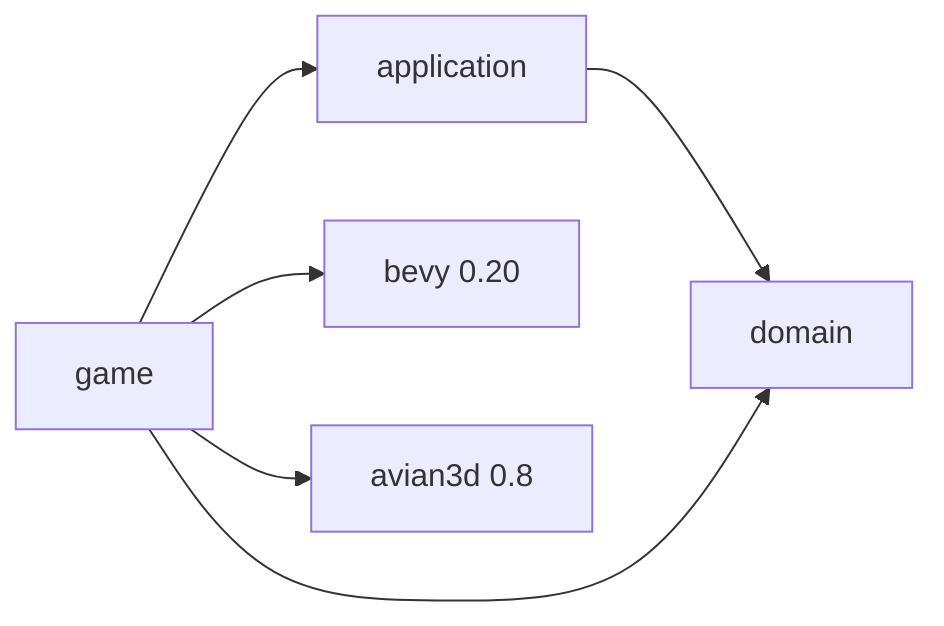
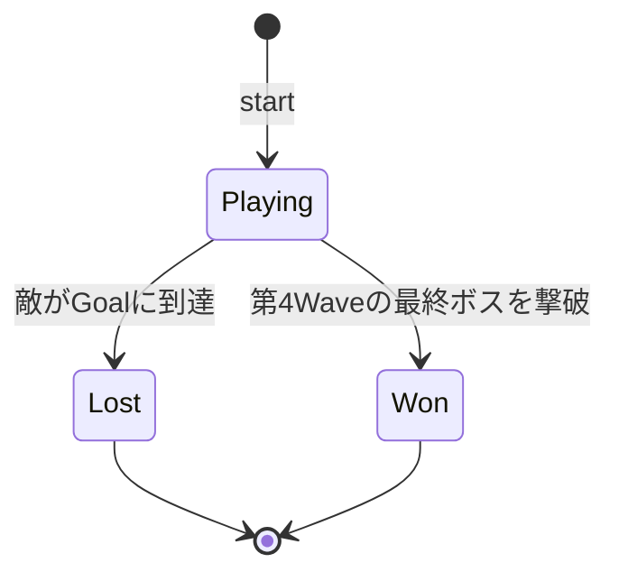
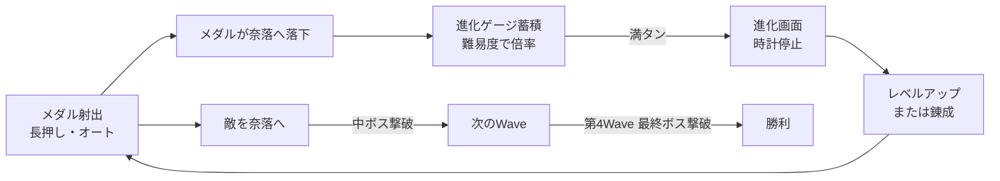
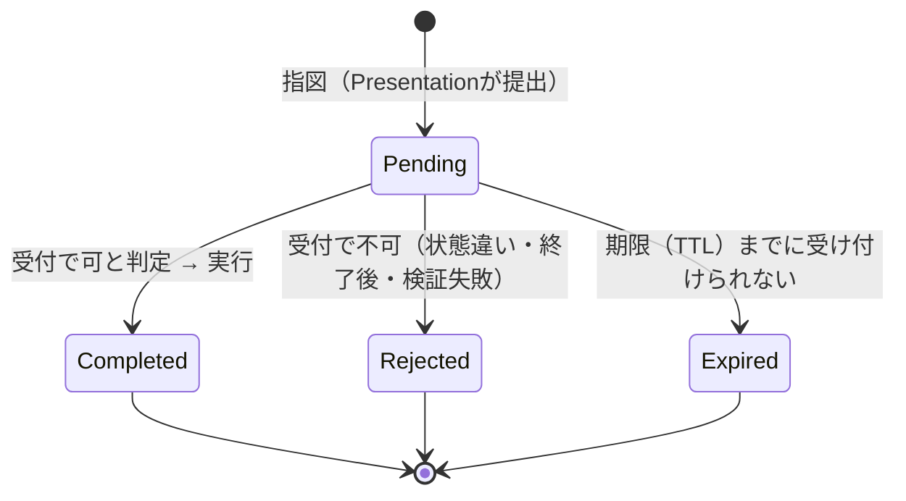
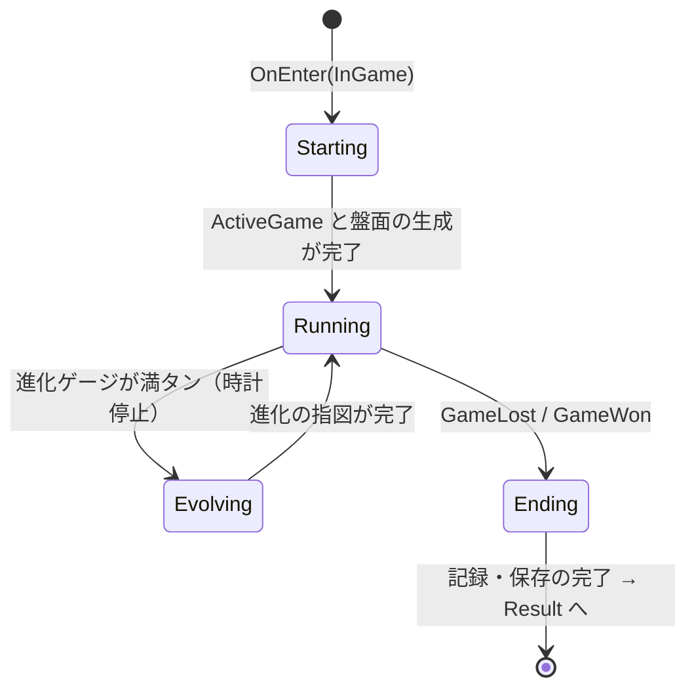
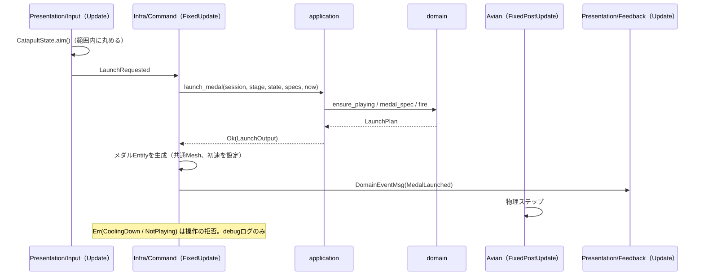
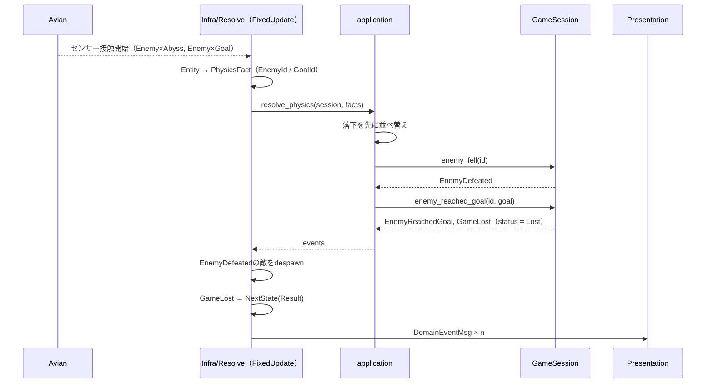

# 基本設計書

- 文書バージョン：0.1
- 作成日：2026-11-19
- プロジェクト名：NUDRA
- 入力文書：
  - 要件定義書 v0.1（[requirements.md](requirements.md)）… 以下「要件」
  - アーキテクチャ設計方針 v0.1 … 以下「方針」
- 技術基盤：Rust（edition 2024）/ Bevy 0.20.x / Avian 0.8.x（avian3d）/ thiserror 2.x / anyhow 1.x / tracing 0.1.x

### 記号

- 【仮決定】要件が未確定のため、本書で置いた暫定の決定。要件確定・検証結果に応じて見直す。
- 【要検証】プロトタイプで成立性やAPI仕様を確認してから確定する事項。
- コード片は設計意図を示す擬似コードである。正確なシグネチャは実装時に確定する。

---

# 1. 本書の位置づけ

## 1.1 目的

要件と方針を、実装できる構造（crate・モジュール・型・スケジュール・エラー処理）へ落とし込む。

## 1.2 範囲

含むもの:

- crate構成と依存関係
- ドメインモデルの型・不変条件・操作
- ユースケースの入出力
- ECS構成（Entity / Component / Resource / Plugin / State）
- スケジュールと処理順序
- 物理設計（剛体種別・衝突レイヤー・センサー）
- エラー管理とログ
- 性能・テスト方針

含まないもの:

- 数値パラメータ（質量・速度など）。定義データで調整する
- 未確定のゲームルールの詳細（勝利条件、経験値、特殊メダル効果、中ボス能力）
- アート・UIデザイン

## 1.3 全体を貫く設計判断

1. **ゲームの意味はDomain、物理状態の正本はECS（Avian）**
   位置・速度・接触状態を持つのはAvianのComponentだけとする。
   Domainは座標を入力として受け取ることはあるが、保持はしない。

2. **外側への指示は戻り値で返す**
   ユースケースは「射出計画」「出現指示」「ドメインイベント」を値として返し、
   game crateのSystemがそれをECSへ適用する。
   物理演算や生成のための出力ポートtraitは作らない
   （要件15.3の「必要に応じて」に対し、必要が生じていないため。方針17）。

3. **集約の操作は全か無か**
   集約のメソッドは検証を先に済ませ、Errを返す場合は状態を一切変更しない。
   エラー発生後もゲーム状態の整合性が保たれることを、エラー管理（8章）の前提とする。

---

# 2. システム構成

## 2.1 Workspace構成

```
nudra/
├── Cargo.toml              # 仮想マニフェスト（workspace）
├── crates/
│   ├── domain/             # 純粋なRust。ゲームの意味とルール
│   └── application/        # ユースケース
├── game/                   # Bevy + Avian。Infrastructure + Presentation。実行バイナリ
├── assets/
│   ├── data/               # 定義データ（RON）: stage / character / specs
│   └── ...                 # モデル・テクスチャ・音
└── docs/
```

現在のルート単一パッケージ（`src/main.rs`）は `game/` へ移す。

```toml
# Cargo.toml（workspace）
[workspace]
resolver = "3"
members = ["crates/domain", "crates/application", "game"]

[workspace.dependencies]
domain      = { path = "crates/domain" }
application = { path = "crates/application" }
bevy        = "0.20"
avian3d     = "0.8"
glam        = "…"   # bevy_mathが使うバージョンと同一にする（2.4）
thiserror   = "2"
anyhow      = "1"
tracing     = "0.1"
serde       = { version = "1", features = ["derive"] }
ron         = "0.12"

[profile.dev.package."*"]
opt-level = 3       # Bevy・Avianは開発ビルドでも最適化する（物理を実時間で確認するため）
```

## 2.2 crate依存関係



| 外部crate | domain | application | game | 用途 |
|---|:-:|:-:|:-:|---|
| glam | ✓ | （domain経由） | （bevy経由） | ベクトル・クォータニオン |
| thiserror 2 | ✓ | ✓ | ✓ | 型付きError |
| anyhow 1 | – | –※ | ✓ | 技術エラーの集約・文脈付与 |
| tracing 0.1 | – | ✓ | ✓（`bevy::log`） | 構造化ログ |
| bevy 0.20 | – | – | ✓ | エンジン |
| avian3d 0.8 | – | – | ✓ | 3D物理 |
| serde / ron | – | – | ✓ | 定義データ読込 |

※ applicationは、失敗し得る外部依存（保存など）を持った時点でanyhowを追加する（8.3）。

## 2.3 レイヤーとコードの対応

| レイヤー | 置き場所 | 主な内容 |
|---|---|---|
| Domain | `crates/domain` | 集約・VO・ドメインサービス・ドメインイベント・Repository trait |
| Application | `crates/application` | ユースケース関数、PhysicsFact、ユースケースのError |
| Infrastructure | `game/src/infrastructure` | 定義データ読込、Repository実装、ユースケースを呼ぶSystem（ECSアダプタ）、Avian設定、Entity生成 |
| Presentation | `game/src/presentation` | 入力・カメラ・UI・音・演出・キャラクター選択画面 |

依存ルールの担保:

- Domain / Application の独立性は **crate境界で強制** する（domainの`Cargo.toml`にbevy・avianが無い限り、参照できない）。
- InfrastructureとPresentationは同一crateのため規約で守る。
  Presentationはdomain・applicationの型を**読み取りのみ**で使い、
  ゲーム状態の変更はMessage（`LaunchRequested`など）で依頼する。
  状態変更をFixedUpdateの明示的な順序（6章）に集めるためである。
  例外は操作状態の`CatapultState`で、入力時にDomainのメソッド経由で直接更新する。

## 2.4 glamの扱い【設計判断】

Domainはベクトル演算（Rail上の位置、射出速度、進行方向）を必要とする。

- glamはBevy固有の型ではなく汎用の数学crateであり、Bevyの`Vec3`・`Quat`はglamの再公開である。
- よってDomainはglamに直接依存し、境界での変換をなくす。
- domainのglamはbevy_mathと一致させる（現在0.33系）。`cargo tree -i glam@0.33.12`で両者が同じ型を共有することを確認する。
  Avian内部のobvhsは別途glam 0.34系を使うが、その型をDomainとの境界には渡さない。
- domainは`domain::math`としてglamを再公開し、applicationはそれを使う。
- 座標系はBevyに合わせ、右手系・Y軸上向き・単位はメートルとする。

---

# 3. ドメイン層設計（crates/domain）

## 3.1 モジュール構成

```
domain/src/
├── lib.rs
├── math.rs          # glamの再公開
├── id.rs            # 各種ID
├── stage/           # Stage集約（geometry, catapult, bridge, abyss, rail, goal, placement, wave, error）
├── session/         # GameSession集約（status, wave_progress, level, error）
├── pusher/          # PusherCharacter集約、MovementState
├── spec.rs          # MedalType / MedalSpec / EnemyTypeId / EnemySpec / SpecCatalog
├── launch.rs        # CatapultState・射出計画（MedalLaunchService相当）
├── navigation.rs    # 敵の経路と進行方向（EnemyNavigationService相当）
├── event.rs         # DomainEvent
└── repository.rs    # StageRepository / PusherCharacterRepository
```

要件21章の総覧は概念の整理であり、そのままフォルダ構成にはしない（要件21の注記）。

## 3.2 IDと共通の値

| 型 | 表現 | 発行元 | 備考 |
|---|---|---|---|
| StageId | 文字列newtype | 定義データ | 例 `"stage_01"` |
| PusherCharacterId | 文字列newtype | 定義データ | 例 `"mop_rabbit"` |
| EnemyTypeId | 文字列newtype | 定義データ | 敵の種類をデータで追加できるようにする |
| GoalId / BridgeId / RailId | `u16` newtype | 定義データ | Stage内でのみ一意 |
| GameSessionId | `u64` newtype | 呼び出し側 | ログの相関用 |
| EnemyId | `u64` newtype | GameSession | 出現時に連番で発行。Bevy Entityとは別物 |

メダルの個体IDは設けない。`MedalId` はメダル種の文字列IDであり、個体の識別にはBevy Entityを使う（3.7、3.13）。

## 3.3 Stage集約

### 構成

```
Stage [Aggregate Root]
├── id: StageId
├── geometry: Geometry                          [VO]
├── catapult: Catapult                          [Entity]
├── bridges: Vec<Bridge>                        [Entity]
├── abysses: Vec<Abyss>                         [VO]
├── rails: Vec<Rail>                            [Entity]
├── goals: Vec<Goal>                            [Entity]
├── initial_medals: Vec<InitialMedalPlacement>  [VO]
└── wave_plan: WavePlan                         [VO] 【仮決定】追加
```

### 構成要素

| 要素 | 保持する内容 | 主な振る舞い |
|---|---|---|
| Geometry | 形状種別（Rectangle / Circle / Polygon …）、外形寸法、床面の高さ。【仮決定】衝突形状そのものはアセット側が持ち、Domainはルールに必要な寸法だけを持つ | 包含判定（初期配置の検証用） |
| Catapult | 発射位置、基準方向、旋回角の範囲（min / max）、仰角、射出速度、クールダウン | 射出計画の計算（3.8） |
| Bridge | id、外部側の端点（敵の出現点）、ステージ側の端点、幅 | 敵の経路の起点 |
| Abyss | 領域。【仮決定】AABBの集合 | なし（侵入判定はAvianのセンサーが行う） |
| Rail | id、経路。【仮決定】折れ線（曲線・円弧は点列で近似） | `length()`、`point_at(s)`（弧長→位置） |
| Goal | id、位置、到達判定の半径 | なし |
| InitialMedalPlacement | メダル種別（Normal固定）、配置。【仮決定】格子（原点・列数・行数・段数・間隔） | `positions()`（配置座標の列挙） |
| WavePlan | Waveの列。各Waveは出現エントリ（時刻・EnemyTypeId・BridgeId・GoalId）の列 | 時刻範囲内の出現エントリ取得 |

WavePlanをStageに含める理由:
BridgeId・GoalIdの参照整合性をStageの不変条件として一度で保証でき、
GameSessionがStageの構造を複製せずに済むため（要件11.2）。

### 不変条件（`Stage::new`で検証）

| # | 条件 | 違反時のError | 出典 |
|---|---|---|---|
| S1 | Goalが1つ以上 | `StageError::NoGoal` | 要件11.1 |
| S2 | Bridgeが1つ以上 | `NoBridge` | 要件11.1 |
| S3 | Railが1つ以上 | `NoRail` | 要件11.1 |
| S4 | 初期メダル配置があり、総枚数が1以上 | `NoInitialMedals` | 要件11.1 |
| S5 | Goal・Bridge・RailのIDがStage内で一意 | `DuplicateId` | 本書 |
| S6 | Railは2点以上かつ長さが正 | `InvalidRail(RailId)` | 本書 |
| S7 | WavePlanが参照するBridge・GoalがStage内に存在 | `UnknownReference` | 本書 |
| S8 | Catapultの旋回角が min ≤ max | `InvalidCatapult` | 本書 |

```rust
pub struct Stage { /* フィールドは非公開 */ }

impl Stage {
    /// 唯一の生成経路。不変条件を満たすStageしか存在できない
    pub fn new(parts: StageParts) -> Result<Self, StageError>;
    pub fn id(&self) -> &StageId;
    pub fn catapult(&self) -> &Catapult;
    pub fn rail(&self, id: RailId) -> Option<&Rail>;
    pub fn goal(&self, id: GoalId) -> Option<&Goal>;
    pub fn bridge(&self, id: BridgeId) -> Option<&Bridge>;
    pub fn wave_plan(&self) -> &WavePlan;
}
```

`StageParts`は全フィールドを公開した組み立て用の構造体（引数の多い関数を避けるため）。

Stageは生成後は不変であり、インゲーム中の敵やメダルの状態を持たない。

## 3.4 GameSession集約

### 構成

```
GameSession [Aggregate Root]
├── id: GameSessionId
├── stage_id: StageId
├── character_id: PusherCharacterId
├── status: GameStatus
├── waves: WaveProgress               現在のWave、Wave内の経過時間、次の出現エントリ位置
├── difficulty: Difficulty            1〜4
├── medals: MedalCollection           所持メダル種とLv.1〜4
├── gauge: EvolutionGauge             進化ゲージ
├── rng / offer                      シード付き乱数と固定したNew!の候補
├── alive_enemies: HashSet<EnemyId>   【追加】
└── next_enemy_id: u64                【追加】
```

`alive_enemies`を持つ理由:
同じ敵の二重撃破や、撃破後のGoal到達を集約の中で排除するため。
保持するのはIDだけで、位置などの物理状態は持たない（方針5）。

### GameStatus



`Lost { enemy: EnemyId, goal: GoalId }` として敗北の原因を保持する（リザルト表示用）。

### 主要操作

| 操作 | 戻り値 | Playing以外のとき |
|---|---|---|
| `start(id, &Stage, &PusherCharacter, difficulty, &EvolutionRules, seed)` | `(GameSession, DomainEvent)`（GameStarted） | — |
| `advance(&Stage, now: Tick)` | `Vec<SpawnOrder>`（EnemyId発行済み） | 空を返す |
| `ensure_playing()` | `Result<(), GameSessionError>` | `Err(NotPlaying)` |
| `enemy_fell(EnemyId)` | `Vec<DomainEvent>`（EnemyDefeated、WaveCleared / GameWon） | 空を返す |
| `enemy_reached_goal(EnemyId, GoalId)` | `Vec<DomainEvent>`（EnemyReachedGoal, GameLost） | 空を返す |
| `medal_spec(&MedalId, &SpecCatalog)` | `Option<MedalSpec>`（現在レベルの定義） | 同左 |
| `medals_fell(count, &SpecCatalog)` | `Vec<DomainEvent>`（EvolutionReady） | 空を返す |
| `evolve(Evolution, &SpecCatalog)` | `Result<DomainEvent, GameSessionError>`（Evolved） | `Err(NotPlaying)` |

区別の原則:

- **物理から来た結果**（落下・到達）はエラーにしない。
  終了後に届いた結果や、既に退場した敵の結果は、正常に起こり得る遅れとして無視する（方針12）。
- **プレイヤー操作から来た要求**（射出・レベルアップ選択）は、
  終了後であれば`NotPlaying`を返し、呼び出し側が分岐する。

### 不変条件

| # | 条件 | 担保方法 |
|---|---|---|
| G1 | 開始時の成長状態は初期状態 | `start`は`MedalCollection::default()`（ノーマルLv.1）と空のゲージだけで生成する |
| G2 | Goal到達が成立したらLost | `enemy_reached_goal`が同じ呼び出しの中で遷移させる |
| G3 | 終了後は進行しない | 全操作の先頭でstatusを判定する |
| G4 | 敵は1回だけ退場する | `alive_enemies`から除去できた場合にだけイベントを出す |

### 同一tick内の判定順序【仮決定】

同じ物理ステップで「奈落への落下」と「Goal到達」が両方起きた場合は、落下（撃破）を先に処理する。
落下で退場した敵のGoal到達はG4により無視されるため、判定はプレイヤーに有利な側に倒れる。
並べ替えはapplicationが行う（4.3）。

## 3.5 PusherCharacter集約

```
PusherCharacter [Aggregate Root]
├── id: PusherCharacterId
├── name: String
├── base_stats: BaseStats        [VO] 移動速度・質量・押し出し力（最大推力）・押し出し幅
├── movement: MovementPattern    [VO]
└── abilities: Vec<Ability>      [VO]【未確定】初期は空
```

MovementPattern【仮決定】: `PingPong { pause_at_ends }`（端で停止して折り返す往復）のみ。
新しいパターンはenumのバリアント追加で増やす。

### MovementState（インゲームのPusherの移動状態）

要件12.3のMovementStateをVOとして定義し、ECSのComponentの中身として保持する。
Domain側に別のコピーは持たない。

```rust
pub struct MovementState { s: f32 /* Rail上の弧長位置 */, forward: bool, pause_left: f32 }

impl MovementState {
    pub fn start(rail: &Rail) -> Self;
    /// 純関数。dtだけ進めた状態を返す（端で停止・反転）
    pub fn advance(self, rail: &Rail, pattern: &MovementPattern, speed: f32, dt: f32) -> Self;
    /// 現在の目標位置
    pub fn target(&self, rail: &Rail) -> Vec3;
}
```

要件13.4のPusherMovementServiceは、この振る舞いで完結するため設けない。

## 3.6 定義データ（Spec）

「物理特性のゲーム上の定義」（方針5）を表す読み取り専用のVO。集約ではない。

| 型 | 内容 |
|---|---|
| MedalId / MedalTier | メダル種の文字列IDと階層（Normal / Element / Fusion）。個体のIDではない |
| MedalSpec | 質量、半径、厚み、摩擦、反発係数 |
| EnemySpec | 質量、サイズ、最大歩行速度、歩行力、摩擦、`ability: Option<EnemyAbility>`（未確定） |
| SpecCatalog | `MedalId → MedalDef { tier, levels: [MedalSpec; 4] }`、敵定義、錬成レシピ、進化ゲージのルール。ノーマル定義・素材と結果の階層・参照・レシピと結果の重複を検証する |
| Positive | 正の有限値（`is_finite() && > 0.0`）だけを生成できるnewtype。積は`checked_mul`で検証する |

- 敵もメダルも種類は文字列IDとし、定義データで追加する。効果の部品だけをコードで実装する（3.13）。
- 物理パラメータは調整の頻度が高いため、コード中の定数にせず定義データ（RON）に置く（5.5）。
- **不正な物理パラメータはDomainで生成できないようにする。** Avianへ渡す直前の検証には頼らない。
  - `Positive`: メダル・敵の質量／半径／厚み／高さ、Pusherの全能力値（要件6.2より速度0は不正）、強化倍率
  - `f32`のまま: 摩擦・反発係数、敵の最大速度・歩行力、端での停止時間（0が有効値のため）

## 3.7 動的Entity（Medal / Enemy / Pusher）の扱い【設計判断】

要件12章の動的Entityは、概念としてはDomainに存在するが、実行時の状態はECSを正本とする（方針5）。
Domainに「全メダルのコレクション」は作らない。

| 要件上の構成 | 実装上の置き場所 |
|---|---|
| Medal.MedalId | **設けない**。メダルに個体識別は不要（強化は種別単位、3.10） |
| Medal.MedalType | Component `MedalKind(MedalId)`（種別ID） |
| Medal.PhysicalProperties | 生成時に`MedalSpec`からAvianの質量・摩擦・反発Componentへ設定 |
| Medal.Transform | Avianの位置・回転Component |
| Enemy.EnemyId | Component `Enemy { id }`（Domain IDとBevy Entityの関連付けはここだけ） |
| Enemy.EnemyType / Ability | Component `EnemyKind(EnemyTypeId)` |
| Enemy.GoalId | Component `Navigation { route, progress }`（Goalまでの経路） |
| Enemy.PhysicalProperties / MovementSpeed | 生成時に`EnemySpec`からAvianへ設定。歩行力はComponent `Walker` |
| Enemy.Transform | Avianの位置・回転Component |
| Pusher.CurrentStats | Component `Pusher { stats: PusherStats }` |
| Pusher.RailId / MovementState | Component `PusherMotion { rail: RailId, state: MovementState }` |
| Pusher.Transform | Avianの位置・回転Component |
| CatapultState | Resource `CatapultControl(CatapultState)` |

- Componentはdomainの値を包むnewtypeにする。DomainにBevyのderiveを持ち込まないため、またorphan ruleのため。
- Systemは包んだdomainの値のメソッドを呼ぶだけにし、ルールをSystemに書かない。

要件12.5（動的Entityの集約境界）と要件15.4（WorldState）への回答:
**WorldStateという集約は作らない。**
ECSのWorldがその役割を担い、DomainはGameSessionの`alive_enemies`など、ゲーム上の意味に必要な最小限だけを持つ。

## 3.8 ドメインサービスの実装方針

| 要件の候補 | 初期実装 | 理由 |
|---|---|---|
| MedalLaunchService | `CatapultState::fire`（launch.rs） | 射出の判断はカタパルトの操作状態に自然に属する |
| EnemyNavigationService | `navigation::route(&Stage, BridgeId, GoalId) -> Route` と `Route::steer(&mut progress, pos) -> Vec3` | 経路は出現時にStageから一度だけ導出する。【仮決定】経路探索は持たず、Bridge外端→Bridge内端→Goalの経由点を順に目指す |
| PusherMovementService | `MovementState::advance`（3.5） | Entityの振る舞いで完結する |
| LevelUpService | `GameSession::evolve` と `MedalCollection::evolve` | 進化ルールと全か無かの検証をDomainで完結させる |
| BattleResolutionService | `GameSession::enemy_fell` / `enemy_reached_goal` | 判定がGameSessionの状態遷移で完結する |

いずれもBevyの型・Query・Commandsを受け取らない。座標は`Vec3`（glam）で受け取る。

### CatapultState

```rust
pub struct CatapultState { yaw: f32, selected: MedalId, next_fire: Tick }

impl CatapultState {
    /// 範囲外は丸める（エラーにしない）
    pub fn aim(&mut self, delta: f32, catapult: &Catapult);
    pub fn select(&mut self, medal: MedalId);
    /// 発射できたときだけnext_fireを更新する。周期内ならNone
    pub fn fire(&mut self, catapult: &Catapult, spec: &MedalSpec, now: Tick)
        -> Option<LaunchPlan>;
}

pub struct LaunchPlan { pub medal: MedalId, pub spec: MedalSpec, pub origin: Vec3, pub velocity: Vec3 }
```

- 【仮決定】プレイヤーが操作する射出角度は水平の旋回角（yaw）のみとし、仰角はCatapultの定義値で固定する。
- 【仮決定】クールダウンは要件12.4への追加。連射によるメダル数の急増を防ぐ、性能上の安全弁である（9章）。

## 3.9 ドメインイベント

純粋なRustの値（`enum DomainEvent`）とする。
集約やドメイン関数の**戻り値**として返し、Domainの中にイベントバスは持たない。

| イベント | ペイロード | 初期実装 |
|---|---|---|
| GameStarted | session, stage, character | ✓ |
| MedalLaunched | medal | ✓ |
| EnemySpawned | enemy, kind, goal | ✓ |
| EnemyDefeated | enemy | ✓（要件のEnemyFellIntoAbyssを統合。撃破の原因が奈落落下だけのため） |
| EnemyReachedGoal | enemy, goal | ✓ |
| GameLost | enemy, goal | ✓ |
| GameWon | — | 最終ボス撃破 |
| WaveCleared | wave | 中ボス撃破 |
| EvolutionReady | — | 進化ゲージ満タン |
| Evolved | medal, level | レベルアップ・錬成・New!成功 |

- 物理衝突（メダル同士、メダルと敵）はドメインイベントにしない。
- メダルの落下は、tick単位の集計値としてDomainへ渡し、進化ゲージへ加算する（4.3）。

## 3.10 成長（LevelProgress）

> 成長の仕様は 3.12「メダル進化」で確定した。この節の `LevelProgress` / `Upgrade` は、
> 3.12 の `MedalCollection` / `Evolution` に置き換え済み。

- 強化の適用単位は**種別単位**（確定）。個体単位にすると、メダル個体のIDと状態をDomainが持つ必要が生じ、方針5・15に反するため。
- 強化後の値は強化した時点でchecked演算で確定し、正の有限値にならない強化は状態を変えずに拒否する（全か無か）。
  この原則は 3.12 のレベルアップ・錬成でも維持する。
- 強化結果のECSへの反映は強化時の1回だけ行う。毎フレームの同期はしない（4.4）。

## 3.11 Repository

```rust
pub trait StageRepository {
    fn find(&self, id: &StageId) -> Option<Stage>;
}

pub trait PusherCharacterRepository {
    fn find(&self, id: &PusherCharacterId) -> Option<PusherCharacter>;
}
```

- 定義データは起動時（Loading状態）に全件を読み込み・検証してメモリに置く。
  そのため`find`は技術的に失敗しない。戻り値に`Result`を持たせない。
  読込の失敗はLoading時点の技術エラーとして扱う（8章）。
- 「見つからない」はユースケース側で型付きError（`StageNotFound`）に変換する。
- `save`（要件14.2）は作らない。ステージの編集機能が無いため。
- **GameSessionRepositoryは作らない。** インゲームの途中保存・再開の要件が無いため（要件14.4、方針13）。
- 実装はgame crateの`StageCatalog` / `CharacterCatalog`（HashMapを持つResource）。
  applicationのテストでは、テスト内の簡易実装を使う。
- キャラクター選択画面の一覧表示は、Infrastructureが読み取りモデル`CharacterRoster`として公開する（5.6）。

### ProgressRepository（セーブデータ）

```rust
pub trait ProgressRepository {
    type Error: std::error::Error + Send + Sync + 'static;
    fn load(&self) -> Result<Option<PlayerProgress>, Self::Error>;
    fn save(&mut self, progress: &PlayerProgress) -> Result<(), Self::Error>;
}
```

- 定義データと違い、ローカル保存は失敗し得るため`Result`を返す。エラー型は実装が関連型で決める。
- 対象の集約`PlayerProgress`【仮決定】: 最後に選んだキャラクター、総プレイ回数、ステージごとの記録（回数・最多撃破数）。
  インゲームの成長は持ち越さないため保存しない（要件9.1）。
- `PlayerProgress::restore`が読込時の値を検証する（記録の回数が0、同じステージの重複、
  ステージ回数の合計 > 総プレイ回数 を拒否）。
- 実装と保存形式は5.7。

## 3.12 中核のゲームサイクル（確定仕様）



### メダル射出（連射・オート）

- 射出は**継続的な操作意図**（6.4）。`firing = fire_button_held || auto_fire` で決まる。
  - 手動: 押している間、連続で射出する（ダダダダ）
  - オートON: 押していなくても連続で射出し続ける（メダルが流れ続ける）
- 射出の間隔は、待ち時間を意識させるクールダウンではなく、**連射速度を決める発射周期**（`fire_interval: Ticks`）。
  例: 60Hzで6Tickごとなら秒間10枚。値は調整ノブ。
- **射出の制約はStage、現在の状態はゲーム中の状態**に分ける（静的な定義と動的な状態を混ぜない）。

  | 置き場所 | 持つもの |
  |---|---|
  | Stage（定義） | カタパルトの位置、初期の旋回角、旋回できる範囲、仰角、射出速度、発射周期 |
  | `CatapultState`（ゲーム中） | 現在の旋回角、選択中のメダル、次に発射できるTick（`next_fire`） |

  発射周期はステージごとに定義し、将来は進化で変えられるようにする（そのときも期限Tickの比較だけで済む）。

### Wave（全4Wave、確定）

| Wave | 出現内容 | 次へ進む条件 |
|---|---|---|
| 1〜3 | 通常敵 + 終盤に中ボス1体 | その中ボスを撃破 |
| 4 | 最終ボスのみ | 最終ボス撃破で**勝利**（`GameStatus::Won`） |

- ボスは **Waveの構造で指定する**（各Waveは「通常の出現の列」と「ボスの出現1件」を持つ）。どの敵種をボスにするかは定義データ次第。
  これによりStage単体で構成を検証でき、セッションは定義データを見ずに「この敵がWaveのボスか」を判断できる。
- Stage の不変条件に追加: Waveはちょうど4つ。第4Waveは通常の出現を持たない（最終ボスのみ）。
- 中ボス撃破で `WaveCleared`、次に進めたTickから次のWaveが始まる。最終ボス撃破で `GameWon`。
- 【未決】中ボス撃破の時点で残っている通常敵の扱い（そのまま残す／一掃する）。当面は「そのまま残す」で実装する。
- 【未決】「終盤」の定義（Wave内の出現時刻の最後とするか、条件で出すか）。当面は WavePlan の出現時刻で表す。

### メダル進化（レベルアップ・錬成）

- メダルを奈落へ落とすと**進化ゲージ**が溜まる。溜まりやすさは難易度に依存する。
  - 落下の検知は物理（Infrastructure）が行い、**落下の成立（tickごとの枚数の集計）をDomainへ渡す**。
    ゲージの増加量（枚数 × 難易度の倍率）はDomainが決める（旧方針「メダル落下はDomainへ渡さない」を変更）。
- ゲージが満タンになると、インゲーム中に**進化画面**を出す。進化画面の間は**ゲーム世界の時計を止める**
  （`GamePhase::Evolving`。`GameClock` は進まず、敵も物理も止まる）【仮決定】。選択を確定すると `Running` に戻る。
- 進化の選択肢はレベルアップ・錬成・New!。選択は**指図**（`Request::Evolve`）として台帳を通し、必ず完了／却下で終わる。

  | 選択 | 条件 | 結果 |
  |---|---|---|
  | レベルアップ | 対象のメダル種がLv.4未満 | そのメダル種が Lv+1（最大Lv.4） |
  | 錬成 | メダルA・Bがどちらも**Lv.4**で、A+Bの錬成レシピが存在する | 別のメダルCを**Lv.1**で得る |

- 錬成の項目は、条件を満たすときだけグレーアウトを解除する。UIの表示とは別に、**Domainでも条件を検証する**。
- メダル種ごとのレベル（1〜4）は、セッション中の `MedalCollection`（所持メダル種とレベル）で持つ。
  開始時は Normal Lv.1。レベルごとの物理特性（質量など）は定義データに持たせ、checked演算の原則（3.10）を守る。
- 錬成レシピは定義データ（`(A, B) → C`）で持つ。順序は問わない（A+B と B+A は同じ）。
- 錬成では素材A・Bを**消費する**（確定）。A・Bは所持から外れ、Cが Lv.1 で加わる。
- 【仮決定】錬成の結果Cをすでに所持している場合は錬成できない（`ResultAlreadyOwned`）。
- Normal 以外のメダルは、進化画面の **New!**（未所持の素材をランダムに1つ、Lv.1）で手に入る（確定、3.13）。
- Pusherは成長しない（確定）。進化の対象はメダルだけ。
- インゲームの成長は持ち越さない（要件9.1）。

### 難易度（全4段階）

| 影響するもの | 難易度による違い |
|---|---|
| 進化ゲージ | 溜まりやすさ（倍率） |
| Goalの数 | Easy は1つ。難しくなるほど増える |
| Wave構成 | 4Wave は共通 |
| 進化のルール | Lv.4上限・錬成条件は共通 |

- `Difficulty` を値オブジェクトとし、難易度ごとの設定値（ゲージ倍率など）は定義データに持つ。
- Goal は Stage の定義で「どの難易度から有効か」を持ち、選んだ難易度で有効なGoalだけを使う。
  敵が目指すのも有効なGoalだけ。
- 難易度はアウトゲームで選び、開始の指図（`Request::Start`）に含める。
- 【未決】Easy 以外の3段階の名称と、各段階の具体的な数値。

### Abyss（奈落）

- Abyss は**橋より下にある奈落**。落下した敵は撃破、メダルは除去してゲージに数える。
- 【未決】判定の形（落下判定面か領域か）。単純なY座標だけの判定は、橋の下に足場があると誤判定するため、
  ステージのアセットが決まった時点で決める。当面の実装はAABBの集合のまま。

## 3.13 メダル図鑑と効果

### 全89種（確定）

| 階層 | 種類 | 数 | 入手 |
|---|---|---|---|
| ノーマル | ノーマルメダル | 1 | 開始時に所持（Lv.1） |
| 素材 | 炎・砂・水・光・浄化・血・毒・雷・風・幻・死・星・時・刃・太陽・山 | 16 | 進化画面の **New!**（未所持の素材から1つランダム、Lv.1） |
| 錬成 | 焼きいも・サウナ・花火 … 72種（下の錬成表） | 72 | 素材2種（どちらもLv.4、消費）の錬成で Lv.1 |

- 錬成表は素材16種どうしの対称表（A+B と B+A は同じ）。72通りのレシピがあり、結果はすべて別のメダル。
  同じ素材どうし（×）とレシピの無い組み合わせ（—）は錬成できない。ノーマル・錬成メダルは素材にならない。
- メダルは**定義データで識別する**（`MedalId`、例 `"fire"` `"roasted_sweet_potato"`）。89種をコードの列挙で持たない。
  名前・階層・レベルごとの物理特性・効果は定義データに書き、表示名はロケールのカタログ（`ui.json` とは別の `medals.json`）に置く。
- 錬成表そのものも定義データ（`fusions`）。読込時に、対称性・自己錬成なし・結果の重複なし・参照するメダルの存在を検証する。

### 進化画面の選択肢

| 選択肢 | 出る条件 |
|---|---|
| レベルアップ（所持メダルごと） | そのメダルが Lv.4 未満 |
| 錬成（組み合わせごと） | 素材2種がどちらも Lv.4 で、レシピがある（それ以外はグレーアウト） |
| **New!** 未所持メダル Lv.1 | 未所持の素材が残っている。候補は1つ【仮決定】 |

- New! の候補は、ゲージが満タンになった時点で決めて進化の提示（`EvolutionOffer`）として固定する。画面を開き直しても変わらない。
- 乱数はセッション開始時のシードから生成する決定的な乱数（Domain内の小さなPRNG）。同じシードなら同じ候補になり、テストで再現できる。
- New! の選択も指図（`Request::Evolve(Evolution::Acquire(id))`）。提示された候補以外は却下する。

### 効果の設計方針

#### メダル名の雰囲気（確定）

ダークファンタジー調に寄せず、少し気の抜けた、コミカルでカジュアルな名前にする。
素材の組み合わせを厳密な物質変化として解釈する必要はない。今回確定した名前は次の通り。

| 素材A | 素材B | 錬成メダル | ID |
|---|---|---|---|
| 炎 | 水 | サウナ | `sauna` |
| 炎 | 毒 | 激辛 | `spicy_food` |
| 星 | 浄化 | 願い | `wish` |
| 刃 | 雷 | チェーンソー | `chainsaw` |

錬成表の正本は [medal-fusions.csv](medal-fusions.csv)。ユーザーから提示された16×16の対称表をそのまま収録する。
現在の同梱データはノーマル1種・素材16種・錬成72種（全89種）。全256組について、錬成可否・結果・対称性を正本と照合する。
特殊効果は未実装。レベル別の物理特性・進化ゲージの数値は検証用の仮値。

#### 物理による効果

敵にHPは無い（要件2.4）。効果はすべて**物理で表す**: 押す・引く・浮かせる・滑らせる・止める・重さを変える。
効果は少数の**効果の部品**（コードで実装）の組み合わせとして定義データに書く。新しいメダルはデータの追加で作れる。

| 効果の部品 | 物理での表し方 |
|---|---|
| 爆風 `Blast` | 着弾点から放射状のインパルス |
| 突風 `Gust` | 一方向（射出方向）への広い押し出し |
| 引力 `Pull` | 一点（または奈落方向）へ引き寄せる力 |
| 浮上 `Lift` | 上向きのインパルス（メダルの山を崩す） |
| 床効果 `Floor` | 一定時間、その範囲の摩擦を上げる／下げる |
| 足止め `Stall` | 敵の歩行力を一定時間0にする（気絶・幻惑） |
| 減速 `Slow` | 敵の最大速度を一定時間下げる |
| 重さ `Weight` | メダル自体の質量・大きさを変える（重い・巨大） |
| 弱体 `Weaken` | 敵の質量を一定時間下げる（押し流されやすくなる） |
| 迷走 `Confuse` | 敵の進行方向を一定時間ずらす（奈落側へ歩く） |

#### 素材16種の効果（案）

| 素材 | 効果 | 部品 |
|---|---|---|
| 炎 | 着弾で熱風。周りのメダルと敵を外へ弾く | 爆風 |
| 砂 | 砂だまり。範囲の床が重くなり敵が歩きにくい | 床効果（摩擦↑）＋減速 |
| 水 | 水たまり。床が滑り、敵もメダルも流されやすい | 床効果（摩擦↓） |
| 光 | まぶしさで近くの敵が立ち止まる | 足止め |
| 浄化 | 中ボスの能力を一定時間打ち消す | （能力解除。能力の仕様確定後） |
| 血 | 当たった敵に印。その敵は軽くなり押されやすい | 弱体 |
| 毒 | じわじわ効く毒。範囲の敵が遅く・軽くなる | 減速＋弱体 |
| 雷 | 当たった敵から近くの敵へ連鎖して一瞬しびれる | 足止め（連鎖） |
| 風 | 射出方向へ突風。メダルの山ごと押し流す | 突風 |
| 幻 | 幻を見せて敵を迷わせ、奈落側へ歩かせる | 迷走 |
| 死 | 奈落の縁にいる敵を奈落へ引きずり込む | 引力（奈落方向） |
| 星 | 小さな重力異常。周りのメダルを浮かせて崩す | 浮上 |
| 時 | 範囲の敵の時間を遅らせる | 減速（強） |
| 刃 | 鋭く速い薄いメダル。敵を貫いて後ろの敵も押す | 重さ（薄く速い）＋貫通 |
| 太陽 | 巨大なメダル。ゆっくり転がり何でも押しのける | 重さ（大きさ↑） |
| 山 | 最も重いメダル。押されず、敵の通り道をふさぐ | 重さ（質量↑） |

#### 錬成メダルの効果

- 錬成メダルは**両方の素材の効果を受け継ぎ**、名前に合わせた**ひとひねり**を加える。例:

  | 錬成メダル | 素材 | 効果（案） |
  |---|---|---|
  | 焼きいも | 炎＋砂 | 熱い砂だまり。踏んだ敵が熱さで跳ね退き（爆風）、足も取られる（摩擦↑） |
  | サウナ | 炎＋水 | 蒸気で範囲の敵がのぼせて止まる（足止め＋床が滑る） |
  | 花火 | 炎＋光 | 時間差で連続して弾ける（爆風×複数回）＋まぶしさで足止め |
  | 台風 | 水＋風 | 広範囲の渦。周りを巻き込みながら一方向へ押し流す（突風＋床が滑る） |
  | ブラックホール | 死＋星 | 一点に強い引力。周りの敵とメダルを吸い寄せてから奈落へ |
  | 化石 | 時＋山 | 動かない重い化石になり、敵の通り道を長く塞ぐ（重さ↑↑＋減速） |

- 【未決】72種すべての効果の詳細と数値。部品の組み合わせとして定義データに書き、調整する。

---

# 4. アプリケーション層設計（crates/application）

## 4.1 方針

- ユースケースは**関数**として実装する。状態を持つUseCase構造体やUseCase traitは作らない。
- 入力は「domainの値への参照」と「コマンド値」。
  出力は「domainへの変更」と「外側への指示（Plan / Order）」と「DomainEvent」。
- Bevy・Avianの型を扱わない。ECSへの適用はgame crateのSystemが行う。
- 手順の調整が無い単純な処理（Pusherの移動、敵の操舵）はユースケース関数で包まず、
  SystemからDomainの関数を直接呼ぶ（方針14の`game → domain`の依存）。

## 4.2 ユースケース一覧

| ユースケース | 入力 | 出力 | Error | 呼び出し元 |
|---|---|---|---|---|
| `start_game` | Repository、SpecCatalog、`StartGameCommand { session_id, stage_id, character_id, difficulty, seed }` | `StartGameOutput { session, stage, character, pusher: PusherSetup, event }` | `StartGameError` | OnEnter(Starting) |
| `launch_medal` | `&GameSession`, `&Stage`, `&mut CatapultState`, `&SpecCatalog`, now | `LaunchOutput { plan, event }` | `LaunchMedalError` | FixedUpdate / Command |
| `advance_waves` | `&mut GameSession`, `&Stage`, dt | `Vec<SpawnOrder>`、EnemySpawnedイベント | なし | FixedUpdate / Intent |
| `resolve_physics` | `&mut GameSession`, `&mut Vec<PhysicsFact>`, `&SpecCatalog` | `Vec<DomainEvent>` | なし | FixedUpdate / Resolve |
| `evolve` | `&mut GameSession`, `&SpecCatalog`, `Evolution` | `EvolveOutput`（イベント・変更後のSpec） | `GameSessionError` | Update / Evolving（時計停止中） |

## 4.3 PhysicsFact（物理の結果からゲーム上の意味への変換点）

```rust
pub enum PhysicsFact {
    EnemyEnteredAbyss(EnemyId),
    EnemyEnteredGoal(EnemyId, GoalId),
    MedalsFell(u32),
}
```

- InfrastructureがAvianのセンサー接触からPhysicsFactを作る。
  Bevy EntityからEnemyId・GoalIdへの変換はここで完結させる。
- `resolve_physics`は次の順に処理する。
  1. 落下を先、到達を後に並べ替える（3.4）
  2. GameSessionへ順に適用する
  3. 発生したDomainEventを返す
- メダルの落下はセンサー・安全高度の重複をEntity単位で除き、tick単位の枚数 `MedalsFell(count)` を1件だけ渡す。
- ジャックポット（要件8章）専用のロジックは持たない。通常の物理から自然に発生させる（要件8.3）。
  検知や報酬が必要になった時点で、上記の集計値から判定する。

## 4.4 各ユースケースの手順

### start_game（要件16.1）

1. Stageを取得する。無ければ`StageNotFound`
2. PusherCharacterを取得する。無ければ`CharacterNotFound`
3. `GameSession::start`で生成する（成長状態は初期状態）
4. Pusherの初期配置（先頭Railの`MovementState::start`、補正済みステータス）を算出する
5. 出力を返す。地形と初期メダルは、game側がStageの値から生成する

### launch_medal（要件16.2）

1. `session.ensure_playing()?`
2. `let spec = session.medal_spec(state.selected(), specs);`
3. `let plan = state.fire(stage.catapult(), &spec, now)?;`
4. `LaunchOutput { plan, event: MedalLaunched }`を返す

### AdvanceGame（要件16.3）

1つの関数にはせず、物理ステップの前後に分割する（6章）。

- 物理の前: `advance_waves`（敵の出現）、敵の操舵、Pusherの移動
- 物理: Avian
- 物理の後: `resolve_physics`（撃破・敗北の判定）

### evolve（要件16.4、確定仕様3.12）

1. `session.evolve(choice, specs)?`。ゲージ・所持・レベル・錬成・New!の候補を検証する
2. 変更後のSpecとイベントを返す
3. game側で、該当種別の既存メダルの質量・Collider・摩擦・反発・仮形状を1回だけ更新する
4. 錬成で選択中の素材が消費されたら、射出メダルをノーマルへ戻す。盤面上の素材個体は残す
5. 成功したときだけRunningへ戻す。却下時は時計停止とNew!の候補を保つ

全メダルがLv.4で、未所持の素材も実行可能な錬成も無い場合、ゲージを蓄積しない。
選択肢の無い進化画面でゲームが止まることを防ぐ。

## 4.5 アプリケーションのError

規約は8.3で定める。

```rust
#[derive(Debug, thiserror::Error)]
pub enum StartGameError {
    #[error("stage not found: {0}")]
    StageNotFound(StageId),
    #[error("pusher character not found: {0}")]
    CharacterNotFound(PusherCharacterId),
}

#[derive(Debug, thiserror::Error)]
pub enum LaunchMedalError {
    #[error(transparent)]
    Session(#[from] GameSessionError),   // NotPlaying
    #[error(transparent)]
    Launch(#[from] LaunchError),         // CoolingDown
}
```

---

# 5. game crate設計（Infrastructure / Presentation）

## 5.1 モジュールとPlugin

```
game/src/
├── main.rs                 App構築、Plugin登録、ログ・エラーハンドラ設定
├── state.rs                AppState
├── infrastructure/
│   ├── mod.rs              InfrastructurePlugin
│   ├── data.rs             RONのDTO、AssetLoader、DTO→Domain変換、Catalog
│   ├── session.rs          セッション系Resource、Resolve / Command / IntentのSystem
│   ├── world.rs            Entity生成（地形・メダル・敵・Pusher）、共通Mesh・Material
│   └── physics.rs          衝突レイヤー、Avian設定、PhysicsFactの収集、Specの反映
└── presentation/
    ├── mod.rs              PresentationPlugin
    ├── select.rs           キャラクター選択画面
    ├── input.rs            入力 → CatapultControl / LaunchRequested
    ├── camera.rs
    ├── hud.rs              インゲームUI・リザルト
    └── feedback.rs         DomainEventMsg → 演出・音
```

- 各モジュールは`pub(super) fn plugin(app: &mut App)`（関数Plugin）を公開し、`mod.rs`で束ねる。
- Pluginは機能単位で分ける。集約の単位に合わせない（方針6）。
- Avianへの依存は`infrastructure/physics.rs`と`world.rs`に閉じ込める。
  物理ライブラリを差し替える場合（要件18.2）の影響範囲をここに限定する。抽象化traitは作らない。

## 5.2 アプリケーション状態（States）

```mermaid
stateDiagram-v2
    [*] --> Loading
    Loading --> CharacterSelect : 定義データの読込・検証に成功
    Loading --> [*] : 致命的エラー（AppExit::error）
    CharacterSelect --> InGame : キャラクター決定
    InGame --> Result : GameStatusがLost / Won
    Result --> CharacterSelect
```

- 【仮決定】ステージ選択は未確定（要件3.1）のため、当面は既定のステージを使う。
- InGame中のサブ状態（ポーズ、レベルアップ選択中）は、成長仕様の確定時にSubStatesとして追加する。
- InGameで生成するEntityには状態スコープ（`DespawnOnExit(AppState::InGame)`）を付け、個別の後始末を書かない。

| タイミング | 処理 |
|---|---|
| OnEnter(Loading) | 定義データのロード開始 |
| Loading中（Update） | ロード完了を待ち、DTO→Domain変換、Catalogを登録 |
| OnEnter(InGame) | `start_game`、地形・初期メダル・Pusherの生成、セッション系Resourceの登録 |
| OnExit(InGame) | 結果を`LastResult`へ移し、セッション系Resourceを除去（Entityは状態スコープで自動除去） |

### 要件3.2（インゲーム開始）との対応

| 要件3.2の手順 | 実行箇所 |
|---|---|
| 1. Stageを読み込む | Loading（全件読込）、`start_game`（取得） |
| 2. 地形・設備を配置する | OnEnter(InGame)、world.rs |
| 3. 初期メダルを配置する | OnEnter(InGame)、`InitialMedalPlacement::positions()`から一括生成 |
| 4. Pusherを配置する | OnEnter(InGame)、`PusherSetup`から生成 |
| 5. 敵の出現進行を初期化する | `GameSession::start`（WaveProgressの初期化） |
| 6. 成長状態を初期化する | `GameSession::start`（ノーマルLv.1・空の進化ゲージ） |
| 7. ゲームを開始する | 状態がInGameになり、FixedUpdateのGameplaySetが動き始める |

## 5.3 ECS構成

### Entityの種類とComponent

| Entity | 独自Component | Avian | 想定数 |
|---|---|---|---|
| 地形・Bridge・出現領域 | `StageGeometry` | Static + Collider | 少 |
| Abyss | `AbyssZone` | Static + Sensor | 少 |
| Goal | `GoalZone(GoalId)` | Static + Sensor | 少 |
| Catapult | `CatapultModel` | なし（表示のみ） | 1 |
| Medal | `MedalKind(MedalId)` | Dynamic + Collider（円柱） | 数百〜数千 |
| Enemy | `Enemy { id }`, `EnemyKind`, `Navigation`, `Walker` | Dynamic + Collider、回転ロック | 数十〜数百 |
| Pusher | `Pusher { stats }`, `PusherMotion` | Dynamic + Collider、回転ロック | 1（複数可否は未確定） |

メダルの独自Componentは`MedalKind`の1つに抑える（メモリ量とArchetype移動を最小にするため）。

### Resource

| Resource | 中身 | 寿命 |
|---|---|---|
| `StageCatalog` / `CharacterCatalog` / `Specs` | Domainの定義データ（Repository実装） | 起動〜終了 |
| `ActiveSession` | `GameSession` | InGame |
| `ActiveStage` | `Stage` | InGame |
| `ActiveCharacter` | `PusherCharacter` | InGame |
| `CatapultControl` | `CatapultState` | InGame |
| `MedalAssets` | 種別ごとの共通Mesh・MaterialのHandle | 起動〜終了 |
| `LastResult` | 勝敗とその原因 | Result画面 |

`ActiveSession`は`GameSession`をそのまま包む。
`GameSession`のフィールドは非公開のため、Resource経由でも公開メソッドでしか変更できない（方針6）。

## 5.4 物理設計

### 剛体の種別と制御【要検証】

| 対象 | 種別 | 制御方法 | 理由 |
|---|---|---|---|
| Medal | Dynamic | 射出時に初速を与えるだけ | 物理ライフサイクル（要件2.2）をそのまま発生させる |
| Enemy | Dynamic | 進行方向へ上限付きの歩行力を加える | 速度を直接上書きすると、メダルに押し流される挙動（要件7.1）が消えるため |
| Pusher | Dynamic | Rail上の目標点へ、最大推力＝押し出し力の制御力で追従させる | Kinematicは推力が無限になり、「押し出し力」や「重いメダルは押しにくい」（要件5.4、6.4）を表現できないため |

Pusherの追従の安定性（目標点の先行量の上限、制御ゲイン）は、最優先の検証項目とする（9.4）。

### 衝突レイヤー

| | Stage | Medal | Enemy | Pusher | Abyss | Goal | SpawnFloor |
|---|:-:|:-:|:-:|:-:|:-:|:-:|:-:|
| **Medal** | ✓ | ✓ | ✓ | ✓ | ✓ | – | – |
| **Enemy** | ✓ | ✓ | ✓ | ✓ | ✓ | ✓ | ✓ |
| **Pusher** | – | ✓ | ✓ | – | – | – | – |

PusherはStageと衝突させず、並進Yを固定して床からわずかに浮かせる（床の摩擦で追従が乱れないようにするため）。

- Goalのセンサーは敵だけを検知する。数千枚のメダルとの組み合わせ判定を発生させない。
- 敵の出現領域の床（SpawnFloor）は敵とだけ衝突させる。
  「外部領域にはメダルの物理作用が及ばない」（要件4.4）をレイヤーで保証する。
- 敵同士の衝突は有効にする（押し合い）。負荷が問題になったら無効にする調整ノブとする。

### センサーと衝突イベント

- 衝突イベントの有効化は、AbyssとGoalのセンサー側のEntityにだけ付ける。
  メダル同士の大量の接触からイベントを生成しない。
- Resolve Systemはセンサーの接触開始イベントを読み、相手のEntityを`Enemy` / `MedalKind`で振り分ける。

  | 組み合わせ | 処理 |
  |---|---|
  | Enemy × Abyss | `PhysicsFact::EnemyEnteredAbyss` |
  | Enemy × Goal | `PhysicsFact::EnemyEnteredGoal` |
  | Medal × Abyss | 即座にdespawn（技術的な後片付け。Domainへは渡さない） |

- 安全策として、一定の高さより下へ落ちた物体を除去する。
  メダルはそのまま除去し、敵は`EnemyEnteredAbyss`として扱う。
- Avianの物理スケジュールは`PhysicsPlugins::new(FixedPostUpdate)`のように明示して登録し、既定値に依存しない。
- イベント型や有効化Componentの正確な名前はAvian 0.8で確認する【要検証】。

## 5.5 定義データとアセット

| ファイル | DTO | 変換先（Domain） |
|---|---|---|
アセットのルートは`game/assets/`（`cargo run`時のBevyの既定位置）。

| ファイル | DTO | 変換先（Domain） |
|---|---|---|
| `data/stages/*.stage.ron` | `StageAsset` | `Stage`（`Stage::new`で検証） |
| `data/characters/*.character.ron` | `CharacterAsset` | `PusherCharacter` |
| `data/game.specs.ron` | `SpecsAsset` | `SpecCatalog` |
| `visuals.visuals.ron` | `VisualManifest`（Presentation） | —（見た目の割り当て、5.8） |

- DTOはserdeでデシリアライズする。Domainの型にはserdeを付けず、DTOの`to_domain()`で変換する（方針13）。
- RONの読込は汎用の`RonLoader<A>`で行う（拡張子ごとに登録）。Errorはthiserrorで定義する（8.3）。
- 【未実装】定義データのホットリロード（Catalogの再構築）。物理調整の反復が増えた時点で追加する。
- 地形の衝突形状は当面Geometryから単純形状で作る。glTFメッシュ由来にするかは【要検証】。

## 5.6 依存性逆転とMessage / Event / Observerの使い分け

Bevy ECSの流儀で依存性を逆転する。ポートのtraitにDTOを流す代わりに、
`game/src/port.rs` に置いた **Message・読み取り専用Resource・Component** を境界にする。
InfrastructureとPresentationは`port`だけに依存し、互いを参照しない。

| 方向 | 種類 | 型 |
|---|---|---|
| Presentation → Infrastructure | 継続意図と指図（入力ポート） | `ControlIntent`（旋回・手動／オート発射）、`SubmitRequest`（Start / Evolve / SelectMedal / Menu） |
| Infrastructure → Presentation | Message（出力ポート） | `DomainEventMsg(DomainEvent)` |
| Infrastructure → Presentation | 読み取り専用Resource | `CharacterRoster` / `HudModel` / `AimModel` / `GameResult` |
| Infrastructure → Presentation | Component | `Appearance { key, silhouette }`（何に見えるべきか） |
| Avianの衝突 → Resolve | Avianの`CollisionStart`をMessageとして読む | — |
| UIウィジェット内の反応 | Observer（`On<PointerClick>`） | — |

- ユースケース（application）を呼ぶのはInfrastructureのSystemだけ。
- ゲーム進行（射出・撃破・敗北）をObserverで連鎖させない。処理順序を6章のSystemSetだけで決めるため（方針11）。
- `DomainEvent`自体はBevyに依存しない値である。game側で1種類のMessageに包んで配る。

## 5.7 セーブデータ（オフラインファースト）

Nudraのゲームプレイは、インターネット接続・ユーザー認証・外部サーバーの稼働状態に依存しない。
ローカルのセーブファイルが唯一の正本で、通信できない状況でもゲーム進行と記録を維持する。
オンライン機能は、将来このファイルを同期する**後付けのサービス**として追加する（今は抽象を作らない）。

実装: `game/src/infrastructure/save.rs` の `FileProgressRepository`（`ProgressRepository`の実装）。

| 要件 | 設計 |
|---|---|
| シリアライズ | serde。版ごとの保存形式（`SaveV1` …）はDomainと分離し、リリース後は変更しない |
| バイナリ保存 | postcard（ワイヤー形式が1.0で固定）。ファイル: `"NUDRASAV"(8) \| 版 u16 \| 長さ u32 \| CRC32 u32 \| 本体` |
| バージョン管理 | 版番号で分岐し、古い版は最新の形へ移行する。未来の版のファイルは**読み取り専用**とし上書きしない。版1の固定バイト列をテストで保持する |
| 保存失敗への備え | 一時ファイルへ書いて同期 → 現行を`.bak`へ退避 → 一時ファイルを現行へ改名。途中で落ちても現行か`.bak`が残る |
| 読込時の検証 | マジック → 版 → 長さ（上限1MiB）→ CRC32 → デコード → `PlayerProgress::restore`（Domainの検証） |

- 読めない現行ファイルは`.corrupt`へ隔離し、`.bak`から復旧する（警告ログ）。両方とも読めなければ空の記録で始め、隔離したファイルは残す。
- 保存先: 環境変数`NUDRA_SAVE_DIR` → OSのユーザーデータ領域`/nudra` → `./save`。
- 保存の失敗はゲームを止めない。記録はメモリに保持し、次の保存で再試行する（`warn`ログ）。
- 保存のタイミング: キャラクター選択時、ゲーム終了時。ファイルは数百バイトのため同期I/Oで書く（大きくなったら非同期化）。

## 5.8 2.5Dの外観とアセットの差し替え

- 物理は3D（Avian）のまま、見た目を2.5Dにする。縦長の盤面を急角度（約60°）・狭い画角の固定カメラで見下ろす。
  画面下（+Z）にカタパルトとGoal、画面上（-Z）の橋から敵が下りてくる。左右の外周は奈落。
- Infrastructureは見た目を`Appearance`（keyと仮の形状）で指定するだけ。Presentationが
  `visuals.visuals.ron` でkeyごとの見た目を決める。アセットが揃ったら、この定義ファイルの行を書き換えるだけで差し替わる。

| 見た目 | 用途 |
|---|---|
| `Placeholder(color)` | 仮の図形（円柱・箱・カプセル）。同じ形のメッシュとマテリアルは共有する |
| `Billboard(image, height)` | 2.5D用。カメラを向く板ポリに画像を貼る（転がる物体でもカメラを向く） |
| `Model(scene)` | glTFシーン |

## 5.9 表示文の国際化（i18n）

- Presentation 層に文字列リテラルを書かない。表示文は bevy-intl のカタログ `game/locales/<言語>/ui.json` に置き、
  `I18nText` Component で表示する（言語を切り替えると自動で再描画される）。
- 翻訳キーは enum `Ui`、引数名は enum `Arg` で表し、`presentation/keys.rs` に集約する（Rust 側の打ち間違いをコンパイル時に防ぐ）。
- カタログとの整合は `game/tests/presentation_text.rs` で検査する: 全言語に `Ui::ALL` のキーが過不足なくある、
  `{{引数}}` がすべて `Arg::ALL` にある、言語間で `{{引数}}` が一致する、Presentation にリテラルが無い。
- カタログは `bundle-only` でビルド時にバイナリへ埋め込む（オフラインファーストと整合。場所は `.cargo/config.toml`）。
- bevy-intl は crates.io の最新版（0.3）が Bevy 0.18 向けのため、Bevy 0.20 対応の master を Git 依存で使う。
- 【仮決定】既定の言語は英語。日本語のグリフを持つフォントを同梱したら日本語を既定にする。

---

# 6. スケジュール設計

## 6.1 1フレームの流れ

```
PreUpdate          Bevyの入力収集
StateTransition    OnEnter / OnExit
FixedMain × N      固定ステップ（60Hz。調整ノブ）
  FixedUpdate
    GameplaySet::Resolve    前ステップの物理結果 → resolve_physics → 撃破した敵の除去・敗北遷移
    GameplaySet::Command    ControlIntent → launch_medal → メダル生成
    GameplaySet::Intent     advance_waves → 敵の生成 / 敵の歩行力 / Pusherの制御力
    GameplaySet::Advance    GameClockを1Tick進める
  FixedPostUpdate
    Avianの物理ステップ
Update
    PresentationSet::Input     入力 → ControlIntentの更新 / SubmitRequestの送信
    PresentationSet::Feedback  DomainEventMsg → HUD・演出・音
    カメラ
PostUpdate以降     Transformの伝播・描画
```

## 6.2 順序の決め方

- `GameplaySet`は`(Resolve, Command, Intent, Advance).chain()`で**明示的に直列化**し、`Running`の間だけ動かす。
  Resolveで終了またはゲージ満タンが確定したTickは、後続のCommand・Intent・Advanceも止める。
- Resolveを先頭に置く理由:
  1. 敗北が確定したtickで、同じtickの射出や敵の出現を行わせないため
     （GameSessionの不変条件G3でも防いでおり、二重の安全策になる）
  2. Avian内部のSystemSet名に依存せず、自前のSetだけで順序が閉じるため

  物理結果の反映は最大1固定ステップ（約16ms）遅れるが、ゲーム上の影響はない。
- Commandで生成したメダルは、同じtickのFixedPostUpdateの物理ステップから参加する。
- Presentationは順序の要求が弱いため、Set間の依存を最小にして並列実行を妨げない。
  `chain_weak`などの採用は、計測で効果が確認できた箇所に限る（方針7）。

## 6.3 方針8（ゲームループの処理境界）との対応

| 方針8の手順 | 実行箇所 |
|---|---|
| 1. プレイヤー入力を取得 | Update / Input |
| 2. 射出要求を生成 | Update / Input（LaunchRequested） |
| 3. Domainルールを評価 | FixedUpdate / Command（launch_medal） |
| 4. ECSへメダル生成を要求 | FixedUpdate / Command |
| 5. Pusherと敵の行動目標を更新 | FixedUpdate / Intent |
| 6. 物理シミュレーションを実行 | FixedPostUpdate / Avian |
| 7. 物理結果を収集 | 次のtickのFixedUpdate / Resolve |
| 8. Domainルールで結果を評価 | 同上（resolve_physics） |
| 9. GameSessionを更新 | 同上 |
| 10. UI・演出へ反映 | Update / Feedback |

## 6.4 処理のライフサイクル（パイプライン管理）

ゲームであっても、処理を単発で投げっぱなしにしない。フレームや状態をまたぐ処理は、
業務システムの「指図 → 受付 → 実行 → 完了」と同じくライフサイクルを持たせ、
**すべての処理が必ず終端状態に到達し、その結果が観測できる**ことを基盤で保証する。
目的は、実行時エラー（パニック・エラーハンドラ行き・黙った取りこぼし）を構造的にゼロへ近づけること。

### 対象と典型的な事故

| 処理 | フレーム・状態をまたぐ理由 | 起き得る事故 |
|---|---|---|
| プレイヤーの離散要求（開始・強化・メニュー） | Update で発生し FixedUpdate / 次の状態で処理 | 取りこぼし、状態遷移中に届く、二重実行、却下の黙殺 |
| プレイヤーの連続入力（旋回・発射ボタン） | 毎フレーム発生 | 要求の洪水（押しっぱなしで毎フレーム射出要求） |
| セッションの開始・終了 | 状態遷移は次のフレームで適用される | Resource が一部だけ存在する時間帯に System が走る |
| 定義データの読込 | 非同期I/O | 失敗の見落とし、未完了のデータの参照 |
| 物理結果の判定 | 物理ステップの後 | 除去済み Entity への二重コマンド |
| セーブ | I/O | 失敗の黙殺、書き込み中の再要求 |

### 原則

1. **離散要求は台帳で管理する。** 要求は ID を振って台帳（`RequestLedger`）に記帳し、
   `受付待ち → 完了 / 却下 / 期限切れ` のいずれかの終端へ必ず移す。終端に移すときに結果（`RequestOutcome`）を通知する。
2. **連続入力は要求にしない。** 旋回量と発射ボタンの押下は「意図（`ControlIntent`）」という状態として扱い、
   毎tick最新の値を読む。射出の可否（クールダウン）は Domain が決める。要求の洪水と大量の却下ログを構造的に無くす。
3. **実行可否は受付で決める。** 状態・セッションの有無・Domain の検証は受付で行い、実行段階に失敗し得る処理を残さない。
4. **フレームをまたぐ状態は1つの Resource にまとめる。** セッションに必要な値（セッション・ステージ・キャラクター・カタパルト）は
   `ActiveGame` 1つで挿入・除去し、「一部だけ存在する」時間帯を作らない。
5. **フェーズで実行範囲を区切る。** InGame をサブ状態 `GamePhase::{Starting, Running, Evolving, Ending}` に分け、
   ゲーム進行の System は `Running` の間だけ動かす。`Running` なら `ActiveGame` が必ず存在する。
6. **網羅性をテストで保証する。** 「全要求が終端に至る」「台帳が空に戻る」に加え、
   ランダムな入力列で長時間プレイさせるソークテストで、パニック0・エラーハンドラ到達0を確認する
   （テストでは `FallbackErrorHandler` を panic にして、実行時エラーを即座にテスト失敗にする）。

### 要求のライフサイクル



| 要求 | 受け付ける状態 | 主な却下理由 |
|---|---|---|
| `Start { character, difficulty }` | CharacterSelect | 未知のキャラクター、ステージ無し |
| `Evolve(choice)`（レベルアップ・錬成） | InGame / Evolving | Lv.4のメダルのレベルアップ、錬成条件（両方Lv.4・レシピあり）を満たさない |
| `SelectMedal(id)` | InGame / Running | 未所持のメダル、終了・進化への遷移中 |
| `Menu` | Result | — |

- 期限（TTL）は調整ノブ（既定 1秒）。状態遷移の途中で届いた要求も、期限切れとして必ず終端に至る。
- 同じ種類の要求の重複（例: 開始ボタンの連打）は、最初の1件だけ実行し残りは `Rejected(Duplicate)` にする。

### セッションのライフサイクル



- `Starting`: `start_game` を実行し、`ActiveGame` と盤面を生成する。失敗したら CharacterSelect へ戻す（終端あり）。
- `Running`: ゲーム進行（Resolve → Command → Intent）が動く唯一のフェーズ。
- `Evolving`: Updateで進化の指図だけを処理する。Resolveでゲージ満タンを検出した時点から射出・歩行・出現・時計を止め、`Time<Physics>::pause()`で物理も止める。次の状態遷移を待たない。
- `Ending`: 結果の記録と保存を行ってから Result へ遷移する。進行の System は止まっている。

### 非同期ジョブと並列処理

自前の `std::thread` や `Mutex` は使わない。Bevy の TaskPool と並列 Query を用途別に使う。

| 用途 | 使うもの | Nudraでの例 |
|---|---|---|
| ファイル・ネットワークI/O | `IoTaskPool` | セーブの書き込み |
| 複数フレームにまたがる重い計算 | `AsyncComputeTaskPool` | （将来: ステージの事前計算など） |
| 現在のフレーム内で終える計算 | `ComputeTaskPool`、`Query::par_iter(_mut)` | 大量のメダルの落下判定、敵の歩行力 |

- **タスクは投げっぱなしにしない（`.detach()` しない）。** `Task` のハンドルを Resource に保持し、
  毎フレーム `bevy::tasks::futures::check_ready` で完了を確認して、終端（完了 / 失敗）を必ず受け取る。
- 定義データの読込: `読込中 → 完了 / 失敗` の終端を必ず判定する（失敗は起動中止、5.5）。
- セーブ（`SaveJob`）: `待機 → 書込中 → 完了 / 失敗` のジョブ。
  - 書込中に届いた保存依頼は、最新の内容1件に合流させ、書き終えたら続けて書く（同時に2つ書かない）。
  - 一時的な失敗（I/O）は間隔をあけて再試行する。恒久的な失敗（未来の版のファイルで読み取り専用）は再試行せず終端にする。
  - アプリの終了時は、書込中のタスクと未書き込みの依頼を書き切ってから終了する。
- 並列 Query の中で Entity を除去するときは `ParallelCommands` を使う。共有の可変状態は持たない。

## 6.5 ゲーム内の論理時刻（Tick）

ゲーム世界に時計は1つだけ置く。Entityごとに時計を持たない。

| 時計 | 役割 |
|---|---|
| Bevy `Time<Fixed>`（60Hz） | 固定ステップを駆動する（いつ1tick進めるか） |
| `GameClock`（`Tick`、u64） | ゲーム上の「いつ」を表す唯一の時刻。セッション開始が `Tick(0)` |

- `GameClock` は `GamePhase::Running` の固定ステップごとに1つ進む。一時停止中・`Starting` / `Ending` 中は進まない。
  端末の時計やフレームレートに依存しない。
- Entity・Domainの状態は「残り時間」を毎tick減算せず、**期限のTick**を持って現在のTickと比較する（u64の比較なので誤差が無い）。
  - カタパルト: `next_fire: Tick`。射出中（押下またはオート）で `now >= next_fire` なら発射し、`next_fire = now + fire_interval`（発射周期）。
  - Wave: 開始Tickを持ち、`開始Tick + 出現オフセット ≦ now` で出現させる。
- Domainの時間はすべて `Tick` / `Ticks`。定義データのミリ秒は読込時に `Ticks::from_millis_ceil(ms, 60)` で切り上げ変換する
  （クールダウンが短くならないように）。
- 連続的な運動（Pusherの移動など）は、1tickの長さ（秒）を掛けて進める。
- 射出は意図（`ControlIntent { fire, auto }`）。`fire || auto` の間は発射周期ごとに発射する。周期の途中で発射しないことは却下ではない。
  発射した事実だけを `MedalLaunched` で通知する。

---

# 7. 主要な処理の流れ


## 7.1 メダル射出



## 7.2 敵の撃破と敗北



---

# 8. エラー管理設計

## 8.1 基本方針

- 使用ライブラリ:
  - **thiserror 2.x**: 型付きError
  - **anyhow 1.x**: 技術エラーの集約と文脈の付与
  - **tracing**: 記録
- 内側（domain・application）は**型付きError**で返し、呼び出し側が`match`で分岐できるようにする。
- 外側（game）で技術エラーを**anyhowに集約**し、文脈を付けてBevyのエラー処理とtracingへ渡す。
- 1つのエラーは**処理した場所で1回だけ**記録する。伝播の途中の層ではログを出さない。

## 8.2 分類

| 分類 | 例 | 表現 | 記録 | 処理 |
|---|---|---|---|---|
| ゲーム上の出来事 | 敵が奈落へ落下、Goal到達、敗北 | `DomainEvent` | debug（勝敗はinfo） | 通常の処理 |
| 操作の拒否 | クールダウン中の射出、終了後の射出 | 型付きError（`LaunchError`など） | debug | 呼び出し側で`match`。状態は変わらない |
| 入力の範囲外 | 旋回角の範囲外 | エラーにしない | なし | Domainが丸める |
| 定義データの不整合 | Goalの無いStage | 型付きError（`StageError`） | error | Loadingで検出し、起動を中止 |
| 技術的な失敗 | ファイル読込の失敗、RONの構文エラー | Infraの型付きError → anyhow | error | 起動時は終了。実行中はそのSystem実行を破棄して継続 |
| バグ | Domainの事前条件違反、到達しないはずの分岐 | panic（`expect`に理由を書く） | panicメッセージ | 捕捉しない |

「操作の拒否」は型付きErrorだが、**ソフトウェアのエラーではない**。
`?`でBevyのエラーハンドラへ流さず、その場で`match`して処理する。

## 8.3 crateごとの役割と規約

### domain（thiserror）

- Errorは集約・操作ごとに分ける: `StageError`、`SpecError`、`GameSessionError`、`LaunchError` など。
- 全体を束ねる巨大な`DomainError`は作らない（方針12の`DomainError`はこれらの総称とする）。
  呼び出し側が、起こり得ないバリアントまで`match`しなくて済むようにするため。
- バリアントは判断に必要な値（ID・数値）を持つ。メッセージ文字列だけのバリアントは作らない。
- anyhow・tracingに依存しない。Domainはログを出さず、値を返すだけにする。
- `PartialEq`を付け、テストで`assert_eq!(result, Err(StageError::NoGoal))`と書けるようにする。

```rust
#[derive(Debug, PartialEq, thiserror::Error)]
pub enum StageError {
    #[error("stage has no goal")]
    NoGoal,
    #[error("rail {0} must have at least 2 points and a positive length")]
    InvalidRail(RailId),
    #[error("wave plan refers to unknown {kind} {id}")]
    UnknownReference { kind: &'static str, id: u16 },
    // ...
}

#[derive(Debug, PartialEq, thiserror::Error)]
pub enum LaunchError {
    #[error("catapult is cooling down ({remaining:?} left)")]
    CoolingDown { remaining: Duration },
}
```

### application（thiserror、必要になればanyhow）

- ユースケースごとに`XxxError`を定義する。
  domainのErrorは`#[error(transparent)]`と`#[from]`で包み、`?`だけで伝播できるようにする。
- 「見つからない」などユースケース固有の失敗はバリアントとして追加する（`StageNotFound`）。
- 将来、失敗し得る外部依存（例: GameSessionの保存）を持った場合に限り、
  次の透過バリアントでanyhowを受ける。分岐の必要がない技術エラーを型で細かく分けない。

  ```rust
  #[error(transparent)]
  Infrastructure(#[from] anyhow::Error),
  ```

### game（thiserror + anyhow）

- 外部の仕組みが特定のError型を要求する箇所（AssetLoaderなど）は、thiserrorで型を定義する。

  ```rust
  #[derive(Debug, thiserror::Error)]
  pub enum DataLoadError {
      #[error(transparent)]
      Io(#[from] std::io::Error),
      #[error(transparent)]
      Ron(#[from] ron::error::SpannedError),
      #[error(transparent)]
      InvalidStage(#[from] StageError),
  }
  ```

- それ以外のSystemやセットアップ処理では、`anyhow::Context`で文脈（どのStageか、どのファイルか）を付けて伝播する。
- Bevy 0.20 の prelude は `ContextExt`（BevyError向けの `.context()` / `.with_context()`）を含み、`anyhow::Context` と名前が衝突する。
  anyhow で文脈を付けるファイルでは `bevy::prelude::*` を glob で読み込まず、必要な型を個別に import する。

### 共通の規約

- 下位のエラーを`#[source]` / `#[from]` / `transparent`で保持する場合、上位のメッセージに下位のメッセージを埋め込まない（原因チェーンの表示で二重に出るため）。
- anyhowのErrorを記録するときは`{:?}`で出力し、原因チェーン全体を残す。
- `unwrap()`は使わない。`expect("理由")`は、不変条件上起こり得ない場合（バグ）に限る。

## 8.4 伝播の流れ

```
domain                application              game（Infrastructure / Presentation）
──────                ───────────              ─────────────────────────────────────
StageError ─────────────────────────────────► DataLoadError ─► anyhow + context ─► pipe → AppExit
GameSessionError ──┬─► LaunchMedalError ────► match（拒否 → debugログ、状態変更なし）
LaunchError ───────┘
                       StartGameError ──────► anyhow + context ─► pipe → CharacterSelectへ戻る
                                              その他の技術エラー ─► BevyError ─► FallbackErrorHandler
```

## 8.5 Bevyとの接続

### SystemのResult

失敗し得るSystemはBevyの`Result`（`Result<(), BevyError>`）を返す。
thiserrorで定義した型も`anyhow::Error`も、`?`で`BevyError`に変換される。

```rust
fn apply_level_up_stats(/* ... */) -> Result {
    let outcome = application::level_up(&mut session, choice)
        .with_context(|| format!("level up failed: {choice:?}"))?;
    // ... 該当種別のメダルの質量Componentを更新
    Ok(())
}
```

### 回復動作が必要な失敗

エラーハンドラにできるのは「記録して、そのSystem実行を破棄する」ことだけである。
状態遷移などの回復動作が必要な失敗は、`pipe`で受けて処理する。

```rust
fn exit_on_error(In(result): In<anyhow::Result<()>>, mut exit: MessageWriter<AppExit>) {
    if let Err(e) = result {
        error!("{e:?}");
        exit.write(AppExit::error());
    }
}

// app.add_systems(Update, build_catalogs.pipe(exit_on_error).run_if(in_state(AppState::Loading)));
```

| 失敗する箇所 | 受け方 | 回復動作 |
|---|---|---|
| 定義データの読込・検証（Loading） | `pipe` | `AppExit::error()` |
| `start_game`（OnEnter(InGame)） | `pipe` | CharacterSelectへ戻す |
| その他のSystem | `Result`を返す | FallbackErrorHandler |

### FallbackErrorHandler

| ビルド | 設定 | 意図 |
|---|---|---|
| debug | panic | 技術エラーを開発中にすぐ顕在化させる |
| release | errorログを出して継続 | 1回のSystem失敗でゲームを止めない |

releaseで継続してよい根拠:
集約のメソッドは失敗時に状態を変更しない（1.3の3）。
そのため、失敗したSystem実行を破棄してもGameSessionの不変条件は保たれる。

### panic

- Bevy 0.20の「panicをエラーハンドラへ渡す機能」は使わない。
  panicはバグであり、継続した場合の状態の安全性を保証できないため（方針12）。
- 将来使う場合も、捕捉したpanicは記録したうえで`AppExit`で終了させ、継続はしない。

## 8.6 tracing

- subscriberはBevyの`LogPlugin`が設定する。
  game crateは`bevy::log`のマクロを、applicationは`tracing`を直接使う。
  tracingのバージョン（0.1系）をBevyと揃え、同じsubscriberへ流す。
- domainはログを出さない。
- application: 頻度の低いユースケース（`start_game`、`level_up`）にだけ
  `#[tracing::instrument(skip_all, fields(...))]`でspanを張る。
  毎tick呼ばれる`resolve_physics`などにはspanを張らない（オーバーヘッドを避けるため）。
- 構造化フィールド: `session_id`、`stage_id`、`character_id`、`enemy_id`。

| レベル | 記録する内容 |
|---|---|
| ERROR | 技術エラー、定義データの不整合 |
| WARN | 想定外だが継続できる状況（例: アセットの一部欠落による代替表示） |
| INFO | 起動、状態遷移、セッションの開始・終了と勝敗 |
| DEBUG | ドメインイベント、操作の拒否 |
| TRACE | PhysicsFactの個々の値（大量のため通常は無効） |

- フィルタ: 開発時は`info,application=debug,game=debug,wgpu=error`、リリース時は`warn`。`RUST_LOG`で上書きできるようにする。
- 性能計測時は、Bevyのトレース機能（Tracy連携）でSystem単位のspanを取る（9.4）。

---

# 9. 性能設計

## 9.1 方針

最大の技術リスクは、大量のメダルの密集接触である（方針15）。
最適化は計測してから行う。独自の物理エンジンやECSは作らない。

## 9.2 設計上の対策

| 対策 | 内容 |
|---|---|
| Domain・ECS間の同期をなくす | メダルの状態はECSだけが持つ。Domainへの全件同期・全件コピーをしない（3.7） |
| メダルのComponentを最小にする | 独自Componentは`MedalKind`だけ |
| 衝突イベントを限定する | センサー側でだけ有効化する（5.4）。物理衝突をドメインイベントにしない |
| レイヤーで判定を減らす | Goal × Medalなど不要な組み合わせを判定しない |
| アセットを共有する | メダルのMesh・Materialは種別ごとに1つを共有する（`MedalAssets`） |
| 早く除去する | 奈落へ落ちたメダルはすぐdespawnする。安全高度でも除去する |
| スリープさせる | 静止したメダルの山は物理エンジンのスリープに任せる |
| 強化の反映を1回にする | レベルアップ時に該当種別だけを1回更新する |

## 9.3 調整ノブ

データまたは設定で変更できるようにする。

- 固定ステップの周波数、Avianのサブステップ数
- メダル総数の上限（超えたときの振る舞いは検証後に決める）
- 射出のクールダウン
- 敵同士の衝突の有無
- スリープの閾値
- Pusherの制御ゲイン、目標点の先行量の上限
- メダルのコライダー形状（円柱 / 凸包）

## 9.4 最初に行う検証（プロトタイプ）【要検証】

1. **メダルの積層**: 500 / 1,000 / 3,000枚での安定性と物理ステップ時間（PC・iOS実機）。メダル数の上限とソルバ設定を決める
2. **Pusher**: 力制限付きDynamic制御での、Railへの追従と押し出し
3. **敵**: 歩行力と、メダルの衝突による押し流されやすさの両立
4. **大量崩落**: 数百枚が同時に落下するとき（ジャックポット相当）の処理時間
5. **Avian 0.8のAPI**: 実行スケジュールの指定、センサーの衝突イベント、質量の変更方法
6. **初期メダル**: 生成直後の崩れ方と、静止状態のまま生成できるか

計測には`FrameTimeDiagnosticsPlugin`とTracyを使い、物理と描画の負荷を分けて測る（方針15）。

---

# 10. テスト設計

| 種別 | 対象crate | 実行方法 | 内容 |
|---|---|---|---|
| Domain単体 | domain | `cargo test -p domain` | Bevy不要。Stageの不変条件、GameSessionの状態遷移、Rail・MovementState、射出計画、経路 |
| Application | application | `cargo test -p application` | Repositoryの簡易実装を使ったユースケース、判定順序 |
| Bevy統合 | game | `cargo test -p game` | `MinimalPlugins`と自前Plugin（描画なし）で、Entityの生成・削除、Componentの反映、Setの順序 |
| 物理 | game | `#[ignore]`付きテスト | Avianをヘッドレスで実行。積層・押し出し・落下・崩落。時間は`TimeUpdateStrategy::ManualDuration`で固定する |
| 負荷 | game | `examples/stress_*.rs` | 大量メダル。iOS実機でも実行する |

domainはテストを先に書く（要件のアーキテクチャ「テスト駆動開発」）。

### 最初に用意するテストケース

domain:

- Goalの無いStageは`StageError::NoGoal`になる
- WavePlanが存在しないBridgeを参照すると`UnknownReference`になる
- 敵がGoalに到達するとLostになり、`GameLost`が出る
- Lost後のGoal到達・落下は無視される（イベントが出ない）
- 同じ敵の2回目の落下は無視される
- 開始時の成長状態は初期状態である
- PusherはRailの端で停止したあと反転する
- 旋回角は範囲内に丸められる
- クールダウン中の射出は`CoolingDown`になる

application:

- 登録されていないStage IDでは`StageNotFound`になる
- 同じtickの落下と到達では落下が優先され、敗北しない
- 終了後の射出は`LaunchMedalError::Session(NotPlaying)`になる

game:

- `LaunchRequested`を送って更新すると、メダルEntityが1つ増える
- Abyssのセンサーに入った敵がdespawnされ、`EnemyDefeated`が配信される
- Goalへの到達で`AppState::Result`へ遷移する
- Resolve → Command → Intentの順序が守られる（敗北したtickに射出されない）

---

# 11. プラットフォーム

- 対象はWindows / macOS / iOS（要件18.3）。
- 入力はPresentation（input.rs）で、マウス・キーボードとタッチを同じ操作（旋回・選択・射出）へ対応付ける。
  domain・applicationは入力デバイスを知らない。
- iOSを性能の基準機とする。9.4の検証の合否はiOS実機で判断する。
- 定義データはアセットとして同梱する。現時点ではファイルへの書き込み（永続化）は無い。

---

# 12. 仮決定・未決事項の一覧

| # | 項目 | 本書での扱い | 確定に必要なもの |
|---|---|---|---|
| 1 | Wave（確定） | 全4Wave。第1〜3Waveは通常敵+終盤の中ボス、第4Waveは最終ボスのみ（3.12） | — |
| 2 | 敵のGoal選択 | WavePlanの出現エントリで指定する（難易度で無効なGoalは使わない） | 敵の仕様（要件20.3） |
| 3 | 敵の経路 | Bridge外端→内端→Goalの経由点を直線で結ぶ | ステージ形状の確定 |
| 4 | 射出角度（確定） | 旋回の初期値・範囲はStageで定義、現在の角度はゲーム中の状態（3.12） | 仰角を操作するかは操作感の検証 |
| 5 | 射出の間隔（確定） | 長押し連射・オート連射。発射周期（`fire_interval`）で間隔を決める（3.12） | 周期の数値は調整 |
| 6 | 強化（確定） | メダル種ごとのLv.1〜4、レベルアップと錬成（両方Lv.4で別メダルLv.1）。進化ゲージで発動（3.12） | — |
| 7 | 勝利条件（確定） | 第4Waveの最終ボス撃破で `GameStatus::Won` | — |
| 8 | 同じtickの落下と到達 | 落下を優先 | ゲームバランス |
| 9 | Railの形状 | 折れ線 | 曲線Railに必要な精度 |
| 10 | 初期メダルの配置 | 格子配置 | 配置アルゴリズム（要件4.8） |
| 11 | Abyss | 橋より下の奈落（確定）。判定の形は当面AABBの集合 | ステージのアセット |
| 12 | ステージ選択 | 既定ステージに固定 | アウトゲーム仕様（要件3.1） |
| 13 | Pusherの数 | 1体 | 要件20.2 |
| 14 | Pusher・敵の剛体制御 | 力制限付きDynamic | 9.4の検証 |
| 15 | 地形の衝突形状 | glTFメッシュ由来か単純形状か | 9.4の検証 |
| 16 | GameSessionRepository | 作らない（インゲームの途中保存は無し） | 保存・再開の要件 |
| 17 | メダル落下（確定） | 落下の成立をtickごとに集計してDomainへ渡し、進化ゲージに加算（旧方針を変更） | — |
| 18 | セーブの対象 | 最後のキャラクター・総プレイ回数・ステージごとの記録 | アウトゲームの仕様 |
| 19 | 2.5Dの外観 | 固定カメラの見下ろし＋Billboard差し替え | アート方針 |
| 20 | 進化画面中の時計 | 止める（`GamePhase::Evolving`） | 操作感の検証 |
| 21 | 錬成の素材（確定） | 素材A・Bは消費する | — |
| 22 | 中ボス撃破時に残っている通常敵 | 残す | ゲームデザイン |
| 23 | Waveの「終盤」の定義 | WavePlanの出現時刻で表す | ゲームデザイン |
| 24 | 難易度 | 全4段階（確定）。Easy以外の名称・数値は未決 | ゲームデザイン |
| 25 | Pusherの成長（確定） | 成長しない。進化はメダルのみ（旧 `Upgrade::Pusher*` は廃止） | — |
| 26 | メダル図鑑（確定） | ノーマル1・素材16・錬成72の全89種。錬成表は確定（3.13） | — |
| 27 | New! の候補 | 未所持の素材から1つ（セッションのシードによる決定的な乱数） | ゲームデザイン |
| 28 | メダルの効果 | 効果の部品の組み合わせ。素材16種は案あり、錬成72種は詳細未決 | ゲームデザイン |

---

# 13. 要件との対応

| 要件 | 本書の該当箇所 |
|---|---|
| 2.2 メダルの物理ライフサイクル | 5.4 |
| 3.2 インゲーム開始 | 4.4、5.2 |
| 3.4 敗北条件 | 3.4、7.2 |
| 4 ステージ要件 | 3.3、5.4 |
| 5 メダル要件 | 3.6、3.7、3.10 |
| 6 Pusher要件 | 3.5、5.4 |
| 7 敵要件 | 3.6、3.8、5.4 |
| 8 ジャックポット | 4.3、9.4 |
| 9 インゲーム成長 | 3.10、4.4 |
| 10〜11 DDD・集約 | 2章、3章 |
| 12 動的Entity | 3.7、5.3 |
| 13 ドメインサービス | 3.8 |
| 14 Repository | 3.11 |
| 15 物理演算とドメインの境界 | 1.3、3.7、4.3、5.4 |
| 16 Application Service | 4章 |
| 17 ドメインイベント | 3.9、5.6 |
| 18 技術要件 | 2章、9章、11章 |
| 19.3 テスト容易性 | 10章 |
